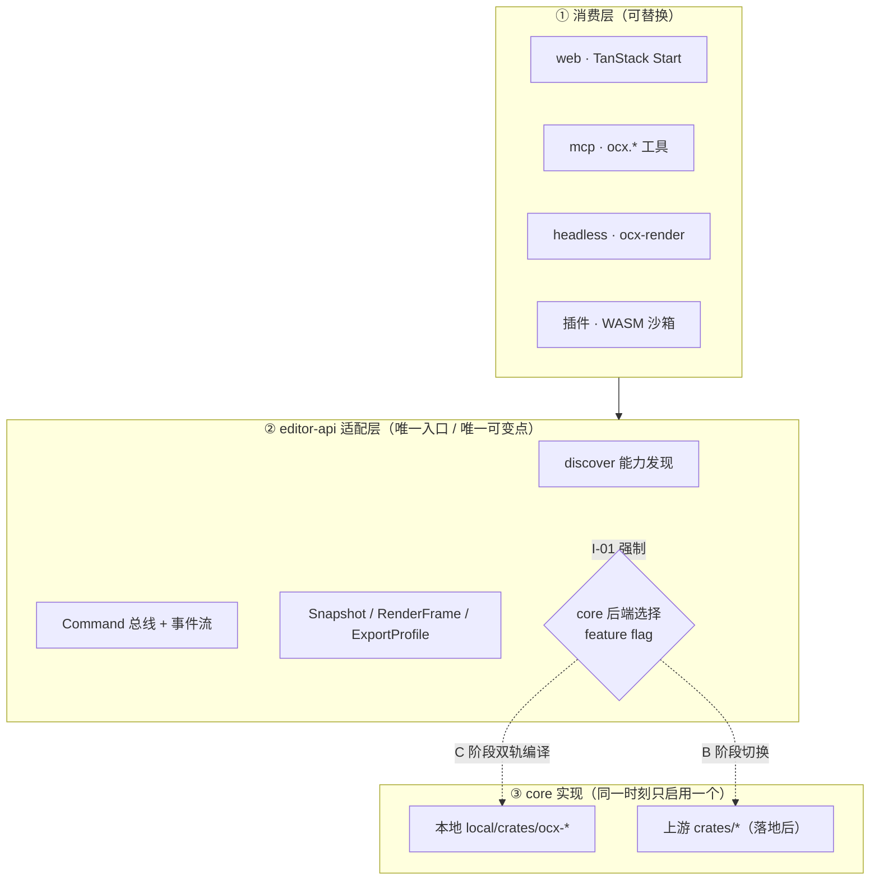
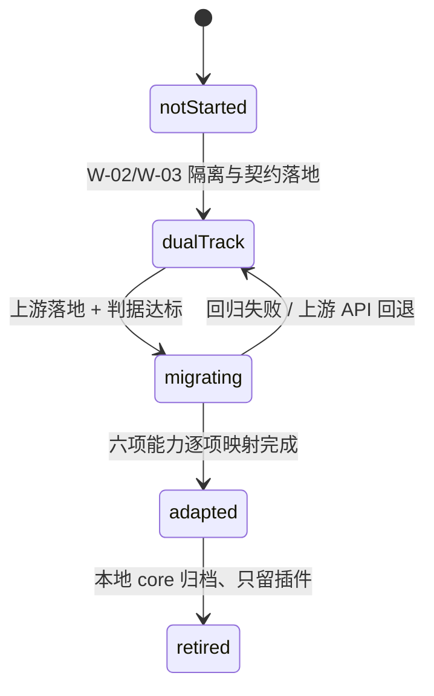

# C→B 兼容层 · 基石设计与实现规范

> **定位**：这不是「将来再说的迁移备忘」，而是**架构基石**。所有本地能力从第一行代码起就必须满足本文的不变量，否则上游落地 Editor API / 插件体系时，本地实现无法平滑切换。
> **依据**：`README.md` §7.9（L3 收敛预案）、`PRIORITY.md` W-02/W-03（P0，排在迁代码之前）。
> **机器可读真相源**：[`compat-contract.json`](compat-contract.json)；**可执行校验**：[`compat.test.cjs`](compat.test.cjs)（`node compat.test.cjs`）。
> 本文说明设计意图，契约 JSON 定义事实，测试保证二者不漂移。

---

## 1. 核心不变量（不可协商）

| ID | 不变量 | 违反后果 |
| --- | --- | --- |
| **I-01** | 任何 app / 插件 / MCP / headless **只能通过 `editor-api` 适配层访问 core**，禁止直接依赖 `local/crates/ocx-*` 的内部类型 | 切换上游 core 时需重写所有调用方 |
| **I-02** | 本地新增资产一律落在隔离命名空间（§3） | 与上游同名路径冲突，产生静默双实现 |
| **I-03** | 所有跨边界数据用**版本化契约**（`apiVersion` / `schemaVersion`），字段只增不删不改名 | 上游接口一变就全线断裂 |
| **I-04** | 本地差异化能力必须能表达为**扩展点/插件**，而不是 core 里的特判分支 | 无法走 B 路线，永远双实现 |
| **I-05** | 同一时刻**只允许一个 core 实现被注册**（用 feature flag / 构建期选择） | 两套 Editor API / 插件宿主同时启动 |
| **I-06** | 每次上游同步后必须更新能力台账并跑契约测试 | 决策与代码漂移 |

> I-01 与 I-04 是「C→B」能成立的充要条件：**差异在插件里，切换才只需换适配层**。

---

## 2. 三层架构



**关键设计**：`BACKEND` 是唯一需要改的地方。C 阶段通过 feature flag 让两套都能编译（但只注册一套，I-05），B 阶段把默认指向上游，本地 core 归档。

---

## 3. 命名空间规范（W-02 落地）

| 资产 | 规则 | 校验 |
| --- | --- | --- |
| Rust crate | `local/crates/ocx-*`；`Cargo.toml` **追加式** `members = [..., "local/crates/*"]` | 契约测试检查前缀 |
| 应用 | `apps/local-*`；CLI 名 `ocx-render` | 同上 |
| Web 组件/路由 | `apps/web/src/local/` | 同上 |
| MCP 工具 | `ocx.<domain>.<action>`（如 `ocx.project.open`） | 契约测试检查前缀 |
| 契约/文档 | `roadmap/compat-contract.json`、`roadmap/COMPAT.md` | 随 fork 可跟踪 |
| 禁区 | 不新建 `crates/<通用名>`、不改上游既有文件名、不占用 `project.open` 等裸工具名 | §7 反模式 |

---

## 4. 接口契约（W-03 实现）

### 4.1 Rust：`EditorApi` 与 `Command`

```rust
/// 编辑器核心唯一入口；所有端与插件都通过它访问 core。
/// 实现可以是本地 ocx-*，也可以是上游 core（切换时只换 impl）。
pub trait EditorApi: Send + Sync {
    /// 能力发现：返回 API 版本、支持的能力、当前后端标识。
    fn discover(&self) -> DiscoverResult;

    /// 执行命令并产生事件；命令必须可序列化、可回放。
    fn execute(&self, command: CommandEnvelope) -> Result<CommandOutcome, ApiError>;

    /// 获取某时刻的不可变快照，供 UI / 脚本 / MCP 消费。
    fn snapshot(&self, at: MediaTime) -> Result<SceneSnapshot, ApiError>;

    /// 撤销/重做，历史栈由 core 管理。
    fn undo(&self) -> Result<CommandOutcome, ApiError>;
    fn redo(&self) -> Result<CommandOutcome, ApiError>;
}

/// 命令 trait：所有编辑操作都必须走这里，天然支持 undo、脚本、协同。
pub trait Command: Send + Sync {
    /// 执行并返回逆命令所需的事件。
    fn execute(&self, state: &mut SceneState) -> Result<Vec<Event>, ApiError>;
    /// 撤销：由事件流逆变换，不依赖 JS 对象身份。
    fn undo(&self, state: &mut SceneState, events: &[Event]) -> Result<(), ApiError>;
    /// 命令类型标识，用于跨语言映射与上游 API 对照。
    fn kind(&self) -> &'static str;
}
```

`CommandEnvelope` 必须携带 `apiVersion`、 `commandId`、`kind`、`payload`（serde，camelCase）与 `schemaVersion`，落实 I-03。

### 4.2 WIT：插件契约（版本化、能力清单）

```wit
package ocx:editor@0.1.0;

/// 插件向宿主声明所需能力，宿主逐项授予（最小权限）。
interface capabilities {
    enum capability { read-project, write-timeline, render-frame, export-media, network }
    record manifest { id: string, version: string, api-version: string,
                      capabilities: list<capability>, entry: string }
    grant: func(m: manifest) -> result<handle, error>;
}

/// 扩展点：命令、效果、导入导出、媒体定位、生成器、钩子。
interface extension-points {
    register-command: func(kind: string, handler: handle) -> result<_, error>;
    register-effect: func(shader: string, params: string) -> result<_, error>;
    register-exporter: func(format: string, handler: handle) -> result<_, error>;
}
```

### 4.3 TypeScript：适配层（唯一可变点）

```ts
/** 创建编辑器适配层；切换上游 core 时只需替换 backend 实现。 */
export function createEditorAdapter(backend: CoreBackend, apiVersion: string): EditorAdapter;

/** 能力发现：先协商再调用，避免调用上游不支持的命令。 */
export async function discover(adapter: EditorAdapter): Promise<DiscoverResult>;

/** 统一命令入口；禁止在 UI 里直接 import core 内部类型。 */
export async function dispatch(adapter: EditorAdapter, cmd: CommandEnvelope): Promise<CommandOutcome>;
```

`CoreBackend` 是接口（`LocalOcxBackend` / `UpstreamBackend`），由构建期 feature flag 选择；**同一进程只注册一个实现**（I-05）。

---

## 5. 六项能力映射台账（机器可读，见契约 JSON）

| 能力 | 本地路径 | 扩展点 | 迁移到 B 的动作 |
| --- | --- | --- | --- |
| Editor API | `local/crates/ocx-editor-api` | `command` | 把 `CommandEnvelope` 逐个映射到上游命令 ID；适配层换 impl |
| 插件优先 | `local/crates/ocx-plugin-host` | 全部 6 类 | 插件 manifest 改接上游 SDK；宿主实现废弃 |
| Rust core 多端 | `local/crates/ocx-{time,domain,...}` | — | 上游 core 覆盖的部分归档；独有算法（ripple/MediaTime）作为插件或补丁保留 |
| MCP server | `apps/local-mcp`（`ocx.*`） | `command` | 工具实现改为调用上游 Editor API；保留 `ocx.*` 命名空间避免撞名 |
| Headless | `apps/local-headless` / `ocx-render` | `exporter` | 导出编排改调上游；`ExportProfile` 契约不变 |
| scripting tab | `apps/web/src/local/scripting` | `command` | 脚本 API 绑定到上游命令总线 |

> 「上游实现路径 / SHA / 决策 / 迁移状态」**落地当天才填**，禁止预填猜测（`README.md` §7.9.4）。

---

## 6. 决策判据（何时从 C 切到 B）

| ID | 判据 | 权重 | 打分（0~1） | 达标参考 |
| --- | --- | --- | --- | --- |
| G1 | 上游 API 是否冻结且有版本化契约 | 0.25 | 有语义化版本 + 弃用策略 = 1 | ≥0.8 |
| G2 | 六项能力对本地需求的覆盖率 | 0.25 | 实际 diff 逐项核对 | ≥0.8 |
| G3 | 本地差异能否表达为插件/扩展 | 0.20 | 由 §5 映射表评估 | ≥0.8 |
| G4 | 维护人力是否够支撑双轨 | 0.15 | 不够 = 1（更该切） | ≥0.6 |
| G5 | 是否打算回馈上游 | 0.15 | 打算 = 1 | ≥0.6 |

**切换阈值**：加权总分 ≥0.75 且 **G1、G2 均 ≥0.8** → 进入 B；否则维持 C。分数、依据与上游 SHA 记入 `compat-contract.json` 的 `decisionGates[].score`，每次上游同步复评。

---

## 7. 状态机与迁移 Runbook



| 步骤 | 动作 | 验收 |
| --- | --- | --- |
| 1 | `upstream-mirror` fast-forward；`git merge-tree --write-tree` 预演 | 预演退出码与三方清单归档 |
| 2 | 逐项填台账（上游真实路径/SHA），按 §6 打分 | 六行齐全，分数有依据 |
| 3 | **适配层双写**：同一 `CommandEnvelope` 同时喂本地与上游 impl，比较 `SceneSnapshot` | golden master 100% 一致 |
| 4 | 把本地差异改造成插件（I-04），删除 core 内特判 | 插件越权被拒；无 core 特判分支 |
| 5 | 逐能力切换 `BACKEND` feature flag，一次只切一个 | 每切一次跑全套 CI + 三端冒烟 |
| 6 | 六项全绿后停注册本地 impl，代码移到 `local/legacy/` 并打 tag | 契约测试 + `cargo test --workspace` 全绿 |
| 7 | 更新台账、HOTSPOTS、ADR-09 | 文档与代码同 PR |

**反模式（禁止）**：直接删本地实现再改调用方；两套 core 同时注册；在 UI 里写上游类型判断；用 `-X theirs` 覆盖；把插件逻辑塞进 core；`git add -A` 盲提未审查的内部文件（`.codebuddy/memory/*.md` 已获授权纳入版本控制，但仍须逐个显式暂存）。

---

## 8. 实现清单（W-02 / W-03 的交付物）

```
roadmap/
├── COMPAT.md                    # 本文（设计意图）
├── compat-contract.json         # 机器可读真相源（已实现）
└── compat.test.cjs              # 契约一致性校验（已实现、可运行）

local/crates/                    # W-02 建立目录 ✅
├── ocx-editor-api/              # ✅ W-03：EditorApi/Command、版本化信封、能力发现、单后端注册、undo/redo、内置参考后端
├── ocx-bridge/                  # ✅ W-04：经典版 bridge 迁入（关 wasm）
├── ocx-time/                    # ✅ W-04：经典版 time 迁入 + golden master
├── ocx-domain/                  # ✅ W-05 三批：ripple + placement + animation（bezier/interpolation）+ 72 个跨语言 golden 用例；⏳ keyframe-query / serde schema 待续
├── ocx-render/                  # ✅ W-07 第一批：RenderFrame / ExportProfile 契约、帧计划（音画同步）、合成帧源 + 26 个 golden 用例
├── ocx-bindings-wasm/           # ✅ W-06/W-07：WASM 薄绑定，domain 与 render 的统一入口
└── ocx-plugin-host/             # ⏳ W-12
apps/web/src/local/              # ✅ W-06/W-07：editor-adapter.ts 唯一入口 + WASM glue + webcodecs 能力探测 + 契约测试（I-01）
```

**当前状态说明（诚实边界）**：`ocx-time` / `ocx-bridge` / `ocx-editor-api` / `ocx-domain` / `ocx-bindings-wasm` / `ocx-render` 六个 crate 已真实落地，用 `cargo 1.97.0` 完成 `fmt --check` / `clippy -D warnings` / `cargo test` 全绿验证；`ocx-domain` 共 97 个 JSON golden 用例由 Rust 与经典版 TS 的 JS 参考实现共用同一期望值（ripple 64/64、placement 100/100、animation 88/88、legacy 107/107，浮点按 1e-5 容差）；`ocx-render` 的 26 个 golden 用例是本地新契约，无经典版对应物，故由 Rust golden master + Node 真实 WASM 契约双层验证。`editor-api.contract.json` 与 5 项 Node 契约测试保证 Rust 常量、命令清单、错误码与 Web 契约不漂移。**W-05 第四批 / W-06 / W-07 两批 / W-08 三批 / W-09 两批已落地**：`ocx-bindings-wasm` 编译到 `wasm32-unknown-unknown` 并生成 Web glue，`editor-adapter.ts` 是业务侧访问 core 的唯一入口（I-01）；`/editor` 可**导入经典版 v31 项目 JSON**（只读兼容层，字段只增不删、缺失补默认值并记 warnings、高于 v31 明确拒绝，新增读取可选 `trimStart`/`trimEnd`）、**导入真实音视频素材**（浏览器 `<video>` 抽取恒定 320×180 代理帧 + Web Audio 解码音轨 + `frame-cache.ts` 内存 LRU + `frame-store.ts` IndexedDB 三级缓存，命中时跳过逐帧 seek + core `composite_frame_rgba` 合成真实底图，预览与导出共用帧源）、按片段 `trimStart` 映射素材帧与音频（删除/分割真正改变画面与声音）、点击删除片段（core ripple 重算）、在播放头分割、拖动播放头逐帧预览、用 `VideoEncoder`/`AudioEncoder` + `mp4-muxer` **导出带 AAC 音轨的真实画面 MP4**、导出低分辨率代理 MP4；真实浏览器端到端验证「演示 mp4 → 解码 → 预览 → 剪辑 → 导出 → 重新解码确认画面与声音」全链路，两次导出首帧 hash 不同、音轨时长随剪辑缩短；缓存量化首次 11,733ms → 跨刷新命中 107ms，单帧合成 < 16ms 阈值。Node 侧真实 WASM 端到端 **47/47**、四套跨语言对齐 107/88/100/64、前端 vitest 57/57、`vite build` 退出码 0；`moon ci` 与三端 dev/check 冒烟已实跑通过（H03 已关闭）。**仍未完成**：裁剪时长/拖拽交互、真实 4K 素材端到端 scrub 基准、M6 时间线版本快照、WebM/AV1 编码、Firefox 音频兼容回归、WIT 插件契约、命令层 / serde 版本化 schema、经典版项目 JSON 写回（当前严格只读）。

> **上游冲突提示**：`apps/web/src/routes/editor.tsx` 原为上游 "Coming soon." 占位页（TanStack Start 要求路由文件位于 `src/routes/`），W-06 就地扩展为最小时间轴，这是本仓**唯一一处上游文件改动**；其余本地资产全部在 `local/crates/*` 与 `apps/web/src/local/` 隔离路径。上游同步时须按 `README.md` §7.9 能力台账人工复核。

---

## 9. 测试策略（与项目测试规范对齐）

| 层次 | 用例 | 期望 |
| --- | --- | --- |
| 契约静态校验 | 权重和为 1、六项能力 ID 唯一、命名空间前缀合法、扩展点引用有效、状态机端点合法、导出决策与能力表完整 | `node compat.test.cjs` 全绿 |
| 边界 | 空契约、缺字段、权重不等、未知状态值、非法命名空间 | 校验返回明确错误，不静默通过 |
| golden master | 同一 `CommandEnvelope` 喂本地/上游 backend，`SceneSnapshot` 逐字段比对 | 100% 一致 |
| 双实现检测 | 启动时断言只注册一个 core backend；MCP `tools/list` 无重复工具名 | 违反即启动失败并给出友好提示 |
| 插件越权 | 未声明 `export-media` 的插件调用导出 | 返回 `PermissionDenied` |
| 能力协商 | 各浏览器 × codec 组合的 `isConfigSupported` 表 | 降级链可达且无静默失败 |
| 回归 | Firefox MP4+音频、MediaTime 边界、23.976/29.97 帧对齐 | 全部通过 |

日志：分层 `INFO/PASS/FAIL`，未通过标红，文件名带日期时间，写入系统临时目录（由 `compat.test.cjs` 实现）。

---

## 10. 维护流程

1. 每次新增本地能力 → 先更新 `compat-contract.json` 的 `capabilities` 与命名空间，再写代码。
2. 每次 `merge upstream/main` → 复评 §6 分数、更新台账与状态机、跑 `node compat.test.cjs`。
3. 状态机每次流转 → 在 `HOTSPOTS.md` 更新日志追加一行（上游 SHA + 决策 + CI 结果）。
4. 契约结构变更 → 同步更新本文表格与 `README.md` §7.9，避免「文档漂移」（R10）。
