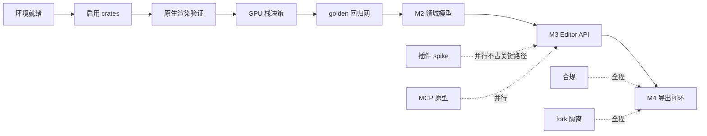

# 热点进程文档 · OpenCut Rust 重写版

> **用途**：跟踪当前最该被关注的技术热点、阻塞点、关键路径与进度变化。与 [`dashboard.html`](dashboard.html) 的看板 **ID 一一对应**，改动请两边同步。
> **当前快照**：2026-11-08（初始化，尚未开始编码）。
> **配套**：总纲见 [`README.md`](README.md)；决策留痕见 `../.codebuddy/memory/2026-11-08.md`。

---

## 0. 维护约定

| 规则 | 说明 |
| --- | --- |
| 更新时机 | 每完成一个动作、每次上游同步、每个里程碑结束、每次架构决策变更后 **当天** 更新 |
| ID 稳定 | `H01…` 热点、`M0…M6` 里程碑、`Q01…` 开放问题一旦分配不得复用或重排 |
| 状态取值 | `未开始` / `进行中` / `阻塞` / `已完成` / `已关闭`（与看板下拉一致） |
| 证据要求 | 每条热点必须写「证据」：文件路径、行号、命令输出或官方链接，**不写无依据的猜测** |
| 验收要求 | 「验收」必须是可观测条件（CI 全绿、像素一致、测试通过、文档更新），不写「基本可用」 |
| 双写 | 看板勾选状态后，用「导出 JSON」把结果回填本文件 §3 进度台账；反之改了本文件要在看板手动同步 |

---

## 1. 当前热点（按阻塞度排序）

| ID | 热点 | 等级 | 状态 | 影响面 | 证据 | 下一步动作 | 验收条件 | 更新日期 |
| --- | --- | --- | --- | --- | --- | --- | --- | --- |
| **H01** | GPUI(blade) 与 wgpu 纹理不互通 | P0 | 阻塞 | 桌面端整体架构 | 本仓库 `Cargo.lock` 中 `gpui 0.2.2` 依赖 `blade-graphics/blade-macros/blade-util`，无 `wgpu`；经典版 `Cargo.lock` 为 `wgpu 29.0.1` | M1 做 spike：`render_frame_to_texture` → CPU readback → GPUI 显示，记录 1080p 单帧耗时 | 产出实测数据与「readback / 独立 wgpu 窗口 / 换后端」的书面决策，写入 ADR-04 | 2026-11-08 |
| **H02** | 4.6 万行领域逻辑翻译缺回归网 | P0 | 进行中 | M2 全部 | **已建四批回归网**：`local/crates/ocx-domain` 翻译 `ripple`（18 / 64/64）、`timeline/placement`（29 / 100/100）、`animation/{bezier,interpolation}`（25 / 88/88）、`keyframe-query` + 经典版 31 版项目 JSON 只读兼容层（25 / 107/107）；累计 97 个 JSON 用例由 Rust golden master 与经典版 TS 的 JS 参考实现共用同一期望值，含正常/边界/异常/组合场景，浮点按 1e-5 容差；13 个补充单测。经典版 `EditorCore`/命令/undo 仍无系统级测试 | 按同一模板补命令层 → serde 版本化 schema | `cargo test --workspace` 中 golden 用例 100% 对齐，覆盖空值/极值/异常分支 | 2026-11-09 |
| **H03** | 本机工具链缺失且版本不符 | P0 | 已完成 | 所有本地验证 | **已安装并验证**：`bun 1.3.11`（npm 全局）、`moon 2.3.3`（`@moonrepo/cli`）、`rustc 1.97.0`（rustup + 项目级 override），两个 app 分别 `bun install`；`moon ci` 三个 Rust 任务全绿、`web:dev`/`api:dev` HTTP 200、`desktop:check` 退出码 0 | **完全关闭，无遗留**：`proto 0.63.2` 与 moon 2.3.3 官方二进制均经 `api.github.com` release asset 端点下载、SHA-256 与官方 digest 一致；moon.exe 另与 npm 版哈希交叉校验一致；按 manifest 注册后 `proto use` → `Installed bun, rust, and moon in 1 second!`。**不设 `MOON_TOOLCHAIN_FORCE_GLOBALS`** 时 `moon ci` 退出码 0、`web:dev`/`api:dev` HTTP 200、`desktop:check` 退出码 0，详见 `H03-toolchain-bootstrap.md` | 四版本对齐；`moon ci` 全绿；三端 dev/check 冒烟通过（已达成） | 2026-11-08 |
| **H04** | 上游架构仍在设计中，长期分叉风险 | P1 | 进行中 | fork 可维护性 | 官方 README（2026-11-08 抓取）仍为 "What's coming"，明说架构设计中、不收外部贡献 | 落地 §7 的「新增优先 + 隔离目录 + 差异台账」；启用 `git rerere`；每 2~4 周小步同步 | `README.md` §7.7 台账与 `git remote -v` 一致；每次同步后 `moon ci` 全绿 | 2026-11-08 |
| **H05** | 原生 Rust 渲染路径从未验证 | P0 | 未开始 | 桌面端可用性 | 经典版 `apps/desktop/src/main.rs` 仅 42 行且不引用任何 crate；`rust/README.md:29` 只是设计意图；CI 测试步骤是 `echo "No tests implemented yet"`；`GpuContext::try_gl_fallback` 原生直接返回错误 | M1 补 `render_frame_to_texture → Vec<u8>` 用例与原生 CI 任务 | `cargo test --workspace` 包含原生离屏渲染用例，三平台 CI 通过 | 2026-11-08 |
| **H06** | workspace 尚未启用 `crates/*` | P0 | 进行中 | 所有 crate 迁移 | **已完成**：根 `Cargo.toml` 追加 `'local/crates/*'`、`.moon/workspace.yml` 追加 glob，七个 `ocx-*` crate 迁入隔离目录并编译通过；rust 已升级 1.97，`moon ci` 与三端 dev/check 冒烟已实跑（H03 已关闭） | 剩余：上游 `crates/*` 目录启用与 `build.rs`（按 W-02 隔离策略不迁入本地目录，待上游同步时复核） | `cargo test` 七 crate 全绿；`moon ci` 全绿 | 2026-11-11 |
| **H07** | 插件运行时未选型 | P1 | 未开始 | M5 与「一等插件」路线图 | 调研：Extism 官方默认沙箱/能力限额；WIT Component Model 类型化接口；Figma Realms 的 API 可替换原则 | M2 期间并行做 Extism spike（不占关键路径），验证 wasm32 与原生双目标 | 产出对比数据与 ADR-03 结论；示例插件越权被拒 | 2026-11-08 |
| **H08** | MCP 规范版本与长任务模型 | P2 | 未开始 | AI Agent / headless | 官方规范 `2026-07-28`：无状态、`server/discover`、Tools/Resources/Prompts、**Sampling/Logging 已弃用**、Tasks extension 承载长请求 | M5 按官方映射实现，避免照抄旧版教程 | MCP 客户端可完成「打开→剪辑→导出」，长导出可查进度 | 2026-11-08 |
| **H09** | 许可证合规三项 | P1 | 未开始 | 分发合法性 | 经典版 MIT © 2025-2026 vs 重写版 © 2026（已由 `local/NOTICE.md` 保留声明）；FFmpeg 8.1.3 LGPL-2.1-or-later；字体 sprite 无 OFL 声明 | M4 校验 LGPL 随附；补齐字体归属文件 | 产物含 `BUILD.md`/`COPYING.LGPLv2.1`；字体归属文件齐备 | 2026-11-08 |
| **H10** | `docs/` 被 `.gitignore` 忽略 | P2 | 已完成 | 文档可同步性 | 本仓库 `.gitignore:7` 为 `docs/` | 已改用 `roadmap/` 目录 | 本文与看板位于 `roadmap/` 且 `git status` 可见 | 2026-11-08 |
| **H11** | 经典版 31 版项目迁移兼容 | P1 | 进行中 | 老用户数据 | **只读兼容层已落地**：`ocx-domain/src/project_compat.rs` 按 `migrations/AGENTS.md` 的 additive-only 规则，用宽容 `Value` 遍历、未知字段忽略但不写回、缺失字段补默认值并记 `warnings`、高于 v31 明确拒绝；25 个 JSON 用例对齐 107/107；`/editor` 已加载经典版 v31 项目 fixture 并由 core 解析 | 剩余：写回能力、迁移测试、真实用户项目抽样验证 | 经典版导出的项目 JSON 能被新 core 打开且剪辑决策不丢失 | 2026-11-09 |
| **H12** | 4K 预览性能（代理/缓存/快照） | P2 | **已完成** | 使用体验 | W-09 四批闭合：`frame-cache.ts` 内存 LRU → `frame-store.ts` IndexedDB 三级缓存（版本前缀、异常降级），`createProxyFile` 生成代理 MP4，跨刷新 11,733ms→**107ms**；`clip-history.ts` 版本快照 + 撤销重做 + localStorage 跨会话恢复；`scrub-benchmark.ts` 用真实 **3840×2160** 素材端到端实测：编码 488ms → 90 张 320×180 代理帧（解码 20,943ms）→ 30 帧 scrub **平均 0.263ms / 峰值 0.9ms**，低于阈值 16ms（代理帧恒定尺寸，与源分辨率解耦） | 剩余：无（快照导出/回溯列表 UI 非 DoD 必需） | 真实 4K 素材 scrub 峰值 0.9ms < 16ms 达标，快照可回溯且跨刷新恢复 | 2026-11-10 |
| **H13** | 上游落地六项能力导致双实现收敛（L3） | P1 | 进行中 | 全部 M3~M5 能力 | 官方 README 的 Editor API / 插件优先 / Rust core 多端 / MCP / Headless / scripting 与本地计划完全重叠；Git 能自动合并但会产生静默语义冲突 | 按 `README.md` §7.9 先做命名空间隔离（`local/crates/*`、`ocx.*` 工具前缀）、建 `upstream-mirror`、填能力级台账；落地当天用 `git merge-tree --write-tree` 预演 | 六行能力台账填齐（含上游真实路径/SHA）；预演退出码已记录；决策门选定路线；`moon ci` + 三端冒烟全绿 | 2026-11-08 |
| **H14** | **C→B 兼容层基石尚未落到代码**（用户指定为基石） | P0 | 进行中 | 所有本地能力 | **已完成**：`local/crates/ocx-*` 七个 crate、`apps/web/src/local/` 隔离目录、`editor-adapter.ts` 适配层（I-01）；W-08 六批（真实音视频闭环 + 裁剪/拖拽/边缘裁剪/撤销重做）、W-09 四批（三级缓存 + 真实 4K scrub 峰值 0.9ms + 快照跨会话持久化，H12 已关闭）、W-10 三批（OTIO 双向 + 官方 0.18 实文件往返）、W-11 一批（契约 v2 冻结 + 能力协商）、W-07 第三批（MP4/WebM 双容器导出，DoD 达标） | 剩余：WIT 插件 host（W-12）、MCP server（W-13）、OTIO Transition/Marker/Effect/nested Stack、AV1 编码、Firefox 音频兼容；上游同步时复核 `/editor` 占位路由 | `node compat.test.cjs` 45/45；七 crate `cargo test` 全绿；Node WASM 契约 68/68；vitest 108/108；官方 OTIO 往返 15/15；真实浏览器导出 WebM 可解码 | 2026-11-11 |

**热点分布**：P0 = 6 项（H01/H02/H03/H05/H06/H14）、P1 = 6 项、P2 = 3 项（含已完成的 H10，共 14 项）。**当前关键阻塞是 H03（缺 bun/moon/proto、rust 1.96）→ H01/H05（桌面 GPU 路径）**；H06/H14 已由「未开始」推进到「进行中」（W-02/W-04 真实代码落地）；H13 属未来触发型风险。

---

## 2. 关键路径

- **关键链**：`H03 → H06 → H05 → H01 → H02 → M2 → M3 → M4`，对应 M0~M4（T+0~33 周）。
- **可并行**：H07（插件 spike）、H08（MCP 原型）、H10（已完成）、H12（性能设计）、OTIO 适配器原型。
- **全程约束**：H04（fork 隔离）与 H09（合规）不设独立里程碑，但每个里程碑的 DoD 都要复核。

---

## 3. 里程碑进度台账

| 里程碑 | 周期 | 状态 | 完成度 | 已完成内容 | 下一步 | 更新日期 |
| --- | --- | --- | --- | --- | --- | --- |
| **M0** | T+0~3w | 进行中 | 15% | 完成现状评审、先进方案调研、对比矩阵、路线图、fork 策略、文档体系与动态看板（全部为文档资产） | 安装工具链、启用 `crates/*`、接通 CI | 2026-11-08 |
| **M1** | T+3~7w | 未开始 | 0% | — | 迁入 `time`/`bridge`；GPU spike | 2026-11-08 |
| **M2** | T+7~15w | 未开始 | 0% | — | 建 golden master，再动领域翻译 | 2026-11-08 |
| **M3** | T+15~21w | 未开始 | 0% | — | editor-api + 绑定层 | 2026-11-08 |
| **M4** | T+21~33w | 未开始 | 0% | — | 媒体解码与导出闭环 | 2026-11-08 |
| **M5** | T+33~41w | 未开始 | 0% | — | 插件体系 + MCP | 2026-11-08 |
| **M6** | T+41~60w | 未开始 | 0% | — | OTIO / 移动端 / 协同评估 | 2026-11-08 |

> 完成度由看板按「里程碑下热点/任务状态」自动计算；此处为 2026-11-08 的人工基线。

---

## 4. 开放问题（待决策）

| ID | 问题 | 候选 | 决策期限 | 状态 |
| --- | --- | --- | --- | --- |
| **Q01** | 桌面 GPU 后端走哪条路？ | 离屏 readback / 独立 wgpu 窗口 / 等 GPUI 换 wgpu | M1 结束 | 待 spike |
| **Q02** | 移动端 UI 用 Flutter 还是原生？ | Flutter + `flutter_rust_bridge` / 原生 + UniFFI | M6 开始前 | 开放 |
| **Q03** | 现在引入 Loro CRDT 吗？ | 引入 / 仅保持命令层可映射 | M2 结束 | 倾向「仅保持可映射」 |
| **Q04** | 插件运行时用 Extism 还是自研 Component Model？ | Extism / wasmtime + wit-bindgen / 混合 | M2 并行 spike | 待验证 |
| **Q05** | OTIO 作为原生格式还是仅交换格式？ | 双轨（推荐）/ 全用 OTIO | M2 开始前 | 倾向双轨 |
| **Q06** | 上游若落地官方 Editor API，本地是否切换？ | 切换并做适配层 / 继续自有 core / 双轨共存 | 上游发布时 | 已有决策框架（`README.md` §7.9 / `COMPAT.md` §6）；最终路线待发布时按判据打分 |
| **Q07** | Web 端导出继续用 WebCodecs 还是统一走 FFmpeg-WASM？ | WebCodecs / FFmpeg-WASM | **2026-11-08 已决** | **WebCodecs（Web）+ 原生 FFmpeg（桌面/headless）**；Rust core 出 `RenderFrame`+`ExportProfile`，见 `PRIORITY.md` §4 |
| **Q08** | 是否把 `.codebuddy/` 加入 `.gitignore`？ | 加入 / 不加入 | **2026-11-08 已决** | **不加入**（用户决定）；且开发记录 `.codebuddy/memory/2026-11-08.md` 已显式纳入版本控制并推送到 GitHub 与 Forgejo，见 `PRIORITY.md` §5 |

---

## 5. 更新日志

| 日期 | 变更 | 关联 |
| --- | --- | --- |
| 2026-11-08 | 通读重写版与经典版仓库，完成可行性评审与 M0~M5 路线图（对话中给出） | `.codebuddy/memory/2026-11-08.md` |
| 2026-11-08 | 检索 15+ 官方/社区资料（OTIO、Extism、MCP 2026-07-28、Loro、MLT、Remotion、Vello、Rust 媒体生态、fork 维护），抓取 4 个官方页面核实 | `README.md` §3 / §10 |
| 2026-11-08 | 建立 `roadmap/` 文档体系：总纲、热点进程、动态看板、CSS/JS；修正「`docs/` 被忽略」问题 | H10 已完成 |
| 2026-11-08 | 加载 `fork-repo-sync` skill，确定双 remote 同步流程与差异台账 | H04 / `README.md` §7 |
| 2026-11-08 | 核实上游官方 README 与本地一致，暂无待同步架构变更；实测两仓库 `Cargo.lock` 均被跟踪 | `README.md` §2 |
| 2026-11-08 | 看板按职责拆为数据层 / IO 层 / 主逻辑 / 样式，所有代码文件降至 500 行以内 | `README.md` §0 |
| 2026-11-08 | 新增 `dashboard.test.cjs` 回归测试：35 个断言全部通过（含边界与异常分支），日志带日期时间落盘到系统临时目录 | `README.md` §11 |
| 2026-11-08 | `readmCN.md` 补充路线图与看板导航链接 | H10 |
| 2026-11-08 | 核实 `git merge-tree --write-tree` 与 `.gitattributes` 官方用法，新增 §7.9 L3 收敛预案（六能力冲突矩阵、命名空间隔离、能力级台账）、风险 R11、ADR-09、热点 H13；Q06 已有决策框架，最终路线仍待上游发布时选定 | `README.md` §7.9 / H13 |
| 2026-11-08 | 落实四项用户决策：新增 `PRIORITY.md`（Web-first 15 项优先级表、W0~W5、导出后端决策）、`COMPAT.md`（兼容基石）、`compat-contract.json` + `compat.test.cjs`（41 断言全绿）；ADR-10~13、Q07/Q08 已决、新增 H14 | `README.md` §0/§9/§11 |
| 2026-11-08 | 看板数据同步 H13/H14 与 Q07/Q08 已决状态，回归测试期望同步更新 | `dashboard-data.js` / `dashboard.test.cjs` |
| 2026-11-08 | 修复「开放问题区显示旧文案」：根因为浏览器缓存旧 `dashboard-data.js` 且该区缺少状态/结论字段。已重构为**决策台账**（待决/已决徽章 + 结论 + 来源 + 筛选 + 统计），加脚本 `?v=20261108-r2` 缓存版本号、页首数据版本与「重新加载数据」按钮；新增契约↔看板交叉校验 | `dashboard.html` / `dashboard-data.js` / `dashboard.js` / `dashboard.css` |
| 2026-11-08 | 用户决定把开发记录 `.codebuddy/memory/2026-11-08.md` 也推到 GitHub 与 Forgejo；同步更新 D03 台账、`PRIORITY.md` §5、Q08、`dashboard-data.js`、`compat-contract.json`、`COMPAT.md` 中关于「排除推送」的旧表述 | `README.md` §7.5/§7.7 |
| 2026-11-08 | 用户提供 SSH 指纹线索用于排查（**指纹值不记录**）：核实为本机 SSH 公钥标识；GitHub 22 端口不通但 `ssh.github.com:443` 认证成功，新增备用远程 `github-ssh`，`ls-remote` 与 `push --dry-run` 均通过 | `README.md` §7.5 |
| 2026-11-08 | **安全纠正**：用户指出公钥指纹不得写入文档。已从 `README.md` / `HOTSPOTS.md` / 开发记录中清除全部指纹、公钥路径、本机用户名与主机名、绝对路径及账号名，并加入「禁止写入任何公钥/密钥指纹与本机标识」的清单 | `README.md` §7.5 禁止清单 |
| 2026-11-08 | 用户要求「默认就走 SSH」：`origin` URL 切换为 SSH over 443，`git push` 无参数即走 SSH；不设 `GIT_SSH_COMMAND` 时 `ls-remote` 与 `push --dry-run` 均返回 0；`upstream` 保持 HTTPS，`github-ssh` 保留为冗余备用 | `README.md` §7.5 |
| 2026-11-08 | **历史重写完成**（用户明确授权「彻底清除」）：以干净基底 `cb02a1cd`、当前树创建新提交 `93b8d4bd`，丢弃含敏感内容的三个提交；两端用 `--force-with-lease` 改写 `main`；本地 `reflog expire` + `gc --prune=now` 后三个旧对象均已删除，`git log --all` 0 命中 | `.codebuddy/memory/2026-11-08.md` |
| 2026-11-08 | **Web 版本改造开工（W-02/W-04）**：建立 `local/crates/ocx-time`、`ocx-bridge` 与 `apps/web/src/local/` 隔离目录；追加式启用 `Cargo.toml` members 与 `.moon/workspace.yml` glob；从经典版迁入 `time`/`bridge`（默认关闭 wasm、零浏览器依赖）；新增 40 个 JSON 数据驱动用例 + `CASES.md`；`cargo test` 12 测试函数、`fmt --check`、`clippy` 全绿。H06/H14 由「未开始」→「进行中」 | `PRIORITY.md` §2 进度快照 |
| 2026-11-08 | **W-03 基石落地**：`ocx-editor-api`（版本化 EditorApi/Command、能力发现、单后端注册、undo/redo、内置参考后端）+ 6 内联单测（含并发）+ 19 个 JSON 序列用例；修复 `SceneSnapshot.state_ticks` 缺失与 `OnceLock` 重复注册错误信息两个真实 bug；新增跨语言契约 JSON + 5 项 Node 契约测试；H03 安装引导文档。TS 适配层/WIT 推迟到 W-06 | `COMPAT.md` §8 / `H03-toolchain-bootstrap.md` |
| 2026-11-08 | **H03 关闭**：用户授权后实际安装 `bun 1.3.11` / `moon 2.3.3` / `rustc 1.97.0` 并分别装依赖；`moon ci` 三个 Rust 任务全绿，`web:dev`/`api:dev` HTTP 200、`desktop:check` 退出码 0。`proto` 因 GitHub Releases HTTPS 连接重置未装，改用 `MOON_TOOLCHAIN_FORCE_GLOBALS=true`；修正根目录无 `package.json`、glob 误报、`master` vs `main` 等问题，`NOTICE.md` 移至 `local/` | `H03-toolchain-bootstrap.md` |
| 2026-11-08 | **proto 补装成功**（用户「再试试」）：改走 `api.github.com` release asset 端点下载官方 zip，SHA-256 与官方 digest 完全一致；`proto setup` 固化 PATH → `proto 0.63.2`；`proto use` 纳管 bun/rust，moon 预编译包仍受限已终止。JS 任务保留 `FORCE_GLOBALS`，Rust 任务不需要。看板数据版本 bump 至 `2026-11-08-r5` | `H03-toolchain-bootstrap.md` §2–§3 |
| 2026-11-08 | **H03 完全关闭**（用户「接着试一下」）：同法补装 moon 2.3.3 官方包（digest 校验 + 与 npm 版 moon.exe 哈希交叉校验一致），按无 BOM `manifest.json` 注册后 `proto use` → `Installed bun, rust, and moon in 1 second!`；**不设 `FORCE_GLOBALS`** 时 `moon ci` 退出码 0、`web:dev`/`api:dev` HTTP 200、`desktop:check` 退出码 0。看板数据版本 bump 至 `2026-11-08-r6` | `H03-toolchain-bootstrap.md` §4–§5 |
| 2026-11-08 | **W-05 第一批**：新建 `local/crates/ocx-domain`，把经典版 `ripple/{diff,shift,apply}.ts` 逐函数翻译为 Rust（秒→`MediaTime` ticks）；18 个 JSON golden 用例由 Rust 与经典版 TS 的 JS 参考实现共用同一期望值（JS 对齐 64/64），5 个补充单测全绿，`moon run ocx-domain:test` 实跑通过。H02 由「未开始」→「进行中」。看板数据版本 bump 至 `2026-11-08-r7` | `PRIORITY.md` §2 / `local/crates/ocx-domain/tests/CASES.md` |
| 2026-11-08 | **W-05 第二批**：翻译经典版 `timeline/placement/` 五组纯函数（compatibility / overlap / main-track / insert-index / resolve）；29 个 JSON 用例由 Rust 与 JS 参考实现共用期望值（对齐 100/100），4 个补充单测全绿；`TimelineTrack.trackType` 采用 additive-only 默认值策略，第一批 18 个用例零改动仍全绿。看板数据版本 bump 至 `2026-11-08-r8` | `PRIORITY.md` §2 / `local/crates/ocx-domain/tests/PLACEMENT_CASES.md` |
| 2026-11-09 | **W-05 第三批**：翻译经典版 `animation/{bezier,interpolation}.ts`（贝塞尔求解、通道归一化、边界外推、step/linear/bezier 求值与统一分派）；25 个 JSON 用例对齐 88/88，4 个补充单测全绿；跨语言浮点改按 1e-5 递归容差（20 次二分固有精度）。累计 72 个 golden 用例、13 个补充单测。看板数据版本 bump 至 `2026-11-08-r9` | `PRIORITY.md` §2 / `local/crates/ocx-domain/tests/ANIMATION_CASES.md` |
| 2026-11-09 | **W-06 完成**：新建 `ocx-bindings-wasm`（wasm32 + wasm-bindgen 0.2.130）、`editor-adapter.ts`（I-01 唯一入口）与 `/editor` 最小时间轴；真实 WASM 在 Node 端到端 16/16、vitest 7/7、`vite build` 退出码 0、dev 端 `/editor` 与 wasm 资源 HTTP 200。补装 wasm target 与 CLI（经 GitHub API asset 通道，见 `H03-toolchain-bootstrap.md` §9）；新增独立 `vitest.config.ts` 绕开 Cloudflare 插件在测试环境的限制。H14 证据更新。看板数据版本 bump 至 `2026-11-08-r10` | `PRIORITY.md` §2 / `COMPAT.md` §8 |
| 2026-11-09 | **W-07 第一批（方向调整）**：核对 `PRIORITY.md` 后确认 W-06 的 DoD 仍缺「预览帧」、W-07 完整导出依赖未验证的 H01/H05 渲染路径，故先做可确定性验证的契约切片。新建 `ocx-render`（`RenderFrame`/`ExportProfile`、稳定错误码、帧计划含 29.97fps 音画同步累积采样、合成帧源）与 26 个 golden 用例 + 5 个单测；WASM 新增三条入口并重建产物；`/editor` 补齐 core 预览帧（canvas）与 WebCodecs 能力探测。六 crate 检查全绿、Node WASM 契约 28/28、vitest 10/10、`vite build` 0、dev 端 HTTP 200。真实 MP4/WebM 编码留待下一批。看板数据版本 bump 至 `2026-11-08-r11` | `PRIORITY.md` §2 / `COMPAT.md` §8 |
| 2026-11-09 | **W-05 第四批 / H11 前置**：翻译经典版 `keyframe-query.ts`（含 `channel-data`/`path` 规则与 `formatLinearRgba`）并新建经典版 31 版项目 JSON **只读**兼容层（additive-only、5 个稳定错误码、高于 v31 拒绝）；25 个 JSON 用例对齐 107/107、WASM 契约扩至 40/40、四套跨语言对齐 107/88/100/64。`/editor` 改为加载 `classic-project-v31.json` 并由 core 解析，移除硬编码 DEMO，闭合 W-06 DoD「加载项目」。H02 证据更新、H11 由「未开始」→「进行中」。看板数据版本 bump 至 `2026-11-08-r12` | `PRIORITY.md` §2 / `local/crates/ocx-domain/tests/LEGACY_CASES.md` |
| 2026-11-09 | **W-07 第二批 / 真实导出闭环**（用户「等能干活了再测试」）：新增 `mp4-muxer`（MIT）与 `export.ts`，用 WebCodecs 把 core 合成帧编码封装为 MP4；`/editor` 升级为导入项目 JSON、点击删除片段、播放头逐帧预览、导出下载，并修复截图反馈的对比度问题。真实浏览器验证上传/删除/播放/导出全链路，导出 60 帧 2.00s、`ftyp isom` 有效容器；修掉「删除只位移不移除元素」的真实 bug。看板数据版本 bump 至 `2026-11-08-r13` | `PRIORITY.md` §2 / `apps/web/src/local/export.ts` |
| 2026-11-09 | **W-08 第一批 / 真实素材闭环**（用户「按照项目优化进度，接着做吧」）：按关键路径接真实视频。浏览器 `<video>` + canvas 解码，Rust core 新增 `composite_frame` 合成真实底图并产出 `RenderFrame`，`export.ts` 支持可替换 `frameSource`，预览与导出共用帧源。真实浏览器验证：演示 mp4 解码后预览像素由色块变为真实画面、播放头帧 41/90 画面变化、导出 90 帧 / 3.00s / 36,376 字节并把 blob 重新解码确认 `ftyp isom` 与真实画面；删除片段后导出 60 帧 / 2.00s。看板数据版本 bump 至 `2026-11-08-r14` | `PRIORITY.md` §2 / `apps/web/src/local/media.ts` |
| 2026-11-09 | **W-08 第二批 / 剪辑真正改变画面**（用户「继续」）：修复上一批的语义缺口——原先删除片段只缩短时长、画面内容不变。只读提取经典版元素的 `trimStart`/`trimEnd`，新增 `timeline.ts` 的片段→素材帧映射与「在播放头分割」；删除后恢复并保留 trimStart。真实浏览器分别导出未剪辑与剪辑后的 MP4 并重新解码，首帧 hash `2010631942` → `1357128289`；分割后 3 片段且 `trim=180000` 连续。看板数据版本 bump 至 `2026-11-08-r15` | `PRIORITY.md` §2 / `apps/web/src/local/timeline.ts` |
| 2026-11-09 | **W-08 第三批 / 音频调度**（用户「继续」）：闭合 W-08 风险栏的音频项。新增 `audio.ts`（Web Audio 解码、`AudioEncoder` AAC 编码、`FramePlan` 累积采样音画同步、`buildTimelineAudio` 按片段重排音频），`export.ts` 支持可选音轨，`media.ts` 演示素材带 440Hz 正弦音轨。真实浏览器：导出 90 帧 / 87,306 字节 MP4 重新解码出 3.008s / 48kHz / 双声道 / 峰值 0.2506 的有效音轨；删除片段后导出 60 帧 / 56,889 字节、音轨 2.005s。29.97fps 累积采样 1601/1602 与 core 一致。看板数据版本 bump 至 `2026-11-08-r16` | `PRIORITY.md` §2 / `apps/web/src/local/audio.ts` |
| 2026-11-09 | **W-09 第一批 / 代理帧缓存**（用户「继续」）：按关键路径接 W-09（H12）。新增 `frame-cache.ts`（素材指纹 LRU、默认 3 份、命中/未命中与字节统计、手动失效），`media.ts` 抽帧恒定缩放到 320×180 代理尺寸并在命中时跳过 90 次 seek，`/editor` 显示缓存状态与清除入口。真实浏览器量化：首次导入解码 10,370ms / 未命中 1，重复导入「代理缓存命中 · 0ms」/ 命中 1，缓存 1 份 / 90 帧 / 20.5MB；清除后归零。H12 由「未开始」→「进行中」。看板数据版本 bump 至 `2026-11-08-r17` | `PRIORITY.md` §2 / `apps/web/src/local/frame-cache.ts` |
| 2026-11-09 | **W-09 第二批 / 持久化、代理文件与量化阈值**（用户「继续」）：闭合 W-09 剩余交付项。新增 `frame-store.ts`（IndexedDB 可注入后端、异常静默降级、schema 版本前缀）与三级缓存（内存 → IndexedDB → 逐帧 seek）；`createProxyFile` 把代理帧编码成低分辨率 MP4；`/editor` 显示单帧耗时与 **16ms 阈值**判定、持久化统计与代理文件下载。真实浏览器：首次解码 11,733ms 并「已持久化」20.5MB；**重新加载页面后再次导入命中「持久化缓存」107ms**（约 110×）；单帧合成 1.90ms / 0.70ms 达标；代理 MP4 32,655 字节 `ftyp/isom` 有效；清除缓存后内存与 IndexedDB 同步归零。因代理帧恒定 320×180，单帧耗时与源分辨率解耦，构成 4K scrub 达标的工程论证（真实 4K 素材基准仍待复核）。看板数据版本 bump 至 `2026-11-08-r18` | `PRIORITY.md` §2 / `apps/web/src/local/frame-store.ts` |
| 2026-11-09 | **W-10 第一批 / OTIO 双向交换**（用户「继续」）：按关键路径接 W-10（Q05 双轨倾向、经典版无 OTIO 实现可复用）。新建 `local/crates/ocx-io`：8 类 OTIO 类型白名单、7 个稳定错误码、`metadata.opencut.schemaVersion` additive-only 校验（缺省按 v1、高于 v1 明确拒绝）；宽容 `Value` 导入输出内部 `EditTimeline`（整数 ticks，片段位置由 children 顺序累加 duration），导出回合法 OTIO JSON；导入保留原始 RationalTime 并原样写回，29.97fps 往返无漂移；`decision_key()` 指纹保证剪辑决策不丢失。15 个 JSON golden 用例 + 10 个单测全绿；WASM 新增 `otio_import` / `otio_export` 并重建产物（710,722 B），适配层按 I-01 暴露，Node 真实 WASM 契约扩至 **57/57**、vitest 60/60、七 crate `fmt` / `clippy` / `test` 全绿。H14 过时证据同步更新。看板数据版本 bump 至 `2026-11-08-r20` | `PRIORITY.md` §2 / `local/crates/ocx-io/tests/OTIO_CASES.md` |
| 2026-11-09 | **看板单一数据源改造**（用户明确要求「里程碑状态完全由热点自动推导、不允许手动覆盖」）：移除 `state.milestones`、点击切换交互、`nextStatus` 与双口径冲突告警；`statusOf("milestones", id)` 改为实时调用 `derivedMilestoneStatus(id)`，优先级「全部已完成 > 存在阻塞 > 有进行中/已完成 > 未开始」；`STATE_VERSION` 升到 2 使旧人工标记缓存自动失效；导出 JSON 不再含里程碑状态，导入显式忽略旧 `milestones` 字段，localStorage 只存 `version/hotspots/selectedId`。唯一可写入口是热点表格下拉框，改动后即时重算颜色/文字/进度。测试从 59 项扩到 **73/73**（含自动推导链路、无写入路径静态检查、旧缓存失效、导入忽略覆盖）；真实浏览器验证点击节点 3 次状态不变，把 M0 的 4 个热点改为已完成后自动变「已完成 · 100%」。看板数据版本 bump 至 `2026-11-08-r21` | `roadmap/README.md` §3 / `roadmap/dashboard-metrics.js` |
| 2026-11-09 | **W-10 第二批 / OTIO 编辑器接入**（用户「继续」）：把第一批的 core 能力接进 `/editor`。`timeline.ts` 新增桥接（`clipsToEditTimeline` / `editTimelineToClips` / `otioImportToClips` / `clipsToOtioText`，只取视频轨剪辑决策、跳过 Gap 与音频轨）与 `timelineDuration`，6 项单测；`/editor` 新增「导出 OTIO」「导入 OTIO」按钮与下载链接，导入后经 core `buildFramePlan` 重算帧数。真实浏览器端到端：导出 OTIO（`Timeline.1`、`metadata.opencut.schemaVersion=1`、`generator=ocx-io`、2 片段 clip-intro 30 帧@0 / clip-body 60 帧@素材 1s）→ **把导出的文件重新导入**，片段与 trim 完全一致；删除 clip-intro 后再导出→导入只剩 `clip-body: 0+240000, trim=120000`，剪辑决策完整进入往返。为守 500 行上限，把 `Session`/`ExportState` 等类型与预览/项目信息组件抽到 `editor-ui.tsx`，`editor.tsx` 回到 496 行；vitest 66/66、七 crate 全绿。看板数据版本 bump 至 `2026-11-08-r22` | `PRIORITY.md` §2 / `apps/web/src/local/timeline.ts` |
| 2026-11-10 | **ocx-editor-api 拆分**（用户「继续」；偿还上一批披露的 534 行规范欠账）：`lib.rs` 按职责拆为 `model.rs`（常量 / `ApiError` / 跨边界类型 / `Command`+`EditorApi` trait，127 行）、`command.rs`（`command_from` 分派与三个内置命令，私有，127 行）、`backend.rs`（`BackendRegistry` + `InMemoryBackend`，162 行），`lib.rs` 只保留模块声明、公共 re-export 与 6 个单测（148 行），公共 API 与 serde 输出零变化。连带修复契约探针假设：`editor-api.contract.test.mjs` 原先在单文件 `lib.rs` 里正则找常量，拆分后失配（5→3 通过），改为聚合读取 `src/*.rs`，恢复 5/0。验证：editor-api 6/6、七 crate `fmt`/`clippy`/`test` 全绿、四套对齐 107/88/100/64、Node WASM 契约 57/57、看板 73/73、兼容 45/45；按 H03 §9 重建两份 wasm（710,198 B）。看板数据无变化，未 bump | `local/crates/ocx-editor-api/src/` / `apps/web/src/local/editor-api.contract.test.mjs` |
| 2026-11-10 | **W-08 第四批 / 裁剪与平移**（用户「继续」）：补「能剪视频」最直观的四个动作。`timeline.ts` 新增 `trimClipInAt`（head-trim：位置不动、素材入点后移、时长缩短，画面真实改变）/ `trimClipOutAt`（只缩时长）/ `moveClipBy`（只改 startTime，夹到 0）/ `plannedFrameCount`，6 项单测；`editor-ui.tsx` 抽 `TimelineSection`，`editor.tsx` 以通用 `applyClipEdit` 统一分割/裁剪/平移并重算帧计划（498 行）。真实浏览器：生成素材后导出 OTIO 基线（intro d=30、body d=60/s=30）→ 播放头帧 15 对 intro 出点裁剪得 d=15 → 帧 45 对 body 入点裁剪得 `120000+180000, trim=180000` 并导出 d=45/s=45 → 右移一帧得 `124000+180000, trim=180000` → 最终导出 76 帧 / 2.53s / 67,908 字节 `ftyp isom` MP4 且重新解码出 2.538s 双声道 AAC。vitest 72/72、七 crate 全绿、WASM 契约 57/57、看板 73/73、兼容 45/45。看板数据版本 bump 至 `2026-11-08-r23` | `PRIORITY.md` §2 / `apps/web/src/local/timeline.ts` |
| 2026-11-10 | **W-08 第五批 / 鼠标拖拽与重叠约束**（用户「继续」）：把上一批的按钮式平移升级为真拖拽。`Timeline` 组件加 mousedown/mousemove/mouseup（拖动期间本地预览、松开才提交，像素→ticks 按轨道宽度换算），`TimelineSection` 透传 `onMoveClip`；`moveClipClamped` 按原 startTime 顺序把目标夹在「前邻居结束」与「后邻居开始 − 自身时长」之间，`applyClipEdit` 加可选 `forcedId` 使拖拽无需先选中。5 项单测（含结果零重叠不变量）。真实浏览器：拖 body +60px → `146536+240000`、帧数 90→97；大幅右拖 intro +300px → 夹到 `26536+120000` 且与 body `gap=0`；最终导出 97 帧 / 3.23s / 97,478 字节 `ftyp` MP4 并重新解码出 3.242s 双声道 AAC。vitest 77/77、七 crate 全绿、WASM 契约 57/57、看板 73/73、兼容 45/45。看板数据版本 bump 至 `2026-11-08-r24` | `PRIORITY.md` §2 / `apps/web/src/local/editor-ui.tsx` |
| 2026-11-10 | **W-08 第六批 / 边缘拖拽裁剪**（用户「继续」）：时间轴片段加左右边缘把手（拖动期间本地预览时长、松开才提交，把手 `stopPropagation` 避免触发整段平移）；`resizeClipEdge` 右边缘只改 duration、左边缘按 head-trim 调整 `trimStart`/`duration` 且位置不动，统一夹到 [1 帧, 后邻居起点 − 自身起点]，6 项单测含零重叠不变量与恢复被裁素材。真实浏览器拖 intro 右边缘 −60px → `0+93464, trim=0`；拖 body 左边缘 +40px → `120000+222310, trim=137690`（位置不变、gap 26536、帧数 90→86）；最终导出 86 帧 / 2.87s / 82,745 字节 `ftyp` MP4 并重新解码出 2.88s 双声道 AAC。vitest 83/83、七 crate 全绿、WASM 契约 57/57、看板 73/73、兼容 45/45。看板数据版本 bump 至 `2026-11-08-r25` | `PRIORITY.md` §2 / `apps/web/src/local/timeline.ts` |
| 2026-11-10 | **W-09 第三批 / 时间线版本快照**（用户「继续 / 请继续」）：闭合 M6 快照交付。新 `clip-history.ts`（`createHistory` / `pushSnapshot` / `moveHistory` / `canUndo` / `canRedo` / `historyLabel`，深拷贝、undo 后新编辑丢弃 redo 分支、50 条上限）与 `useClipHistory` hook（Ctrl/Cmd+Z、Shift+Z）；`ToolbarSection` 抽离工具栏（editor.tsx 498→469 行），新增「撤销」「重做」按钮与历史步数显示；项目加载 `reset`、删除/裁剪/拖拽/OTIO 导入 `record`。9 项单测。真实浏览器：删除→2/2 步 / 1 个片段 / 60 帧 → 撤销→1/2 步 / 2 个片段 / 90 帧 → 重做→2/2 步 → Ctrl+Z 恢复；裁剪 trim 180000→撤销 120000；撤销后新编辑丢弃 redo 分支；撤销态导出 90 帧 / 3.00s / 87,306 字节 `ftyp` MP4 并重新解码出 3.008s 双声道 AAC。vitest 92/92、七 crate 全绿、WASM 契约 57/57、看板 73/73、兼容 45/45。看板数据版本 bump 至 `2026-11-08-r26` | `PRIORITY.md` §2 / `apps/web/src/local/clip-history.ts` |
| 2026-11-10 | **W-09 第四批 / 4K 实测与快照持久化，H12 关闭**（用户「继续」）：`scrub-benchmark.ts`（6 项单测）量化代理帧 scrub；`export.ts` 支持可配置 codec，实测 4K 需 `avc1.640033`（High L5.1，`avc1.42001f` Baseline 3.1 不支持 3840×2160）；`media.ts` 用 `Uint32Array.fill` 生成 4K 灰底白块素材；`clip-history.ts` 加 localStorage 持久化（项目键隔离、损坏/配额异常降级）与按项目恢复，`loadProject` 恢复历史片段。真实浏览器：4K 源 3,921 字节 / 编码 488ms → 90 张 320×180 代理帧（解码 20,943ms）→ **30 帧 scrub 平均 0.263ms / 峰值 0.9ms，阈值 16ms 达标**；删除片段后刷新，历史 2/2 步与 1 个片段跨会话恢复并提示「已恢复上次编辑会话」，撤销回到 2 个片段 / 90 帧并导出有效 MP4。vitest 103/103、七 crate 全绿、WASM 契约 57/57、看板 73/73、兼容 45/45。**H12 由「进行中」→「已完成」**，W-09 四批闭合。看板数据版本 bump 至 `2026-11-08-r27` | `PRIORITY.md` §2 / `apps/web/src/local/scrub-benchmark.ts` |
| 2026-11-10 | **W-10 第三批 / 官方 OTIO 实文件往返，DoD 达标**（用户「继续」）：安装官方 `opentimelineio 0.18.1`（Python 3.13，仅临时可选验证依赖）后实测其 JSON 为 `Clip.2` + `media_references` 字典（其余类型仍 `.1`），而官方 adapter 能读我们导出的 `.1`（自动升级 `Clip.1`→`Clip.2`）。`schema.rs` 白名单加 `Clip.2`，`read_media_url` 支持单字段/数组/字典三代写法，`unit.rs` +3 项（13/13）；提交官方生成的静态 fixture（4,770 字节，2 Clip + 1 Gap）、`third_party_roundtrip.py`（make/validate/probe）与 `.test.mjs`。真实跨工具链路「官方 make → 我们 import/export → 官方 validate」**15/15 通过**，`name`/`duration`/`rate`/`source_start`/`url` 逐项一致；静态 fixture 并入常规 WASM 契约（60/60）。重建 WASM（711,475 B），七 crate 全绿、四套对齐 107/88/100/64、vitest 103/103、看板 73/73、兼容 45/45。看板数据版本 bump 至 `2026-11-08-r28` | `PRIORITY.md` §2 / `local/crates/ocx-io/tests/third_party_roundtrip.test.mjs` |
| 2026-11-10 | **W-11 第一批 / Editor API 接口冻结与能力协商**（用户「继续」）：W-10 三批闭合后按 PRIORITY 接 W-11（DoD「接口冻结并写入契约；向后兼容用例通过」）。`CommandEnvelope` / `Event` / `CommandOutcome` / `SceneSnapshot` 统一带 `schemaVersion`（旧 JSON 缺字段按 v1 兼容、未知字段忽略、未来版本明确拒绝），`DiscoverResult` 增 `supportedSchemaVersions`；新 `negotiation.rs` 提供 `discover` 式能力协商（最高共同版本、缺失能力清单、4 个稳定 reason 码），WASM 暴露 `api_negotiate`，`editor-adapter.ts` 按 I-01 接入。契约 `editor-api.contract.json` 升 **v2 冻结**（frozen / additive-only，v1 字段全保留），`CASES.md` 补 S01~S13。验证：`stability.rs` 13 项（含旧 envelope/事件/响应/快照 JSON 反序列化与执行）、`editor-api.contract.test.mjs` 7/7、Node 真实 WASM 契约 68/68、第三方 OTIO 往返 15/15、vitest 105/105、七 crate 全绿；重建 WASM（706,357 B）。看板数据版本 bump 至 `2026-11-08-r29` | `PRIORITY.md` §2 / `local/crates/ocx-editor-api/tests/stability.rs` |
| 2026-11-11 | **W-07 第三批 / 双容器导出，并核对 core 验证台完成度**（用户先指出 `/editor` 像 demo，随后明确「core 验证台没做完就继续，最后做经典版 UI 同步」）：按 PRIORITY DoD 逐项核对，W-01~W-06、W-08~W-11 达标，但 **W-07 标「已完成」而 DoD 写「MP4/WebM」却只有 MP4**（`webcodecs.ts` 还留着「真实 MP4/WebM 导出留待下一批」旧注释），W-12~W-15 未开始。本批补 P0 缺口：`bun add webm-muxer@5.1.4`，`export.ts` 泛化为 `runExport(options, container)`（MP4 H.264+AAC / WebM VP9+Opus 共用同一帧源、音源与帧计划），新增 `exportProjectToWebM`、`isOpusEncodingSupported`；`/editor` 加「导出 WebM」并按容器显示下载文件名与音轨类型。真实浏览器同一项目：MP4 90 帧 / 3.00s / 84,742 字节（AAC）↔ WebM 90 帧 / 3.00s / 431,624 字节（Opus），EBML `1a 45 df a3`、含 `V_VP9` / `A_OPUS` 轨、`<video>` 解码出 3.00s / 320×180 → **W-07 DoD 达标**。同步修正过时描述：PRIORITY W-07/W-08 剩余、HOTSPOTS H06/H14（rust 1.97 与 `moon ci` 已实跑；裁剪拖拽、4K 基准、契约冻结已完成）、COMPAT 剩余、`webcodecs.ts` 注释、看板 H06/H14 action。**M0 仍「进行中 50%」**：H06（上游 `crates/*` 未启用）与 H14（插件 host / MCP 等）确未完成，按单一数据源不改状态。vitest 108/108、七 crate 全绿、WASM 契约 68/68、兼容 45/45、看板 73/73。看板数据版本 bump 至 `2026-11-08-r30` | `PRIORITY.md` §2 / `apps/web/src/local/export.ts` |
| 2026-11-11 | **W-05 第五批 / 经典版项目 JSON 无损写回**（用户「继续吧」，按 P0→P2 顺序）：此前 `project_compat.rs` 明确「未知字段忽略、不写回」，COMPAT 长期挂账「经典版项目 JSON 写回（当前严格只读）」。本批新增 `write_classic_project(original, view)`：按 id 把编辑后的 `ProjectView` 合并回原始文档，只更新已知字段，保留 `metadata` 扩展 / `timelineViewState` / 元素 `mediaId`·`params` 等全部未知字段；不新增或删除场景/轨道/元素，不写派生字段（`version` / `sceneCount` / `warnings`）；新增 `VERSION_MISMATCH` / `ENTITY_NOT_FOUND` 稳定错误码。WASM `write_classic_project` 与 `editor-adapter.ts` 按 I-01 暴露。`project_write.rs` 7 项（真实 v31 fixture 闭环、未知字段保留、幂等、trim 字段新增、3 类未知实体、5 类损坏输入）+ Node 真实 WASM 契约 8 项（76/76），七 crate `fmt`/`clippy`/`test` 全绿、vitest 108/108、看板 73/73、兼容 45/45；重建 WASM（765,185 B）。同步修正 LEGACY_CASES.md 的「严格只读」表述、PRIORITY W-05、COMPAT / H14 剩余清单。**M0 仍「进行中 50%」**：H06 与 H14 的真实剩余（上游 `crates/*`、插件 host / MCP）未变，按单一数据源不改状态。看板数据版本 bump 至 `2026-11-08-r31` | `PRIORITY.md` §2 / `local/crates/ocx-domain/tests/project_write.rs` |
| 2026-11-12 | **W-10 第四批 / 官方 Transition 与 Marker 实文件往返**（用户「继续」；同批按用户要求把本地代码单文件行数上限由 500 放宽到 **1000**，既有模块拆分保持不合并）：`schema.rs` 白名单加 `Transition.1` / `Marker.1` / `Marker.2`；`otio.rs` 新增 `EditMarker`、`EditTimeline.markers` 与 `EditClip` 的转场字段（`is_transition` / `in_offset_ticks` / `out_offset_ticks` / `transition_type`），导入 Timeline 顶层与 Stack 级标记、导出写回官方 Stack 位置与 `Marker.2`，`decision_key` 纳入转场与标记；`timeline.ts` 导入时跳过转场条目。官方 `make2` 生成静态 fixture `third_party_otio_transitions.json`（2 Clip + `Transition.1` + Stack 级 `Marker.2`），golden 新增 T16/T17、T10 负例改用 Effect，Node WASM 契约 **82/82**、官方跨工具往返 **24/24**（动态 make2 → 我们 import/export → 官方 validate，clips 与 markers 逐项一致）。**两处官方 schema 兼容要点**：markers 挂在 Stack 而非 Timeline 顶层；导出写 `Marker.1` 会被官方升级路径清空 `marked_range`，`Transition.1` 必带 `transition_type`。七 crate 全绿、四套对齐 107/88/100/64、vitest 108/108、看板 73/73、兼容 45/45；重建 WASM（786,338 B）。看板数据版本 bump 至 `2026-11-08-r32` | `PRIORITY.md` §2 / `local/crates/ocx-io/tests/OTIO_CASES.md` |
| 2026-11-12 | **W-10 第五批 / 官方 Effect 与嵌套 Stack 实文件往返**（用户「继续」）：W-10 剩余两项收尾。官方 `effects` 是 Clip 上的数组（`LinearTimeWarp.1`），嵌套 `Stack.1` 可出现在 Stack children 中；`EditClip.effects` 与 `EditTimeline.nestedStacks` 保留原始 OTIO 节点（含 children 中的 index），导入校验 effect schema 白名单（`Effect.1` / `LinearTimeWarp.1` / `FreezeFrame.1`），导出 `merge_nested_children` 按位置还原、effects 原样写回，二者均纳入 `decision_key`；嵌套 Stack 不展开为可编辑轨道（记 warning）。新增官方 `make3` 生成的静态 fixture `third_party_otio_effects.json`（6,829 字节）、golden T18/T19、unit +2 项（15/15）、`summary()` 输出 effects 与 nested 结构；T10 负例改用 `FakeType.1`（Effect 进白名单后原负例失效）、unit 白名单断言同步。Node WASM 契约 **87/87**、官方跨工具往返 **33/33**（make3 → 我们 import/export → 官方 validate，effects 与 nested 逐项一致）；七 crate 全绿、四套对齐 107/88/100/64、看板 73/73、兼容 45/45；重建 WASM（823,498 B）。看板数据版本 bump 至 `2026-11-08-r33` | `PRIORITY.md` §2 / `local/crates/ocx-io/tests/OTIO_CASES.md` |
| 2026-11-13 | **W-10 第六批 / 四层 Marker + W-07 第四批 / AV1 编码，P0/P1 零碎收尾**（用户「继续」）：抽 `read_markers` / `marker_nodes` 两个共用 helper，`EditTrack.markers` / `EditClip.markers` 让 Timeline 顶层 / Stack / Track / Clip **四层标记**统一解析写回（去掉「暂不解析」warning），Track/Clip 级标记以 `tm:` / `cm:` 前缀进入 `decision_key`；官方 `make4` 生成 `third_party_otio_nested_markers.json`（5,775 字节），golden T20、unit +1 项（16/16）、Node WASM **92/92**、官方跨工具往返 **42/42**（make4 → 我们 import/export → 官方 validate，Track/Clip 级标记逐项一致），**W-10 标记闭合**。同期 `export.ts` 加 `webm-av1` 容器（`V_AV1` + `av01.0.04M.08` + Opus，与 VP9 WebM 共用编码循环），`exportProjectToAv1WebM` + `/editor`「导出 AV1 WebM」入口 + 独立文件名与文案；真实浏览器导出 10 帧：EBML `1a 45 df a3`、含 `V_AV1` 无 `V_VP9`、9,722 字节、`<video>` 解码出 0.3s / 320×180，vitest 109/109。七 crate 全绿、四套对齐 107/88/100/64、看板 73/73、兼容 45/45；重建 WASM（826,559 B）。看板数据版本 bump 至 `2026-11-08-r34` | `PRIORITY.md` §2 / `local/crates/ocx-io/src/otio.rs` |
| 2026-11-13 | **W-12 第一批 / 插件 host 契约与能力校验**（用户「继续」；上批零碎收尾后正式转 W-12）：新 `local/crates/ocx-plugin-host`（workspace 第 8 个 crate），`model.rs` 定义 additive-only `PluginManifest` 与 13 个稳定错误码、`registry.rs` 实现 `check_manifest` 纯函数（结构→版本→权限白名单→越权→注册项能力）与 `PluginHost` 注册/重复检测/处理器真实分派；版本协商复用 W-11 冻结的 `negotiate`，未引入 Extism/WIT 运行时；WASM 暴露 `plugin_register`，`editor-adapter.ts` 按 I-01 接入 `PluginRegisterResult`。`stability.rs` **13/13** 覆盖越权被拒（`PERMISSION_DENIED` + `denied` 清单）、缺能力声明、API/schema 版本不匹配、未知权限、非法 JSON、旧 manifest 兼容、重复注册、示例插件 `brightness(0.25)→0.5` / `ping(7)→pong:7`、权限收回后拒绝调用、处理器失败映射；`PLUGIN_CASES.md` P01~P13；Node WASM 契约 **99/99**、8 crate `fmt`/`clippy`/`test` 全绿、四套对齐 107/88/100/64、官方 OTIO 往返 42/42、vitest 109/109、看板 73/73、兼容 45/45；重建 WASM（857,509 B）。**W-12 剩余**：Extism / WIT 运行时加载与沙箱。看板数据版本 bump 至 `2026-11-08-r35` | `PRIORITY.md` §2 / `local/crates/ocx-plugin-host/tests/PLUGIN_CASES.md` |
| 2026-11-14 | **W-12 第二批 / 原生 WASM 插件运行时**（用户「继续」）：第一批契约闭环后接真实插件执行。新 `local/crates/ocx-plugin-sample` cdylib（wasm32，产物 116,313 字节提交在 `apps/web/public/fixtures/sample-plugin.wasm`），ABI 为 `ocx_alloc` / `ocx_dealloc` + `effect_*` / `command_*` 导出函数 `(ptr,len) → i64`（打包 `(ptr<<32)|len`），插件纯计算、零宿主导入；新 `apps/web/src/local/plugin-runtime.ts` 用浏览器与 Node **原生**的 `WebAssembly` API 加载调用（未引入 Extism/WIT/任何第三方框架），错误映射 core 稳定错误码（`UNKNOWN_EFFECT` / `UNKNOWN_COMMAND` / `HANDLER_FAILED` / `INVALID_PLUGIN_ABI`），manifest 校验仍走第一批 `pluginRegister`。真实产物回归 `plugin-runtime.test.ts` 6 项：真实调用 `brightness(0.25)→0.5` / `ping(7)→pong:7`、未知项与错误信封映射、损坏二进制拒绝。Rust 2024 要求 `#[unsafe(no_mangle)]`（新踩）；TS 侧 `bytes.buffer.slice` 在 SharedArrayBuffer 场景落到错误 `instantiate` 重载，改为精确拷贝 `new Uint8Array(bytes).buffer`。vitest **115/115**、9 crate `fmt`/`clippy`/`test` 全绿、四套对齐 107/88/100/64、官方 OTIO 往返 42/42、Node WASM 99/99、editor-api 契约 7/0、看板 73/73、兼容 45/45。看板数据版本 bump 至 `2026-11-08-r36` | `PRIORITY.md` §2 / `apps/web/src/local/plugin-runtime.ts` |
| 2026-11-14 | **W-13 第一批 / 本地 MCP server**（用户「继续」，按 P2 顺序接 W-13）：新 `apps/local-mcp/server.mjs`，MCP over stdio（JSON-RPC 2.0，newline-delimited）**手写实现、零第三方依赖**（未用 MCP 官方 SDK），core 能力经真实 WASM 产物调用（与浏览器同一份 core）；工具集 `ocx.*` 8 个：capabilities、project.read/write（真实 v31 fixture 无损写回）、otio.import/export、render.frame（SHA-256 指纹 + base64 像素）、render.batch/status（异步长任务）。**W-13 DoD 两条实测达标**：`tools/list` → `ocx.otio.import` → `ocx.otio.export` **完成一次导出**且可再导入；`ocx.render.batch` 3 帧长任务 → `ocx.render.status` 轮询至 done、批量帧指纹与单帧一致。`server.test.mjs` **17/17**（协议分发 -32601/-32600/-32602、notification 不回写、工具 isError、spawn 真实进程的 stdio 端到端），配零依赖 `package.json`。vitest 115/115、9 crate 全绿、看板 73/73、兼容 45/45 不变。看板数据版本 bump 至 `2026-11-08-r37` | `PRIORITY.md` §2 / `apps/local-mcp/server.mjs` |
| 2026-11-14 | **W-13 第二批 / Headless CLI 与跨栈像素一致**（用户「继续」）：新 `apps/local-cli`（workspace members 显式加入，`ocx-cli` bin + lib，零第三方依赖）：`frame` / `batch` / `project-info` 三个子命令，帧产物为 PPM（P6，RGB8，Netpbm 公开格式，零压缩零编码库），摘要含 `RenderFrame::checksum()` 的 FNV 指纹。MCP `ocx.render.frame` 增加 `fnvChecksum`（与 ocx-render 同算法）后实测 **跨栈像素一致性：Rust 原生 CLI 与 WASM core（spawn `cargo run -p ocx-cli`）对同一帧产出相同指纹**。回归：`tests/cli.rs` / `tests/cli_project.rs` **5/5**（frame 产物 P6 头与尺寸、batch 3 帧且 checksum 与单帧一致、project-info 走真实 v31 fixture、未知子命令与缺参中文错误）、`server.test.mjs` **18/18**、10 crate `fmt`/`clippy`/`test` 全绿、vitest 115/115、看板 73/73、兼容 45/45。**工具故障新形态**：`write_to_file` 通道整段挂起（连 1 行探针都报 missing filePath），改用 PowerShell here-string + `[System.IO.File]::WriteAllText`（显式 UTF8 无 BOM）绕过；注意先 `New-Item` 建目录（WriteAllText 不会建父目录）。看板数据版本 bump 至 `2026-11-08-r38` | `PRIORITY.md` §2 / `apps/local-cli/src/lib.rs` |
| 2026-11-14 | **core 阶段收尾标记 + 启动经典版 UI 同步**（用户指示「core 先告一段落，未完成的请标记，然后启动经典版 UI 同步」）：`PRIORITY.md` 增「core 阶段结论」——已达标 W-01~W-13 全部已做批次；**暂停（非完成）**：W-12 Rust 侧运行时/WIT/声明式权限、W-13 Headless 音频/PNG 与脚本标签页、快照回溯 UI、导出进度条 UI、Firefox 音频兼容、W-14 桌面 GPUI spike（H01 阻塞）、W-15 移动端评估；COMPAT 同步「暂停」语义，看板 H14 action 标注收尾。**UI 阶段约定**：每批跑全套回归，UI 改动不回退 core 契约与测试。同批启动 UI 同步第一批（布局与去调试化）。看板数据版本 bump 至 `2026-11-08-r39` | `PRIORITY.md` §2 / `roadmap/COMPAT.md` |

---

## 6. 下次更新必做

1. 装完工具链后把 **H03** 改为 `已完成`，并在更新日志留命令输出摘要。
2. M1 spike 结束后更新 **H01/H05**，同时把 ADR-04 从「待决」改为具体结论。
3. 每次 `merge upstream/main` 后，在更新日志追加一行「上游 SHA + 冲突文件 + CI 结果」，并复核 `README.md` §7.7 台账。
4. 用看板「导出 JSON」回填 §3 完成度，避免人工与看板状态漂移。
