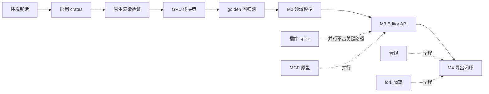

# 热点进程文档 · OpenCut Rust 重写版

> **用途**：跟踪当前最该被关注的技术热点、阻塞点、关键路径与进度变化。与 [`dashboard.html`](dashboard.html) 的看板 **ID 一一对应**，改动请两边同步。
> **当前快照**：2026-11-08（初始化，尚未开始编码）。
> **配套**：总纲见 [`README.md`](README.md)；决策留痕见 `../.codebuddy/memory/2026-11-08.md`。

---

## 0. 维护约定

| 规则 | 说明 |
| --- | --- |
| 更新时机 | 每完成一个动作、每次上游同步、每个里程碑结束、每次架构决策变更后 **当天** 更新 |
| ID 稳定 | `H01…` 热点、`M0…M6` 里程碑、`Q01…` 开放问题一旦分配不得复用或重排 |
| 状态取值 | `未开始` / `进行中` / `阻塞` / `已完成` / `已关闭`（与看板下拉一致） |
| 证据要求 | 每条热点必须写「证据」：文件路径、行号、命令输出或官方链接，**不写无依据的猜测** |
| 验收要求 | 「验收」必须是可观测条件（CI 全绿、像素一致、测试通过、文档更新），不写「基本可用」 |
| 双写 | 看板勾选状态后，用「导出 JSON」把结果回填本文件 §3 进度台账；反之改了本文件要在看板手动同步 |

---

## 1. 当前热点（按阻塞度排序）

| ID | 热点 | 等级 | 状态 | 影响面 | 证据 | 下一步动作 | 验收条件 | 更新日期 |
| --- | --- | --- | --- | --- | --- | --- | --- | --- |
| **H01** | GPUI(blade) 与 wgpu 纹理不互通 | P0 | 阻塞 | 桌面端整体架构 | 本仓库 `Cargo.lock` 中 `gpui 0.2.2` 依赖 `blade-graphics/blade-macros/blade-util`，无 `wgpu`；经典版 `Cargo.lock` 为 `wgpu 29.0.1` | M1 做 spike：`render_frame_to_texture` → CPU readback → GPUI 显示，记录 1080p 单帧耗时 | 产出实测数据与「readback / 独立 wgpu 窗口 / 换后端」的书面决策，写入 ADR-04 | 2026-11-08 |
| **H02** | 4.6 万行领域逻辑翻译缺回归网 | P0 | 进行中 | M2 全部 | **已建四批回归网**：`local/crates/ocx-domain` 翻译 `ripple`（18 / 64/64）、`timeline/placement`（29 / 100/100）、`animation/{bezier,interpolation}`（25 / 88/88）、`keyframe-query` + 经典版 31 版项目 JSON 只读兼容层（25 / 107/107）；累计 97 个 JSON 用例由 Rust golden master 与经典版 TS 的 JS 参考实现共用同一期望值，含正常/边界/异常/组合场景，浮点按 1e-5 容差；13 个补充单测。经典版 `EditorCore`/命令/undo 仍无系统级测试 | 按同一模板补命令层 → serde 版本化 schema | `cargo test --workspace` 中 golden 用例 100% 对齐，覆盖空值/极值/异常分支 | 2026-11-09 |
| **H03** | 本机工具链缺失且版本不符 | P0 | 已完成 | 所有本地验证 | **已安装并验证**：`bun 1.3.11`（npm 全局）、`moon 2.3.3`（`@moonrepo/cli`）、`rustc 1.97.0`（rustup + 项目级 override），两个 app 分别 `bun install`；`moon ci` 三个 Rust 任务全绿、`web:dev`/`api:dev` HTTP 200、`desktop:check` 退出码 0 | **完全关闭，无遗留**：`proto 0.63.2` 与 moon 2.3.3 官方二进制均经 `api.github.com` release asset 端点下载、SHA-256 与官方 digest 一致；moon.exe 另与 npm 版哈希交叉校验一致；按 manifest 注册后 `proto use` → `Installed bun, rust, and moon in 1 second!`。**不设 `MOON_TOOLCHAIN_FORCE_GLOBALS`** 时 `moon ci` 退出码 0、`web:dev`/`api:dev` HTTP 200、`desktop:check` 退出码 0，详见 `H03-toolchain-bootstrap.md` | 四版本对齐；`moon ci` 全绿；三端 dev/check 冒烟通过（已达成） | 2026-11-08 |
| **H04** | 上游架构仍在设计中，长期分叉风险 | P1 | 进行中 | fork 可维护性 | 官方 README（2026-11-08 抓取）仍为 "What's coming"，明说架构设计中、不收外部贡献 | 落地 §7 的「新增优先 + 隔离目录 + 差异台账」；启用 `git rerere`；每 2~4 周小步同步 | `README.md` §7.7 台账与 `git remote -v` 一致；每次同步后 `moon ci` 全绿 | 2026-11-08 |
| **H05** | 原生 Rust 渲染路径从未验证 | P0 | 未开始 | 桌面端可用性 | 经典版 `apps/desktop/src/main.rs` 仅 42 行且不引用任何 crate；`rust/README.md:29` 只是设计意图；CI 测试步骤是 `echo "No tests implemented yet"`；`GpuContext::try_gl_fallback` 原生直接返回错误 | M1 补 `render_frame_to_texture → Vec<u8>` 用例与原生 CI 任务 | `cargo test --workspace` 包含原生离屏渲染用例，三平台 CI 通过 | 2026-11-08 |
| **H06** | workspace 尚未启用 `crates/*` | P0 | 进行中 | 所有 crate 迁移 | **已完成**：根 `Cargo.toml` 追加 `'local/crates/*'`、`.moon/workspace.yml` 追加 glob、迁入 `ocx-time`/`ocx-bridge` 并编译通过、两个 `moon.yml` 已定义 | 剩余：`crates/media/build.rs` 待写；`moon ci` 待安装 moon 后验证；rust 待升级到 1.97 | `cargo test -p ocx-time -p ocx-bridge` 全绿（已达成）；`moon ci` 含 Rust 任务并全绿（待验证） | 2026-11-08 |
| **H07** | 插件运行时未选型 | P1 | 未开始 | M5 与「一等插件」路线图 | 调研：Extism 官方默认沙箱/能力限额；WIT Component Model 类型化接口；Figma Realms 的 API 可替换原则 | M2 期间并行做 Extism spike（不占关键路径），验证 wasm32 与原生双目标 | 产出对比数据与 ADR-03 结论；示例插件越权被拒 | 2026-11-08 |
| **H08** | MCP 规范版本与长任务模型 | P2 | 未开始 | AI Agent / headless | 官方规范 `2026-07-28`：无状态、`server/discover`、Tools/Resources/Prompts、**Sampling/Logging 已弃用**、Tasks extension 承载长请求 | M5 按官方映射实现，避免照抄旧版教程 | MCP 客户端可完成「打开→剪辑→导出」，长导出可查进度 | 2026-11-08 |
| **H09** | 许可证合规三项 | P1 | 未开始 | 分发合法性 | 经典版 MIT © 2025-2026 vs 重写版 © 2026（已由 `local/NOTICE.md` 保留声明）；FFmpeg 8.1.3 LGPL-2.1-or-later；字体 sprite 无 OFL 声明 | M4 校验 LGPL 随附；补齐字体归属文件 | 产物含 `BUILD.md`/`COPYING.LGPLv2.1`；字体归属文件齐备 | 2026-11-08 |
| **H10** | `docs/` 被 `.gitignore` 忽略 | P2 | 已完成 | 文档可同步性 | 本仓库 `.gitignore:7` 为 `docs/` | 已改用 `roadmap/` 目录 | 本文与看板位于 `roadmap/` 且 `git status` 可见 | 2026-11-08 |
| **H11** | 经典版 31 版项目迁移兼容 | P1 | 进行中 | 老用户数据 | **只读兼容层已落地**：`ocx-domain/src/project_compat.rs` 按 `migrations/AGENTS.md` 的 additive-only 规则，用宽容 `Value` 遍历、未知字段忽略但不写回、缺失字段补默认值并记 `warnings`、高于 v31 明确拒绝；25 个 JSON 用例对齐 107/107；`/editor` 已加载经典版 v31 项目 fixture 并由 core 解析 | 剩余：写回能力、迁移测试、真实用户项目抽样验证 | 经典版导出的项目 JSON 能被新 core 打开且剪辑决策不丢失 | 2026-11-09 |
| **H12** | 4K 预览性能（代理/缓存/快照） | P2 | 未开始 | 使用体验 | 调研：Olive 代理剪辑与 90 秒版本快照、Kdenlive 代理任务、OpenShot 3.5.1 Optimize Preview | M4 引入代理文件 + 预览帧缓存；M6 加时间线版本快照 | 4K 素材 scrub 无卡顿（设定量化阈值后再测），快照可回溯 | 2026-11-08 |
| **H13** | 上游落地六项能力导致双实现收敛（L3） | P1 | 进行中 | 全部 M3~M5 能力 | 官方 README 的 Editor API / 插件优先 / Rust core 多端 / MCP / Headless / scripting 与本地计划完全重叠；Git 能自动合并但会产生静默语义冲突 | 按 `README.md` §7.9 先做命名空间隔离（`local/crates/*`、`ocx.*` 工具前缀）、建 `upstream-mirror`、填能力级台账；落地当天用 `git merge-tree --write-tree` 预演 | 六行能力台账填齐（含上游真实路径/SHA）；预演退出码已记录；决策门选定路线；`moon ci` + 三端冒烟全绿 | 2026-11-08 |
| **H14** | **C→B 兼容层基石尚未落到代码**（用户指定为基石） | P0 | 进行中 | 所有本地能力 | **已完成**：`local/crates/ocx-*` 六个 crate、`apps/web/src/local/` 隔离目录、`editor-adapter.ts` 适配层（I-01）、契约测试 45 项 + 跨语言契约 5 项；WASM 端到端 40/40；`/editor` 已实现导入/删除/播放/导出 MP4 闭环（真实浏览器验证） | 剩余：音轨封装、WebM/AV1、WIT 插件契约、命令层 / serde 版本化 schema；上游同步时复核 `/editor` 占位路由这唯一一处上游文件改动 | `node compat.test.cjs` 全绿；`cargo test -p ocx-*` 六 crate 全绿；Node WASM 契约 40/40；vitest 14/14；真实浏览器导出 `ftyp isom` 有效 MP4 | 2026-11-09 |

**热点分布**：P0 = 6 项（H01/H02/H03/H05/H06/H14）、P1 = 6 项、P2 = 3 项（含已完成的 H10，共 14 项）。**当前关键阻塞是 H03（缺 bun/moon/proto、rust 1.96）→ H01/H05（桌面 GPU 路径）**；H06/H14 已由「未开始」推进到「进行中」（W-02/W-04 真实代码落地）；H13 属未来触发型风险。

---

## 2. 关键路径

- **关键链**：`H03 → H06 → H05 → H01 → H02 → M2 → M3 → M4`，对应 M0~M4（T+0~33 周）。
- **可并行**：H07（插件 spike）、H08（MCP 原型）、H10（已完成）、H12（性能设计）、OTIO 适配器原型。
- **全程约束**：H04（fork 隔离）与 H09（合规）不设独立里程碑，但每个里程碑的 DoD 都要复核。

---

## 3. 里程碑进度台账

| 里程碑 | 周期 | 状态 | 完成度 | 已完成内容 | 下一步 | 更新日期 |
| --- | --- | --- | --- | --- | --- | --- |
| **M0** | T+0~3w | 进行中 | 15% | 完成现状评审、先进方案调研、对比矩阵、路线图、fork 策略、文档体系与动态看板（全部为文档资产） | 安装工具链、启用 `crates/*`、接通 CI | 2026-11-08 |
| **M1** | T+3~7w | 未开始 | 0% | — | 迁入 `time`/`bridge`；GPU spike | 2026-11-08 |
| **M2** | T+7~15w | 未开始 | 0% | — | 建 golden master，再动领域翻译 | 2026-11-08 |
| **M3** | T+15~21w | 未开始 | 0% | — | editor-api + 绑定层 | 2026-11-08 |
| **M4** | T+21~33w | 未开始 | 0% | — | 媒体解码与导出闭环 | 2026-11-08 |
| **M5** | T+33~41w | 未开始 | 0% | — | 插件体系 + MCP | 2026-11-08 |
| **M6** | T+41~60w | 未开始 | 0% | — | OTIO / 移动端 / 协同评估 | 2026-11-08 |

> 完成度由看板按「里程碑下热点/任务状态」自动计算；此处为 2026-11-08 的人工基线。

---

## 4. 开放问题（待决策）

| ID | 问题 | 候选 | 决策期限 | 状态 |
| --- | --- | --- | --- | --- |
| **Q01** | 桌面 GPU 后端走哪条路？ | 离屏 readback / 独立 wgpu 窗口 / 等 GPUI 换 wgpu | M1 结束 | 待 spike |
| **Q02** | 移动端 UI 用 Flutter 还是原生？ | Flutter + `flutter_rust_bridge` / 原生 + UniFFI | M6 开始前 | 开放 |
| **Q03** | 现在引入 Loro CRDT 吗？ | 引入 / 仅保持命令层可映射 | M2 结束 | 倾向「仅保持可映射」 |
| **Q04** | 插件运行时用 Extism 还是自研 Component Model？ | Extism / wasmtime + wit-bindgen / 混合 | M2 并行 spike | 待验证 |
| **Q05** | OTIO 作为原生格式还是仅交换格式？ | 双轨（推荐）/ 全用 OTIO | M2 开始前 | 倾向双轨 |
| **Q06** | 上游若落地官方 Editor API，本地是否切换？ | 切换并做适配层 / 继续自有 core / 双轨共存 | 上游发布时 | 已有决策框架（`README.md` §7.9 / `COMPAT.md` §6）；最终路线待发布时按判据打分 |
| **Q07** | Web 端导出继续用 WebCodecs 还是统一走 FFmpeg-WASM？ | WebCodecs / FFmpeg-WASM | **2026-11-08 已决** | **WebCodecs（Web）+ 原生 FFmpeg（桌面/headless）**；Rust core 出 `RenderFrame`+`ExportProfile`，见 `PRIORITY.md` §4 |
| **Q08** | 是否把 `.codebuddy/` 加入 `.gitignore`？ | 加入 / 不加入 | **2026-11-08 已决** | **不加入**（用户决定）；且开发记录 `.codebuddy/memory/2026-11-08.md` 已显式纳入版本控制并推送到 GitHub 与 Forgejo，见 `PRIORITY.md` §5 |

---

## 5. 更新日志

| 日期 | 变更 | 关联 |
| --- | --- | --- |
| 2026-11-08 | 通读重写版与经典版仓库，完成可行性评审与 M0~M5 路线图（对话中给出） | `.codebuddy/memory/2026-11-08.md` |
| 2026-11-08 | 检索 15+ 官方/社区资料（OTIO、Extism、MCP 2026-07-28、Loro、MLT、Remotion、Vello、Rust 媒体生态、fork 维护），抓取 4 个官方页面核实 | `README.md` §3 / §10 |
| 2026-11-08 | 建立 `roadmap/` 文档体系：总纲、热点进程、动态看板、CSS/JS；修正「`docs/` 被忽略」问题 | H10 已完成 |
| 2026-11-08 | 加载 `fork-repo-sync` skill，确定双 remote 同步流程与差异台账 | H04 / `README.md` §7 |
| 2026-11-08 | 核实上游官方 README 与本地一致，暂无待同步架构变更；实测两仓库 `Cargo.lock` 均被跟踪 | `README.md` §2 |
| 2026-11-08 | 看板按职责拆为数据层 / IO 层 / 主逻辑 / 样式，所有代码文件降至 500 行以内 | `README.md` §0 |
| 2026-11-08 | 新增 `dashboard.test.cjs` 回归测试：35 个断言全部通过（含边界与异常分支），日志带日期时间落盘到系统临时目录 | `README.md` §11 |
| 2026-11-08 | `readmCN.md` 补充路线图与看板导航链接 | H10 |
| 2026-11-08 | 核实 `git merge-tree --write-tree` 与 `.gitattributes` 官方用法，新增 §7.9 L3 收敛预案（六能力冲突矩阵、命名空间隔离、能力级台账）、风险 R11、ADR-09、热点 H13；Q06 已有决策框架，最终路线仍待上游发布时选定 | `README.md` §7.9 / H13 |
| 2026-11-08 | 落实四项用户决策：新增 `PRIORITY.md`（Web-first 15 项优先级表、W0~W5、导出后端决策）、`COMPAT.md`（兼容基石）、`compat-contract.json` + `compat.test.cjs`（41 断言全绿）；ADR-10~13、Q07/Q08 已决、新增 H14 | `README.md` §0/§9/§11 |
| 2026-11-08 | 看板数据同步 H13/H14 与 Q07/Q08 已决状态，回归测试期望同步更新 | `dashboard-data.js` / `dashboard.test.cjs` |
| 2026-11-08 | 修复「开放问题区显示旧文案」：根因为浏览器缓存旧 `dashboard-data.js` 且该区缺少状态/结论字段。已重构为**决策台账**（待决/已决徽章 + 结论 + 来源 + 筛选 + 统计），加脚本 `?v=20261108-r2` 缓存版本号、页首数据版本与「重新加载数据」按钮；新增契约↔看板交叉校验 | `dashboard.html` / `dashboard-data.js` / `dashboard.js` / `dashboard.css` |
| 2026-11-08 | 用户决定把开发记录 `.codebuddy/memory/2026-11-08.md` 也推到 GitHub 与 Forgejo；同步更新 D03 台账、`PRIORITY.md` §5、Q08、`dashboard-data.js`、`compat-contract.json`、`COMPAT.md` 中关于「排除推送」的旧表述 | `README.md` §7.5/§7.7 |
| 2026-11-08 | 用户提供 SSH 指纹线索用于排查（**指纹值不记录**）：核实为本机 SSH 公钥标识；GitHub 22 端口不通但 `ssh.github.com:443` 认证成功，新增备用远程 `github-ssh`，`ls-remote` 与 `push --dry-run` 均通过 | `README.md` §7.5 |
| 2026-11-08 | **安全纠正**：用户指出公钥指纹不得写入文档。已从 `README.md` / `HOTSPOTS.md` / 开发记录中清除全部指纹、公钥路径、本机用户名与主机名、绝对路径及账号名，并加入「禁止写入任何公钥/密钥指纹与本机标识」的清单 | `README.md` §7.5 禁止清单 |
| 2026-11-08 | 用户要求「默认就走 SSH」：`origin` URL 切换为 SSH over 443，`git push` 无参数即走 SSH；不设 `GIT_SSH_COMMAND` 时 `ls-remote` 与 `push --dry-run` 均返回 0；`upstream` 保持 HTTPS，`github-ssh` 保留为冗余备用 | `README.md` §7.5 |
| 2026-11-08 | **历史重写完成**（用户明确授权「彻底清除」）：以干净基底 `cb02a1cd`、当前树创建新提交 `93b8d4bd`，丢弃含敏感内容的三个提交；两端用 `--force-with-lease` 改写 `main`；本地 `reflog expire` + `gc --prune=now` 后三个旧对象均已删除，`git log --all` 0 命中 | `.codebuddy/memory/2026-11-08.md` |
| 2026-11-08 | **Web 版本改造开工（W-02/W-04）**：建立 `local/crates/ocx-time`、`ocx-bridge` 与 `apps/web/src/local/` 隔离目录；追加式启用 `Cargo.toml` members 与 `.moon/workspace.yml` glob；从经典版迁入 `time`/`bridge`（默认关闭 wasm、零浏览器依赖）；新增 40 个 JSON 数据驱动用例 + `CASES.md`；`cargo test` 12 测试函数、`fmt --check`、`clippy` 全绿。H06/H14 由「未开始」→「进行中」 | `PRIORITY.md` §2 进度快照 |
| 2026-11-08 | **W-03 基石落地**：`ocx-editor-api`（版本化 EditorApi/Command、能力发现、单后端注册、undo/redo、内置参考后端）+ 6 内联单测（含并发）+ 19 个 JSON 序列用例；修复 `SceneSnapshot.state_ticks` 缺失与 `OnceLock` 重复注册错误信息两个真实 bug；新增跨语言契约 JSON + 5 项 Node 契约测试；H03 安装引导文档。TS 适配层/WIT 推迟到 W-06 | `COMPAT.md` §8 / `H03-toolchain-bootstrap.md` |
| 2026-11-08 | **H03 关闭**：用户授权后实际安装 `bun 1.3.11` / `moon 2.3.3` / `rustc 1.97.0` 并分别装依赖；`moon ci` 三个 Rust 任务全绿，`web:dev`/`api:dev` HTTP 200、`desktop:check` 退出码 0。`proto` 因 GitHub Releases HTTPS 连接重置未装，改用 `MOON_TOOLCHAIN_FORCE_GLOBALS=true`；修正根目录无 `package.json`、glob 误报、`master` vs `main` 等问题，`NOTICE.md` 移至 `local/` | `H03-toolchain-bootstrap.md` |
| 2026-11-08 | **proto 补装成功**（用户「再试试」）：改走 `api.github.com` release asset 端点下载官方 zip，SHA-256 与官方 digest 完全一致；`proto setup` 固化 PATH → `proto 0.63.2`；`proto use` 纳管 bun/rust，moon 预编译包仍受限已终止。JS 任务保留 `FORCE_GLOBALS`，Rust 任务不需要。看板数据版本 bump 至 `2026-11-08-r5` | `H03-toolchain-bootstrap.md` §2–§3 |
| 2026-11-08 | **H03 完全关闭**（用户「接着试一下」）：同法补装 moon 2.3.3 官方包（digest 校验 + 与 npm 版 moon.exe 哈希交叉校验一致），按无 BOM `manifest.json` 注册后 `proto use` → `Installed bun, rust, and moon in 1 second!`；**不设 `FORCE_GLOBALS`** 时 `moon ci` 退出码 0、`web:dev`/`api:dev` HTTP 200、`desktop:check` 退出码 0。看板数据版本 bump 至 `2026-11-08-r6` | `H03-toolchain-bootstrap.md` §4–§5 |
| 2026-11-08 | **W-05 第一批**：新建 `local/crates/ocx-domain`，把经典版 `ripple/{diff,shift,apply}.ts` 逐函数翻译为 Rust（秒→`MediaTime` ticks）；18 个 JSON golden 用例由 Rust 与经典版 TS 的 JS 参考实现共用同一期望值（JS 对齐 64/64），5 个补充单测全绿，`moon run ocx-domain:test` 实跑通过。H02 由「未开始」→「进行中」。看板数据版本 bump 至 `2026-11-08-r7` | `PRIORITY.md` §2 / `local/crates/ocx-domain/tests/CASES.md` |
| 2026-11-08 | **W-05 第二批**：翻译经典版 `timeline/placement/` 五组纯函数（compatibility / overlap / main-track / insert-index / resolve）；29 个 JSON 用例由 Rust 与 JS 参考实现共用期望值（对齐 100/100），4 个补充单测全绿；`TimelineTrack.trackType` 采用 additive-only 默认值策略，第一批 18 个用例零改动仍全绿。看板数据版本 bump 至 `2026-11-08-r8` | `PRIORITY.md` §2 / `local/crates/ocx-domain/tests/PLACEMENT_CASES.md` |
| 2026-11-09 | **W-05 第三批**：翻译经典版 `animation/{bezier,interpolation}.ts`（贝塞尔求解、通道归一化、边界外推、step/linear/bezier 求值与统一分派）；25 个 JSON 用例对齐 88/88，4 个补充单测全绿；跨语言浮点改按 1e-5 递归容差（20 次二分固有精度）。累计 72 个 golden 用例、13 个补充单测。看板数据版本 bump 至 `2026-11-08-r9` | `PRIORITY.md` §2 / `local/crates/ocx-domain/tests/ANIMATION_CASES.md` |
| 2026-11-09 | **W-06 完成**：新建 `ocx-bindings-wasm`（wasm32 + wasm-bindgen 0.2.130）、`editor-adapter.ts`（I-01 唯一入口）与 `/editor` 最小时间轴；真实 WASM 在 Node 端到端 16/16、vitest 7/7、`vite build` 退出码 0、dev 端 `/editor` 与 wasm 资源 HTTP 200。补装 wasm target 与 CLI（经 GitHub API asset 通道，见 `H03-toolchain-bootstrap.md` §9）；新增独立 `vitest.config.ts` 绕开 Cloudflare 插件在测试环境的限制。H14 证据更新。看板数据版本 bump 至 `2026-11-08-r10` | `PRIORITY.md` §2 / `COMPAT.md` §8 |
| 2026-11-09 | **W-07 第一批（方向调整）**：核对 `PRIORITY.md` 后确认 W-06 的 DoD 仍缺「预览帧」、W-07 完整导出依赖未验证的 H01/H05 渲染路径，故先做可确定性验证的契约切片。新建 `ocx-render`（`RenderFrame`/`ExportProfile`、稳定错误码、帧计划含 29.97fps 音画同步累积采样、合成帧源）与 26 个 golden 用例 + 5 个单测；WASM 新增三条入口并重建产物；`/editor` 补齐 core 预览帧（canvas）与 WebCodecs 能力探测。六 crate 检查全绿、Node WASM 契约 28/28、vitest 10/10、`vite build` 0、dev 端 HTTP 200。真实 MP4/WebM 编码留待下一批。看板数据版本 bump 至 `2026-11-08-r11` | `PRIORITY.md` §2 / `COMPAT.md` §8 |
| 2026-11-09 | **W-05 第四批 / H11 前置**：翻译经典版 `keyframe-query.ts`（含 `channel-data`/`path` 规则与 `formatLinearRgba`）并新建经典版 31 版项目 JSON **只读**兼容层（additive-only、5 个稳定错误码、高于 v31 拒绝）；25 个 JSON 用例对齐 107/107、WASM 契约扩至 40/40、四套跨语言对齐 107/88/100/64。`/editor` 改为加载 `classic-project-v31.json` 并由 core 解析，移除硬编码 DEMO，闭合 W-06 DoD「加载项目」。H02 证据更新、H11 由「未开始」→「进行中」。看板数据版本 bump 至 `2026-11-08-r12` | `PRIORITY.md` §2 / `local/crates/ocx-domain/tests/LEGACY_CASES.md` |
| 2026-11-09 | **W-07 第二批 / 真实导出闭环**（用户「等能干活了再测试」）：新增 `mp4-muxer`（MIT）与 `export.ts`，用 WebCodecs 把 core 合成帧编码封装为 MP4；`/editor` 升级为导入项目 JSON、点击删除片段、播放头逐帧预览、导出下载，并修复截图反馈的对比度问题。真实浏览器验证上传/删除/播放/导出全链路，导出 60 帧 2.00s、`ftyp isom` 有效容器；修掉「删除只位移不移除元素」的真实 bug。看板数据版本 bump 至 `2026-11-08-r13` | `PRIORITY.md` §2 / `apps/web/src/local/export.ts` |

---

## 6. 下次更新必做

1. 装完工具链后把 **H03** 改为 `已完成`，并在更新日志留命令输出摘要。
2. M1 spike 结束后更新 **H01/H05**，同时把 ADR-04 从「待决」改为具体结论。
3. 每次 `merge upstream/main` 后，在更新日志追加一行「上游 SHA + 冲突文件 + CI 结果」，并复核 `README.md` §7.7 台账。
4. 用看板「导出 JSON」回填 §3 完成度，避免人工与看板状态漂移。
