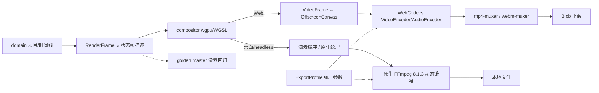

# 改造优先级方案表 · Web 优先（Web-first）

> **依据**：本文件落实 2026-11-08 的四条指令——① 先做 Web 版本；② `.codebuddy/` **不加入** `.gitignore`；③ 导出后端按「在 Rust 与新架构下优势更明显」择优；④ C→B 兼容层作为基石，需详细记录与实现。
> **快照**：重写版 HEAD `e6680107`（2026-09-24），经典版 HEAD `cf5e79e9`（2026-05-17）。
> **配套**：总纲 [`README.md`](README.md) · 兼容层基石 [`COMPAT.md`](COMPAT.md) · 契约 [`compat-contract.json`](compat-contract.json) · 热点 [`HOTSPOTS.md`](HOTSPOTS.md)。
> **本文承载优先级与决策；产品代码的实际进度以 §2 进度快照为准**（W-01~W-05 已陆续落地于 `local/crates/`）。

---

## 0. 四项决策摘要

| # | 议题 | 决策 | 落点 |
| --- | --- | --- | --- |
| 1 | 改造顺序 | **Web 单端优先**，桌面/移动后置；重排为 W0~W5 | 本文 §2 / §3 |
| 2 | `.codebuddy/` | **不加入 `.gitignore`**（用户决定）；开发记录已显式纳入版本控制并推送到 GitHub 与 Forgejo（2026-11-08） | 本文 §5、`README.md` §7.5 |
| 3 | Web 导出 | **WebCodecs（Web）+ 原生 FFmpeg（桌面/headless）双后端**；Rust core 只输出 `RenderFrame` + `ExportProfile` | 本文 §4 |
| 4 | C→B 兼容 | 定为**基石**，P0 即落地命名空间隔离、契约、适配层与回归网 | [`COMPAT.md`](COMPAT.md) |

---

## 1. 为什么先做 Web

| 理由 | 证据 |
| --- | --- |
| 唯一被 CI 验证过的 Rust/WASM 路径 | 经典版 `bun-ci.yml` 三平台跑 `wasm-pack build rust/wasm`，Web 消费 `opencut-wasm@0.2.10` |
| 桌面端有最大未知量 | 本仓库 `Cargo.lock`：`gpui 0.2.2` → `blade-graphics`（无 `wgpu`），经典版合成器 `wgpu 29.0.1`，纹理不互通（H01/R1） |
| 骨架已就绪 | `apps/web` TanStack Start + Vite 8 + Cloudflare Workers，`apps/api` Elysia；`new.opencut.app` 已是预览域名 |
| 交付价值最快 | 浏览器打开即可用，无需安装包；符合「视频留在本机」的产品理念 |
| 合规最轻 | Web 端不需要随附 FFmpeg LGPL 二进制（见 §4） |

**代价**：WebCodecs 有浏览器差异，需要能力探测 + 降级 + 回归用例（§4.5）；桌面端 GPU 决策推迟但 **M1 的 spike 仍要提前做**，不然后面返工。

---

## 2. 改造优先级方案表（核心）

> 优先级说明：**P0 = Web MVP 关键路径，必须按顺序做**；P1 = MVP 后立刻补齐；P2 = 生态与多端。
> 估算口径：1 名熟悉 Rust + wgpu 的开发者全职，`T+` 为累计周数，为估算而非承诺。

| ID | 任务 | 优先级 | 为什么现在做 | 依赖 | 交付物 | 验收 DoD | 估算 | 主要风险 |
| --- | --- | --- | --- | --- | --- | --- | --- | --- |
| **W-01** | 工具链与 CI 基线 | P0 | 现在连 `bun`/`moon`/`proto` 都没装，任何改造无法验证 | — | `proto use` + `bun install`；`crates/*` 启用；`moon ci` 补 fmt/clippy/`cargo test --workspace`/wasm-pack | 三平台 CI 全绿且含真实用例；三个 dev 命令可访问 | T+0~3w | H03 |
| **W-02** | **命名空间隔离落地（基石）** | P0 | 上游迟早落地六项能力；晚做一天就多一天重名债务 | W-01 | `local/crates/*`、`ocx_` crate 前缀、`apps/local-*`、`apps/web/src/local/`、`ocx.*` 工具前缀 | `git ls-files` 中本地新增资产全部落在隔离路径；契约校验通过 | T+2~4w | R11 |
| **W-03** | **兼容契约与适配层骨架（基石）** | P0 | C→B 要求「本地调用只经适配层」，越晚写越难补 | W-02 | `COMPAT.md` + `compat-contract.json` + `compat.test.cjs` + `editor-api` 薄层接口 | 契约测试全绿；六项能力台账可机器校验；无绕过适配层的调用 | T+3~5w | R11 |
| **W-04** | 迁入 `time` / `bridge`（关 wasm feature） | P0 | 零浏览器依赖、11 个单测现成，收益最高风险最低 | W-01/W-02 | `local/crates/ocx-time`、`ocx-bridge` | `cargo test -p ocx-time` 全绿；`MediaTime`/`FrameRate` 被 Web 绑定调用 | T+3~6w | resolver 2→3 |
| **W-05** | 领域模型 + 命令 + golden 回归网 | P0 | 4.6 万行 TS 里最值钱的部分，Rust core 目前完全缺失 | W-04 | `local/crates/ocx-domain`（serde schema、`trait Command`、ripple、placement、动画） | JSON 数据驱动 golden 用例 Rust/TS 同输入同输出 100% 对齐；可读经典版项目 JSON | T+6~14w | R2 |
| **W-06** | Web 绑定薄层 + 最小时间轴 | P0 | Web-first 的第一个可见产物 | W-04/W-05 | `bindings/wasm`（不搬经典版 `rust/wasm` 全局单例实现）+ TanStack Start 路由 | `/editor` 能加载项目、显示时间轴与预览帧 | T+12~17w | wasm 体积 |
| **W-07** | 渲染帧 → WebCodecs 导出管线 | P0 | 打通「Rust core 出帧 → 浏览器编码」闭环 | W-06 | `RenderFrame` / `ExportProfile` 契约、能力探测、`VideoFrame` 构造、muxer 接入 | 同一项目导出 MP4/WebM，帧数/时长/音画同步校验通过 | T+15~20w | §4.5 浏览器差异 |
| **W-08** | 导入 → 剪辑 → 预览 → 导出主链路 | P1 | MVP 的功能完整度 | W-07 | 素材导入、时间轴编辑、预览播放、导出按钮 | 端到端用例：导入 mp4 → 剪辑 → 导出，无人工干预 | T+20~26w | 音频调度 |
| **W-09** | 代理剪辑 + 预览帧缓存 | P1 | 4K 体感，Olive/Kdenlive/OpenShot 已验证的思路 | W-08 | 代理文件生成、帧缓存、缓存失效 | 设定量化阈值后 4K scrub 达标 | T+24~28w | H12 |
| **W-10** | OTIO 导入导出 + 版本化 schema | P1 | 跨 NLE 互通，落实 additive-only | W-05 | `local/crates/ocx-io` | 与第三方 OTIO 往返不丢剪辑决策 | T+24~30w | 标准表达力 |
| **W-11** | Editor API 稳定化 + 能力发现 | P1 | 插件与 MCP 的前置 | W-03/W-05 | 版本化命令/事件/快照、`discover` 式能力协商 | 接口冻结并写入契约；向后兼容用例通过 | T+26~32w | R11 |
| **W-12** | 插件 host（Extism / WIT）+ 示例插件 | P2 | 路线图「一等插件」，也是 C→B 迁移的落点 | W-11 | `local/crates/ocx-plugin-host`、manifest、能力清单 | 越权被拒；示例插件可注册 effect/command | T+32~40w | H07/R8 |
| **W-13** | MCP server + Headless + scripting | P2 | AI Agent / 批量渲染 | W-11 | `apps/local-mcp`（`ocx.*`）、`ocx-render`、脚本标签页 | MCP `tools/list` 可完成一次导出；长任务可查进度 | T+40~48w | H08 |
| **W-14** | 桌面 GPUI 接入（spike 先行） | P2 | H01 决策后才有确定方案 | W-07 + M1 spike | GPUI 显示 wgpu 合成帧 | 桌面与 Web 输出像素一致帧 | T+48~56w | R1/H01 |
| **W-15** | 移动端 / 协同评估 | P2 | 长线 | W-11 | UniFFI 或 flutter_rust_bridge 原型 | 移动端可打开同一项目 JSON | T+56w+ | Q02/Q03 |

### 进度快照（2026-11-08 开工首日）

| 任务 | 状态 | 实证 |
| --- | --- | --- |
| W-01 | **已完成** | `bun 1.3.11` / `moon 2.3.3` / `rustc 1.97.0` 已安装并对齐；`moon ci` 三个 Rust 任务全绿；`web:dev`（HTTP 200）、`api:dev`（HTTP 200）、`desktop:check`（退出码 0）冒烟通过。`proto 0.63.2` 已纳管 bun/moon/rust，**无需 `FORCE_GLOBALS` 旁路**（见 `H03-toolchain-bootstrap.md`） |
| W-02 | **已完成** | 建立 `local/crates/ocx-time`、`local/crates/ocx-bridge`、`apps/web/src/local/`；`Cargo.toml` 与 `.moon/workspace.yml` 以**追加式**启用隔离目录 |
| W-03 | **Rust 侧已完成** | `local/crates/ocx-editor-api`（版本化 `EditorApi`/`Command`、能力发现、单后端注册、undo/redo、内置参考后端）；6 个内联单测 + 19 个 JSON 序列用例全绿；`apps/web/src/local/editor-api.contract.json` + 5 项跨语言契约测试。剩余：WIT 插件契约与 TS 适配层（W-06 随 Web 绑定接入） |
| W-04 | **已完成** | 经典版 `time`/`bridge` 迁入（`ocx_` 前缀、默认关闭 `wasm` feature、零浏览器依赖）；`cargo test` 11 个内联单测 + 40 个 JSON 用例全绿，`fmt --check` 与 `clippy` 通过 |
| W-05 | **四批已完成（回归网收口）** | `local/crates/ocx-domain`：① `ripple/{diff,shift,apply}.ts`（18 用例 / 64/64）；② `timeline/placement/` 五组纯函数（29 用例 / 100/100）；③ `animation/{bezier,interpolation}.ts`（25 用例 / 88/88）；④ `keyframe-query.ts` 翻译（含 `channel-data` / `path` 规则与 `formatLinearRgba`）**+ 经典版 31 版项目 JSON 只读兼容层**（25 用例 / 107/107）。累计 97 个 JSON 用例、13 个补充单测；`/editor` 改为加载真实项目 JSON（W-06 DoD「加载项目」闭合）。剩余：命令层、serde 版本化 schema、项目 JSON 写回（当前严格只读） |
| W-06 | **已完成** | 新建 `local/crates/ocx-bindings-wasm`（WASM 薄绑定）+ `apps/web/src/local/editor-adapter.ts`（I-01 唯一入口，业务禁止直接 import glue）+ `/editor` 最小时间轴；真实 WASM 在 Node 端到端 **16/16**、vitest **7/7**、`vite build` 成功、dev 端 `/editor` 与 WASM 资源均 HTTP 200。**注意**：`/editor` 改写了上游占位路由，是本仓唯一一处上游文件改动，见 `COMPAT.md` §8 |
| W-07 | **两批已完成（真实导出闭环）** | 第一批：`ocx-render` 帧契约、帧计划（29.97fps 音画同步）、合成帧源，26 golden 用例 / 5 单测，WASM 三条入口与预览帧。第二批：`apps/web/src/local/export.ts` 用 `VideoEncoder` + `mp4-muxer` 把 core 帧编码封装为 MP4；`/editor` 升级为**导入项目 JSON → 点击删除片段（core ripple 重算）→ 拖动播放头逐帧预览 → 导出下载 MP4**，并修复文字对比度。真实浏览器端到端：上传自定义项目、删除后剩余 1 片段 / 60 帧、播放推进帧号、导出 60 帧 2.00s 且容器头为 `ftyp isom`。**剩余**：音轨封装、WebM/AV1 编码、导出进度条 UI |
| W-08 | **三批已完成（主链路闭合）** | `apps/web/src/local/media.ts` 用浏览器原生 `<video>` + canvas 逐帧解码真实视频；`ocx-render::composite_frame` 与 WASM `composite_frame_rgba` 让 core 合成真实底图并产出最终 `RenderFrame`（预览与导出共用帧源）；`export.ts` 支持可替换 `frameSource`；`/editor` 新增「导入视频素材」与「生成演示素材」。真实浏览器端到端：演示 mp4 解码 → 预览角落像素由色块 `[17,25,38,166]` 变为真实画面 `[31,39,125,255]` → 播放头帧 41/90 画面变化 → 导出 90 帧 / 3.00s / 36,376 字节，重新解码确认 `ftyp isom` 且画面为渐变背景 + 移动白块；删除片段后导出 60 帧 / 2.00s / 24,530 字节。**第二批**：读取经典版元素的 `trimStart`/`trimEnd`，建立「片段 → 素材帧」映射（`timeline.ts`），使删除片段真正改变导出画面（首帧 hash 由 `2010631942` → `1357128289`）；新增「在播放头分割」（第二段 `trimStart` 连续累加）。**第三批**：闭合 W-08 风险项「音频调度」——`audio.ts` 用 Web Audio 解码 + `AudioEncoder` (`mp4a.40.2`) 编码 AAC，按 `FramePlan` 累积采样思路做音画同步，`buildTimelineAudio` 按片段 `trimStart` 重排音频使剪辑也改变声音；真实浏览器验证导出 MP4 重新解码出 3.008s / 48kHz / 双声道 / 峰值 0.25 的 440Hz 音轨，剪辑后音轨缩至 2.005s。**剩余**：裁剪时长/拖拽、代理缓存（H12）、WebM/AV1、Firefox 兼容回归 |
| W-09 | **两批已完成（代理剪辑）** | 第一批：`frame-cache.ts` 素材指纹 LRU 帧缓存（默认 3 份）、抽帧恒定 320×180 代理尺寸、`clearFrameCache` / `getFrameCacheStats`；真实浏览器首次解码 10,370ms → 重复导入 0ms。第二批：`frame-store.ts` 用 IndexedDB 持久化代理帧（可注入后端、静默降级、schema 版本前缀），`media.ts` 三级缓存（内存 → IndexedDB → 逐帧 seek），`createProxyFile` 把代理帧编码成低分辨率 MP4，`/editor` 显示单帧耗时与量化阈值 **16ms**、持久化统计与代理文件下载。真实浏览器：首次解码 11,733ms 并「已持久化」20.5MB；**重新加载页面后再次导入命中「持久化缓存」107ms**（约 110×）；单帧合成 1.90ms / 0.70ms 均低于 16ms 阈值（代理帧恒定 320×180，与源分辨率解耦）；代理 MP4 32,655 字节 `ftyp/isom` 有效；清除缓存后内存与 IndexedDB 同步归零；vitest 57/57。**剩余**：真实 4K 素材端到端 scrub 基准、M6 时间线版本快照 |
| W-10 | **第一批已完成（OTIO 双向交换）** | 新建 `local/crates/ocx-io`（无 C++ FFI）：`schema.rs` 定义 8 类 OTIO 类型白名单、7 个稳定错误码与 `metadata.opencut.schemaVersion` 的 additive-only 校验（缺省按 v1、高于 v1 拒绝）；`otio.rs` 用宽容 `Value` 遍历导入 `Timeline/Stack/Track/Clip/Gap/TimeRange/RationalTime/ExternalReference`，输出内部 `EditTimeline`（整数 ticks）并可导出回合法 OTIO JSON。片段位置由 children 顺序累加 duration 推导；导入保留原始 RationalTime 并在导出时原样写回，**29.97fps 往返无漂移**；`decision_key()` 作为「剪辑决策不丢失」的不变量指纹。15 个 JSON golden 用例 + 10 个 Rust 单测全绿；WASM 新增 `otio_import` / `otio_export`，`editor-adapter.ts` 按 I-01 暴露，Node 真实 WASM 契约扩至 **57/57**（含导入→导出→再导入 tracks 完全一致）。**剩余**：Web 端导入/导出 UI、Transition/Marker/Effect/nested Stack、与第三方 OTIO 工具（otio-rs / otioconvert）的实文件往返验证 |
| W-11 及以后 | 未开始 | — |

> **H03 已关闭**（2026-11-08）：用户授权后由助手实际安装并跑通全部验证。系统另有一套独立 Rust 1.96，需把 `~/.cargo/bin` 置于 PATH 最前使 rustup 项目级 override 生效；根目录没有 `package.json`，依赖须在两个 app 目录分别安装；`moon ci` 默认 base 为 `master`，本仓库为 `main`。完整记录见 [`H03-toolchain-bootstrap.md`](H03-toolchain-bootstrap.md) §6。
> **H03 完全关闭、无遗留**：moon 2.3.3 官方预编译包也经 `api.github.com` asset 端点下载并校验，按 `manifest.json`（无 BOM UTF-8）注册后 `proto use` 秒级完成；`moon.exe` 与 npm 版 SHA-256 交叉校验一致。**`MOON_TOOLCHAIN_FORCE_GLOBALS` 已不再需要**，不设旁路时 `moon ci` 与三端冒烟全通过。详见 `H03-toolchain-bootstrap.md` §4–§5。

**关键路径**：`W-01 → W-02 → W-03 → W-04 → W-05 → W-06 → W-07 → W-08`。
**与「兼容是基石」的关系**：W-02/W-03 **排在迁代码之前**——先把隔离与契约立起来，再写业务，否则将来切换到上游 core 要重写所有调用方。

---

## 3. Web-first 修订里程碑与原计划映射

| 原里程碑 | Web-first | 变化 |
| --- | --- | --- |
| M0 基线与 CI | **W0**（含 W-01~W-03） | 前移并加入兼容基石 |
| M1 迁入 Rust core + GPU spike | **W1**（W-04 + spike 提前，但不实现桌面） | 拆：代码迁入提前，桌面实现后置 W-14 |
| M2 领域模型 | **W2**（W-05） | 不变，仍是最不可压缩 |
| M3 Editor API 与绑定 | **W3**（W-06 + W-07 + 部分 W-11） | 只做 Web 绑定，不做桌面/移动 |
| M4 媒体与导出 | **W4**（W-08~W-10） | 导出改 WebCodecs（§4） |
| M5 插件与 MCP | **W5**（W-11~W-13） | 后置 |
| M6 生态/移动/桌面 | W-14 / W-15 | 明确后置 |

```mermaid
gantt
    title Web-first 里程碑（1 人全职基准，T+ 周）
    dateFormat X
    axisFormat T+%s
    section 基石（P0）
    W0 工具链/隔离/契约   :crit, w0, 0, 5
    W1 time+bridge+spike  :w1, 3, 7
    section Web MVP（P0）
    W2 domain+golden      :crit, w2, 6, 14
    W3 Web绑定+导出管线   :crit, w3, 12, 20
    section 完整度（P1）
    W4 主链路/缓存/OTIO   :w4, 20, 30
    section 生态（P2）
    W5 插件/MCP/桌面/移动 :w5, 30, 60
```

**剪裁**：只做 Web MVP（W0~W3）约 **20 周**可见第一个可导出视频的版本；完整 P1 约 30 周。比原 M0~M4（33 周）快，因为砍掉了桌面 GPU 不确定性。

---

## 4. 导出后端决策（WebCodecs vs FFmpeg-WASM）

### 4.1 结论先行

**不是二选一，而是分层**：Rust core 只负责**出帧**与**描述导出参数**，编码交给各平台最合适的后端。

| 端 | 编码后端 | 理由 |
| --- | --- | --- |
| **Web** | **WebCodecs**（+ `mp4-muxer` / `webm-muxer` 这类纯 JS 封装） | 浏览器内置硬件编解码、零下载、无需 COOP/COEP、无 LGPL 负担 |
| **桌面 / headless** | **原生 FFmpeg 8.1.3**（已固定的 LGPL 共享库，动态链接） | 格式最全、与导出滤镜链一致、可批渲染 |

Rust core 输出两个稳定契约：`RenderFrame`（无状态帧描述，预览与导出共用）与 `ExportProfile`（container/codec/bitrate/fps/audio 参数）。**跨端一致性由统一 profile + golden master 像素对比保证，而不是靠同一个编码器二进制**。

### 4.2 对比矩阵（Web 端，检索日期 2026-11-08）

| 维度 | WebCodecs | FFmpeg-WASM | 证据 |
| --- | --- | --- | --- |
| 首载体积 | **0**（浏览器内置） | 约 **30MB** core 首次下载 | ffmpeg.wasm 社区实测 |
| 部署要求 | 安全上下文（HTTPS / localhost） | 多线程还需 **COOP/COEP + SharedArrayBuffer**，要在 Workers 配 `_headers` | ffmpeg.wasm 指南 |
| 编码性能 | **硬件编解码器** | 纯软件 x264；5 秒片段约 10~30s；多线程仅约 2× 提速且吃内存/CPU | Remotion 官方与社区基准 |
| 与 wgpu 帧对接 | `VideoFrame` ← `OffscreenCanvas`/Canvas，`copyExternalImageToTexture` 可 GPU-to-GPU | 每帧 RGBA 需经 wasm 线性内存拷贝 | 经典版 `wasm-compositor.ts`；社区 wgpu→WebCodecs 实践 |
| 浏览器支持 | Chrome 94+ / Edge 94+ / Firefox 130+ / Safari 16.4+，2026 已稳定但有细微差异 | 只需 WASM，覆盖面略广 | 社区兼容表 |
| 格式广度 | avc/vp9 + aac/opus，配纯 JS muxer | **最全**（FFmpeg 全部 muxer/滤镜） | 经典版 `scene-exporter.ts` |
| 跨端字节级一致 | 依赖浏览器编码器 | **同一套 FFmpeg** | 架构判断 |
| LGPL 合规 | 无 FFmpeg 依赖 | WASM 静态链接，**重链/替换义务更难满足** | [FFmpeg 官方 legal](https://ffmpeg.org/legal.html) |
| 与 Rust core 分层 | 编码是平台后端，core 保持纯净 | 把编码器塞进 WASM，core 与编码耦合 | 架构判断 |

**判定**：在「Rust core + 插件优先 + 多端」架构下，WebCodecs 在**性能、包体、部署复杂度、合规、架构解耦**五项上优势明显；FFmpeg-WASM 仅在「格式广度 / 字节级一致」占优，而这两项可用 `ExportProfile` + golden master 与桌面原生 FFmpeg 补偿。**因此 Web 端采用 WebCodecs**。

### 4.3 分层管线

### 4.4 `ExportProfile` 契约要点

| 字段 | 说明 |
| --- | --- |
| `apiVersion` / `profileVersion` | 版本化，新增字段只增不改（additive-only） |
| `container` | `mp4` / `webm` |
| `video` | `codec`（`avc1.*` / `vp09.*`）、`width/height`、`bitrate`、`fps: FrameRate` |
| `audio` | `codec`（`aac` / `opus`）、`sampleRate`、`channels`、`bitrate` |
| `range` | 起止 `MediaTime`（整数 tick，避免浮点累积误差） |
| `capabilities` | 由能力探测写入，用于协商降级 |

### 4.5 能力探测、降级与回归（必做）

1. 导出前调用 `VideoEncoder.isConfigSupported` / `AudioEncoder.isConfigSupported`（经典版已用 `AudioEncoder.isConfigSupported({codec:"mp4a.40.2"})`），按结果选 codec/容器组合。
2. 维护浏览器能力表（Chrome / Edge / Firefox / Safari × avc/vp9/aac/opus），写入 `compat-contract.json` 的 `exportCapabilities` 段，由契约测试校验完整性。
3. **回归用例必须覆盖经典版 0.3.0 修过的 bug**：「MP4 导出带音频在 Firefox 失败」；`mediaTime` 边界（0、极值、帧对齐）与 `fps` 有理数（23.976/29.97）。
4. 提供降级链：`avc+aac → vp9+opus → 仅视频 → 明确报错并给出用户可见的友好提示`，禁止静默失败。
5. 长导出用 MCP **Tasks extension** 式任务句柄 + 进度（与 headless 一致）。

### 4.6 反转条件（何时重新评估 FFmpeg-WASM）

| 触发 | 应对 |
| --- | --- |
| Web 端必须支持 FFmpeg 独有滤镜 / 冷门容器 | 加**可选懒加载** FFmpeg-WASM 后端（独立 Worker、COOP/COEP 只在此时启用），不替换默认路径 |
| 要求跨端**字节级**一致且 golden master 无法通过 | 把桌面/headless 也切到 WebCodecs 不可行时，改为服务端统一 FFmpeg 导出 |
| WebGPU 不可用需 CPU 渲染，且 WebCodecs 能力探测大面积失败 | 同上降级链，先评估影响面再决策 |
| 目标浏览器（如旧 Safari）必须覆盖 | 用能力表判定后走 FFmpeg-WASM 降级，不全局切换 |

### 4.7 合规

Web 端不引入 FFmpeg → 无 LGPL 负担；桌面/headless 沿用重写版已固定的 FFmpeg 8.1.3 LGPL 共享库，动态链接并随附 `COPYING.LGPLv2.1`、`LICENSE.md`、`BUILD.md`（`crates/media/setup/setup.ts` 已实现）。两条链路的许可证边界写入 `HOTSPOTS.md` H09。

---

## 5. `.codebuddy/` 决策（不加入 `.gitignore`）

**决定（用户 2026-11-08）**：不加入 `.gitignore`。

| 后果 | 约束 / 操作 |
| --- | --- |
| 版本控制状态 | **已纳入**：`.codebuddy/memory/2026-11-08.md` 于 2026-11-08 显式 `git add` 并推送到 GitHub 与 Forgejo，`git status` 不再显示 `?? .codebuddy/` |
| 容易误 `git add -A` 把其它内部文件推到公开 fork | **禁止 `git add -A` / `git add .`**；一律显式 `git add <具体文件>`，开发记录逐文件暂存 |
| skill 默认排除 | `sync-upstream.ps1` 默认 `-ExcludeDirs ".codebuddy"` 会误报警告（仅 warning，不阻断）；使用时可传 `-ExcludeDirs @()`，脚本本身不改 |
| 台账登记 | `README.md` §7.7 D03 已更新为「显式纳入版本控制并双推」 |
| Q08 状态 | `HOTSPOTS.md` Q08：**不加入 `.gitignore`**（不变）；开发记录纳入版本控制（增加说明） |

> 系统侧说明：`.codebuddy/` 是项目相关数据存储，**不是临时缓存**，不得删除；本决策不改变这一点。

---

## 6. 兼容层基石（第 4 点）

C→B（双轨过渡 → 切换到上游）的完整设计、接口契约、决策判据、状态机与实现规范见 [`COMPAT.md`](COMPAT.md)，机器可读契约见 [`compat-contract.json`](compat-contract.json)，可运行校验见 [`compat.test.cjs`](compat.test.cjs)。

本文件把它固化为 **W-02 / W-03（P0，排在迁代码之前）**，并作为 W-05 domain 与 W-11 Editor API 的强制约束：**任何本地代码不得绕过 `editor-api` 适配层直接调用 core**。

---

## 7. 参考资料（补充，检索 2026-11-08）

- FFmpeg 官方许可证说明：<https://ffmpeg.org/legal.html>
- Remotion 客户端渲染 / WebCodecs：<https://remotion.dev/docs/editor-starter/client-side-rendering>
- ffmpeg.wasm 指南（COOP/COEP、Worker、~30MB）：<https://tarkarn.com/blog/ffmpeg-wasm-browser-guide>、<https://changethisfile.com/blog/convert-mp4-to-gif-javascript>
- WebCodecs 兼容性与硬件编码：<https://github.com/SiddharthFulia/webcodecs-mp4-stitcher/blob/main/docs/COMPATIBILITY.md>、<https://lucioduran.com/blog/webcodecs-api-video-processing-browser>
- Rust/wgpu → WebCodecs 帧管线实践：<https://deepwiki.com/lumina-video/lumina-video/4.5-webwasm>

> 上述社区资料用于交叉印证趋势，不作为性能事实承诺；具体阈值须在 W-07 用本机基准实测后写入 `HOTSPOTS.md`。
