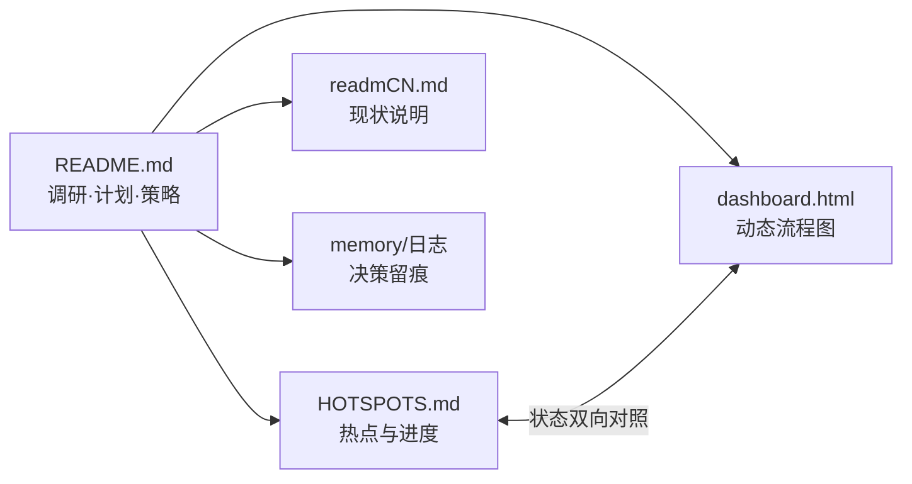
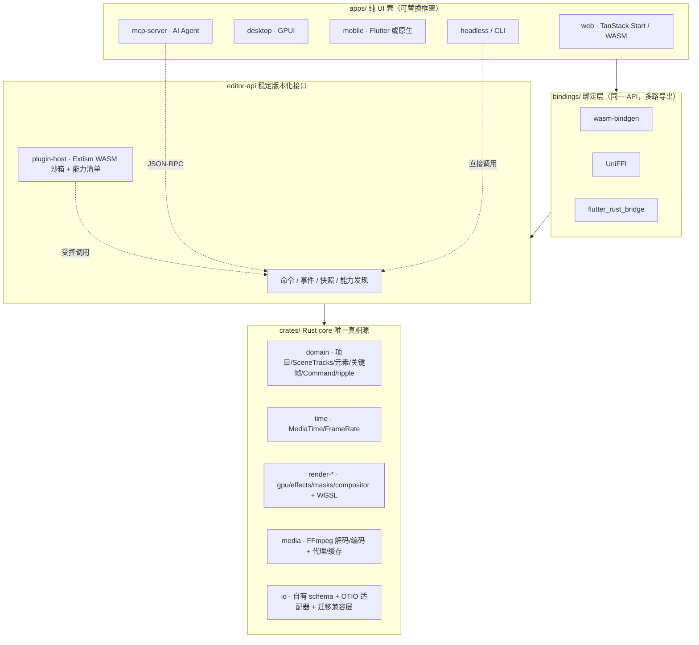
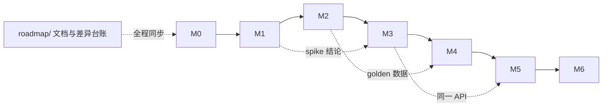
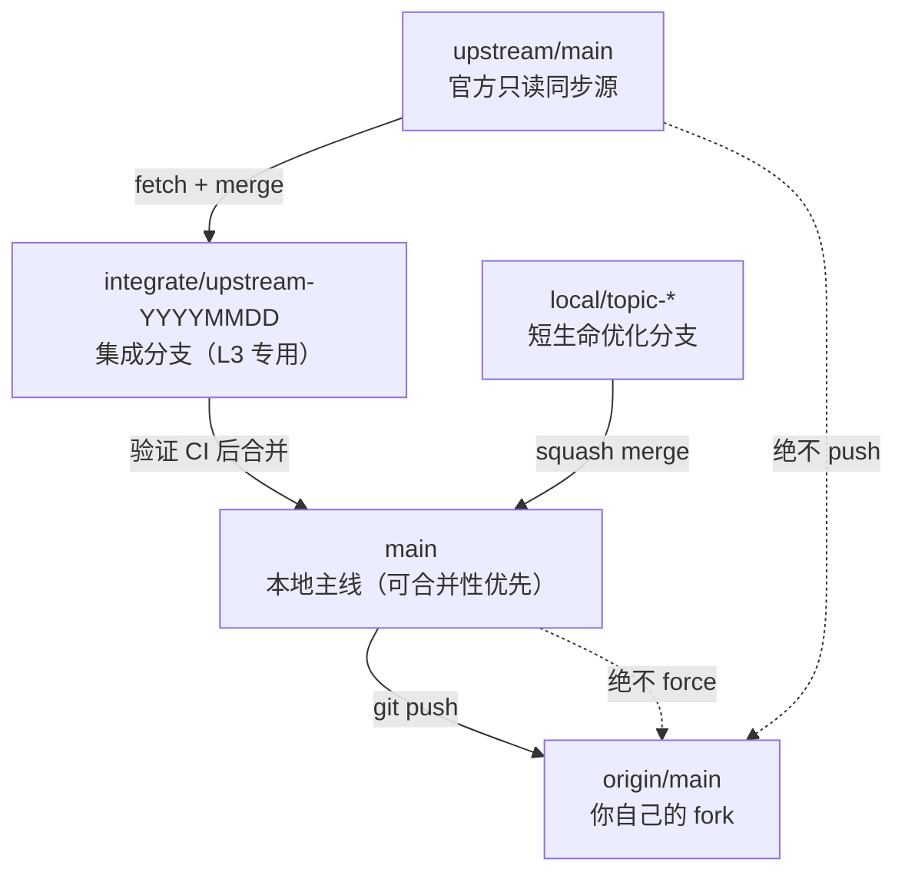
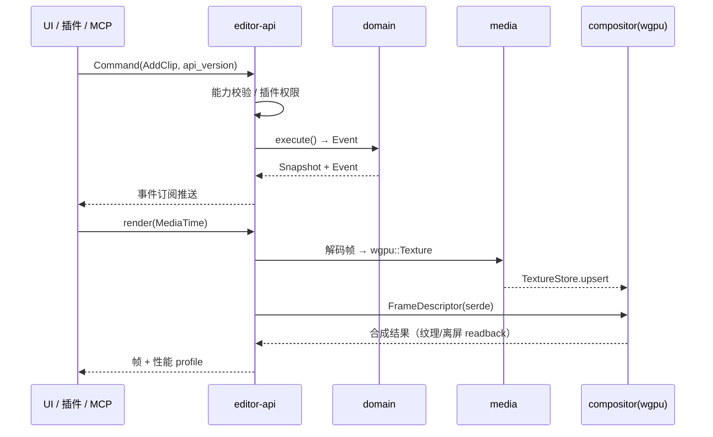
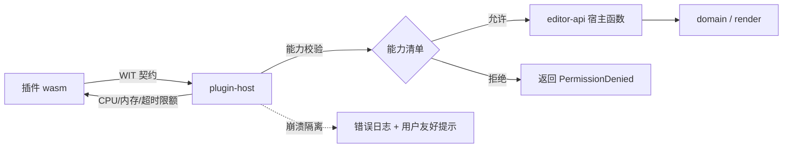
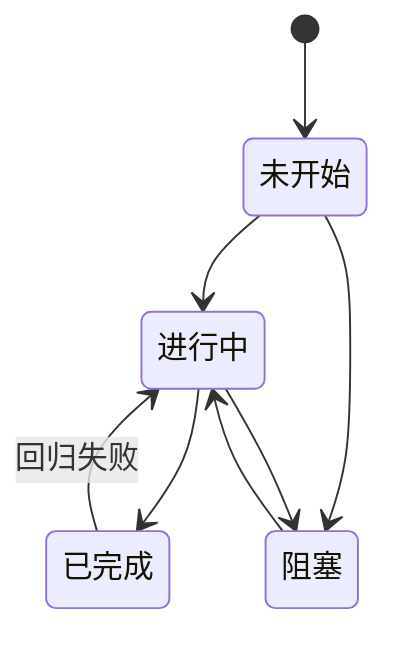

# OpenCut Rust 重写版 · 先进方案调研与实施总纲

> **文档定位**：本文是「基于经典版继续实现 Rust 版本」的完整工作底稿——网上先进方案调研、对比矩阵、架构完善计划、修订线路图、Fork 同步策略与风险登记。
> **快照日期**：2026-11-08。重写版 HEAD `e6680107`（2026-09-24），经典版 HEAD `cf5e79e9`（2026-05-17）。
> **为什么放在 `roadmap/` 而不是 `docs/`**：本仓库 `.gitignore:7` 忽略了 `docs/`，放进去不会被 git 跟踪、也无法随 fork 同步，因此统一使用 `roadmap/`。
> **准确性约定**：文中「实测」= 本地代码/锁文件核实；「官方」= 已从项目官方文档抓取核实；「社区」= 第三方资料，仅作线索。检索日期均为 2026-11-08。
> **本文只新增文档，未改动任何产品代码。**

---

## 0. 文档导航

| 文件 | 用途 | 更新频率 |
| --- | --- | --- |
| [`README.md`](README.md)（本文件） | 调研、对比、架构完善计划、线路图、Fork 同步策略、风险与决策日志 | 架构决策变化时 |
| [`HOTSPOTS.md`](HOTSPOTS.md) | **热点进程文档**：当前阻塞点、关键路径、进度台账、开放问题、更新日志 | 每完成一个动作即更新 |
| [`PRIORITY.md`](PRIORITY.md) | **改造优先级方案表（Web-first）**、W0~W5 里程碑、导出后端决策、`.codebuddy/` 决策 | 优先级或决策变化时 |
| [`COMPAT.md`](COMPAT.md) | **C→B 兼容层基石**：不变量、接口契约、判据、状态机、迁移 Runbook、实现清单 | 契约变更时 |
| [`compat-contract.json`](compat-contract.json) | 兼容层机器可读真相源（命名空间 / 判据 / 六项能力 / 状态机 / 导出决策） | 每次新增能力或上游同步 |
| [`compat.test.cjs`](compat.test.cjs) | 兼容契约回归测试（`node compat.test.cjs`，含正常/边界/异常用例） | 每次契约改动后 |
| [`dashboard.html`](dashboard.html) | **动态流程图看板**：离线单页，点选里程碑/热点状态、自动汇总进度、**决策台账（待决/已决 + 结论 + 筛选）**、数据版本徽章与缓存版本号、localStorage、导入导出 JSON | 随看板勾选实时 |
| [`dashboard-data.js`](dashboard-data.js) | 看板数据层：里程碑 / 热点 / 开放问题与配置常量 | 文档数据变化时 |
| [`dashboard-io.js`](dashboard-io.js) | 看板导入导出层：进度 JSON 导出 / 导入 / 重置 | 随功能迭代 |
| [`dashboard.css`](dashboard.css) / [`dashboard.js`](dashboard.js) | 看板样式与渲染交互逻辑（拆文件便于 `node --check`，单文件均 ≤500 行） | 随功能迭代 |
| [`dashboard.test.cjs`](dashboard.test.cjs) | 看板回归测试（`node dashboard.test.cjs`，零依赖 DOM 桩，含正常/边界/异常用例） | 每次看板改动后 |
| [`../readmCN.md`](../readmCN.md) | 重写版现状中文说明（项目导览） | 现状变化时 |
| [`../.codebuddy/memory/2026-11-08.md`](../.codebuddy/memory/2026-11-08.md) | 当日开发记录与关键结论 | 每次工作收尾 |



---

## 1. 结论摘要

1. **可以继续实现，且调研后路径更清晰**：经典版不是废弃原型，而是已完成约 30% Rust 化的资产库；重写版的架构决策（`AGENTS.md`）与上游 README 的路线图完全一致，**2026-11-08 抓取的上游官方 README 与本地内容一致，尚无新的架构落地**，也就是说短期内 fork 同步不会遇到「上游大改」的冲击。
2. **最值得借鉴的外部方案有五个**：OpenTimelineIO（时间线交换与 schema 版本化）、Extism / WASM Component Model（插件沙箱）、MCP 2026-07-28（AI Agent 接口）、Loro/事件溯源（状态与协同）、代理剪辑 + 预览缓存（性能体感）。它们分别补齐重写版路线图里的「Editor API / 插件 / MCP / headless」四块短板。
3. **头号技术风险仍是两套 GPU 栈**：实测本仓库 `Cargo.lock` 中 `gpui 0.2.2` 依赖 `blade-graphics`（无 `wgpu`），经典版合成器为 `wgpu 29.0.1`；桌面端需离屏 readback 或换后端，必须先做 spike。
4. **功能可扩展性来自「新增优先」而非「改造上游」**：本地优化尽量以新 crate / 新目录 / 新文档形式落盘，少改上游既有文件。这既是插件架构的设计原则，**也恰好是 fork 长期可同步的关键**。
5. **Fork 同步不会自动覆盖本地代码**；风险只发生在 `merge`/`rebase` 时。推荐「新增隔离目录 + 差异台账 + `git rerere` + 定期小步同步」，并禁用 `--force` / `-X theirs` / `reset --hard`。

---

## 2. 基线复核（实测）

| 项 | 重写版 `E:/AI_Studio/OpenCut` | 经典版 `E:/AI_Studio/opencut-classic` |
| --- | --- | --- |
| 状态 | 脚手架：`web` 两个占位路由、`api` 三个示例端点、`desktop` GPUI 四面板文字占位 | 已归档，8.2 万行可用编辑器 + 已启动的 Rust 化 |
| Rust | `Cargo.toml` 只有 `apps/desktop`，`'crates/*'` 被注释，`resolver = "3"` | `rust/` 6 crate + wasm 绑定，34 个 `.rs/.wgsl`，**4,335 行** |
| 前端 | TanStack Start / Vite 8 / React 19 / Cloudflare Workers | Next.js 16 / React 19 / OpenNext → Workers / Postgres+Redis |
| 工程化 | proto + moon 2.3.3 + bun 1.3.11 + rust 1.97 | turbo 2.8.20 + bun 1.2.18 + ESLint/Prettier |
| 测试 | 前端 0 用例；Rust 4 个单测 | 30 个 `bun:test`（纯函数/迁移），Rust 11 个单测 |
| `Cargo.lock` | 已提交、被 git 跟踪 | 已提交、被 git 跟踪（此前报告有误，已实测纠正） |
| 许可证 | MIT © 2026 OpenCut；FFmpeg 8.1.3 LGPL 义务 | MIT © 2025-2026 OpenCut；mediabunny/WebCodecs，无 FFmpeg |

**上游官方现状（2026-11-08 抓取 `raw.githubusercontent.com/OpenCut-app/OpenCut/main/README.md`）**：`Status` 段仍是 "OpenCut is being rewritten from the ground up" + "What's coming"（Editor API、插件优先、Rust core 多端、MCP server、Headless、scripting tab），开发命令与 `proto use` / `moon run ...` 与本地一致，贡献政策仍是「架构设计中，暂不接收外部贡献」。**结论：上游尚未提交新架构代码，本地 fork 目前没有待合并的架构变更。**

---

## 3. 先进方案调研

> 结论标记：**采纳**（直接纳入计划）／**试验**（做 spike 后决定）／**观察**（记录，暂不投入）／**不采纳**（有明确否决理由）。

### A. 时间线与项目交换格式

| 方案 | 来源 | 核心思想 | 对 OpenCut 的借鉴 | 代价 | 结论 |
| --- | --- | --- | --- | --- | --- |
| **OpenTimelineIO (OTIO)** | [官方](https://opentimelineio.readthedocs.io/en/latest/)（ASWF/Pixar，0.19.0.dev1） | 现代版 EDL：`Timeline / Stack / Track / Clip / Gap / Transition / Marker`，只描述剪辑决策与外链媒体，**不含媒体本身**；自带 adapters / media_linkers / schemaDefs / hook_scripts 插件体系；有明确的 schema 升降级与版本化规范 | ① 项目交换格式，解决「跨 NLE 导入导出」；② 其 **schema 升降级规范**可直接落实经典版 `migrations/AGENTS.md` 的 additive-only 规则；③ 插件分类方式可复用到 Editor API 的扩展点设计 | 官方实现是 C++/Python；需纯 Rust 实现 | **采纳**（作为交换格式与 schema 规范） |
| `otio-rs` | [社区](https://github.com/lmcgartland/opentimelineio-rust) | 对 OTIO C++ 的 FFI 绑定，覆盖约 95% 核心类型；内置 NLE 编辑算法 `overwrite/insert/slice/slip/slide/trim/ripple/roll` | 可直接对照经典版 `ripple/` 与 `commands/` 的翻译，是现成的算法规格 | 依赖 C++ 库，与 wasm32 目标冲突 | **观察**（做算法参考，不引入依赖） |
| `oximedia-edl::otio` / `quercus-otio` | [社区](https://docs.rs/oximedia-edl/latest/oximedia_edl/otio/index.html) | **纯 Rust serde** 实现 OTIO JSON 模型 | 可直接抄数据模型，避免自研格式走弯路 | 非官方，API 不稳定 | **试验**（M2 借鉴模型） |
| **MLT Framework** | [官方](https://www.mltframework.org/) | 成熟 NLE 引擎：producer / filter / consumer 组成的媒体管线，Shotcut、Kdenlive、Flowblade 共用 | 「引擎与 UI 分离」正是 OpenCut 的目标架构；producer/filter/transition 抽象可对照 `FrameDescriptor` | C 框架，LGPL/GPL 混合 | **观察**（架构参照） |
| **Olive** | [社区](https://awesome-repositories.com/repository/olive-editor-olive) | 代理剪辑（低码率临时文件）+ 非破坏性时间线 + 每 90 秒自动保存版本快照 | 补齐性能体感与「时间线版本快照」功能 | GPL-3.0，不能抄代码 | **采纳**（功能思路） |

### B. 媒体编解码与导出

| 方案 | 来源 | 要点 | 对 OpenCut 的价值 | 结论 |
| --- | --- | --- | --- | --- |
| FFmpeg 8.1.3 + `rsmpeg` / `ffmpeg-next` | [社区评测](https://wps.hkprog.org/posts/the-state-of-media-processing-in-rust-2026-what-each-crate-actually-covers-2ykxfu) | 进程内 safe 封装，支持 FFmpeg 6/7/8；`ffmpeg-next` 是唯一覆盖「视频解码+编码+滤镜+硬件加速」的 Rust 方案 | 重写版 `crates/media/setup` 已固定 LGPL 共享库，下一步应补 `build.rs` + 进程内绑定 | **采纳**（沿用既定决策） |
| GStreamer 1.28.9 | [官方](https://gstreamer.freedesktop.org/) | 组件图式媒体管线，覆盖播放/流/编辑/分析 | 若未来要做实时采集、多机位、流处理可评估；当前过重 | **观察** |
| Symphonia + rubato | [社区](https://www.cnblogs.com/Yeauty/p/22018803) | 纯 Rust 音频解码/重采样，可编到 WASM，避开 LGPL；但不支持视频 | Web 端音频波形/播放可考虑纯 Rust 路线 | **试验**（M4） |
| mediabunny + WebCodecs | 经典版实测 `scene-exporter.ts` | MP4/WebM 全客户端导出，无需服务端 | 经典版导出编排（逐帧渲染 → `add(frameTime, 1/fps)`）可保留为规格 | **采纳**（仅留编排逻辑） |
| Remotion 4.x 浏览器渲染 | [官方](https://remotion.dev/docs/editor-starter/client-side-rendering) | `@remotion/web-renderer` + `@remotion/webcodecs` 在浏览器内完成「组件 → Canvas 帧 → WebCodecs 编码 → 容器封装」；另有 Rust 帧提取器 | 为「零服务器成本的 headless / 批量渲染」提供成熟范式；其 Agent Skills、参数化批量生成与 MCP 路线图高度契合 | **采纳**（headless 设计参考） |

### C. 渲染与文字

| 方案 | 来源 | 要点 | 结论 |
| --- | --- | --- | --- |
| wgpu 29.0.1 + WGSL | 经典版实测 | 已有 `compositor/effects/masks/gpu` + 9 个 WGSL；原生/浏览器双目标 | **采纳**（直接迁移） |
| Vello / Skia | [社区](https://gittrend.io/repo/linebender/vello) | Rust 2D GPU 计算渲染器，WGSL compute，MIT/Apache；配 `skrifa`/`parley` 做文字排版 | **试验**：经典版的文字/图形/贴纸/渐变全靠 Canvas 2D，跨端重写时 Vello + cosmic-text 是最合适的替代 |
| GPUI / blade | 本仓库 `Cargo.lock` 实测 | GPUI 0.2.2 使用 `blade-graphics`，与 wgpu 不共享纹理 | **风险项**，见 §8 R1 |

### D. 插件与扩展体系（路线图核心）

| 方案 | 来源 | 核心思想 | 借鉴点 | 结论 |
| --- | --- | --- | --- | --- |
| **Extism** | [官方](https://extism.org/) | 开箱即用的 WASM 插件框架，默认沙箱、host 可控 HTTP、运行时限额/计时器、模块级持久内存，Host SDK 覆盖 Rust/Node/Python/Go 等 | 直接作为 `crates/plugin-host` 的运行时候选；「能力由宿主授予」正是编辑器插件所需 | **试验→倾向采纳**（M5 spike） |
| WebAssembly Component Model / `wit-bindgen` | [社区](https://wpnews.pro/news/webassembly-in-2026-the-quiet-revolution-that-finally-delivered) | WIT 接口定义，Rust/Go/C++ 组件互操作，类型化导入导出 | 定义 Editor API 的**稳定版本化接口**，避免 JS/ABI 漂移 | **采纳**（接口规范） |
| Figma 插件沙箱 | [官方博客](https://www.figma.com/blog/how-we-built-the-figma-plugin-system/) | 从 JS 沙箱 → 编译 JS 解释器到 WASM → Realms（同源 iframe 复制全局对象）；API 以「可替换接口」实现，便于换运行时 | ① 插件必须与主线程隔离；② **API 实现与运行时解耦**，为将来换引擎留后路 | **采纳**（设计原则） |
| VS Code Extension Host | [社区](https://sujeet.pro/articles/widget-framework) | 独立进程 + manifest + 贡献点（contributes）+ 激活事件，插件崩溃不拖垮主程序 | 扩展点清单、按需激活、权限声明 | **采纳**（模型） |
| 插件运行时隔离谱系 | [社区](https://safeguard.sh/resources/blog/in-process-iframe-worker-or-wasm-where-should-plugins-run) | 进程内 < iframe < Worker < WASM，隔离性递增 | 决策依据：在「能满足需求的最隔离环境」运行插件 | **采纳**（决策依据） |
| OTIO 插件分类 | 官方 | adapters / media linkers / schemaDefs / hook scripts 四类 + manifest | 扩展点分类可直接映射为：导入导出器 / 媒体定位器 / 自定义数据类型 / 生命周期钩子 | **采纳**（分类法） |

### E. 跨端绑定

| 方案 | 目标端 | 要点 | 结论 |
| --- | --- | --- | --- |
| `wasm-bindgen` + wasm-pack | Web | 经典版已验证（`opencut-wasm@0.2.10`），`tsify-next` 生成 `.d.ts` | **采纳**（Web） |
| **UniFFI** | iOS/Android/Kotlin/Swift/Python | Mozilla 的 Rust 跨语言绑定生成，接口用 UDL/proc-macro 定义，适合移动端 | **采纳**（移动端首选） |
| `flutter_rust_bridge` v2 | Flutter/Dart | 若移动端选 Flutter，这是最成熟路径；支持 Future/Stream | **试验**（取决于移动端 UI 选型） |
| `napi-rs` | Node/Electron/脚本 | 可做 CLI、脚本标签页、Node 侧 headless | **观察** |

> 社区已有「一套 Rust API 三路导出」的实证（[`el-ffi`](https://docs.rs/crate/el-ffi/0.3.9)：RN 用 `uniffi-bindgen-react-native`、Flutter 用 `flutter_rust_bridge v2`、Web 用 `wasm-bindgen`），可作为绑定层组织方式的参考。

### F. 状态、撤销与协同

| 方案 | 来源 | 要点 | 结论 |
| --- | --- | --- | --- |
| Command + Event Sourcing | 经典版实测 `commands/` | `trait Command { execute/undo/redo }` + 历史栈；所有变更走命令，天然可序列化、可回放、可脚本化 | **采纳**（M2 基础） |
| **Loro CRDT** | [官方](https://loro.dev/) / [Undo 文档](https://loro.dev/docs/advanced/undo) | Rust 实现 + JS/WASM 绑定；OPLog 为真相源、二进制增量同步、`UndoManager` 支持**本地撤销**不影响他人编辑、文档级版本历史 | **试验**：若未来做多人协同/云同步，它比自研 CRDT 省数年；M2 只需保证命令层可映射到 OPLog 即可，不必现在引入 |
| Automerge | 同族方案 | 成熟但性能与包体不如 Loro | **观察** |

### G. AI 与自动化（MCP）

**官方规范要点**（抓取 [MCP Architecture](https://modelcontextprotocol.io/docs/learn/architecture)，规范版本 `2026-07-28`）：

- 数据层基于 **JSON-RPC 2.0**，分「数据层 / 传输层」；传输层有 **stdio**（本地）与 **Streamable HTTP**（远程，推荐 OAuth）。
- **无状态**：每个请求在 `_meta` 携带 `protocolVersion`、`clientInfo`、`clientCapabilities`；服务端必须实现 `server/discover` 暴露 `supportedVersions` 与 `capabilities`（可缓存，`ttlMs`）。
- 服务端三基元：**Tools**（`tools/list` + `tools/call`，含 JSON Schema `inputSchema`）、**Resources**（`resources/list` / `read`）、**Prompts**；客户端基元 **Elicitation**（请求用户确认）。
- 变更通知为**可选订阅**：`subscriptions/listen` → `notifications/tools/list_changed`，best-effort，需配合轮询。
- `Sampling` 与 `Logging` 在该版本**已弃用**；长耗时请求用 **Tasks extension** 返回可轮询的持久句柄。

对 OpenCut 的直接映射（**采纳**）：

| MCP 概念 | OpenCut Editor API 对应 |
| --- | --- |
| `server/discover` | 暴露 core 版本、能力（有无 GPU、支持的编解码、插件列表） |
| Tools | `project.open` / `timeline.addClip` / `timeline.trim` / `effect.apply` / `render.frame` / `export.start` |
| Resources | 项目 JSON、时间线摘要、媒体清单、渲染日志 |
| Prompts | 「把这段剪成 30 秒竖版短视频」之类可复用模板 |
| Elicitation | 导出覆盖、删除素材等需用户确认的操作 |
| Tasks extension | **长耗时渲染/导出**返回任务句柄 + 进度，而非阻塞调用 |
| `tools/list` 动态变化 | 插件安装/卸载后工具列表随之更新 |

配套参考：Remotion 的 Agent Skills 与「用 Agent 生成视频 / 批量参数化渲染」实践（[官方](https://www.remotion.dev/)），以及 headless 模式与 MCP 共用同一套 `editor-api` 的设计。

### H. 工程化与质量

| 方案 | 要点 | 结论 |
| --- | --- | --- |
| proto + moon | 工具链版本锁定、任务图与缓存、三平台 CI | **沿用**（本仓库既定） |
| Golden Master / JSON 数据驱动测试 | 经典版 30 个 `bun:test` + fixtures → Rust 表驱动，TS 与 Rust 同输入同输出 | **采纳**（M0 必做，符合项目测试规范） |
| OTIO schema 升降级 | 官方 `versioning-schemas` 的 upgrade/downgrade 规范 | **采纳**（落实 additive-only） |
| `git rerere` / 补丁队列 / vendor overlay | 长期维护 fork 的冲突复用与差异台账 | **采纳**（见 §7） |
| `wasm-pack` + `cargo test --workspace` CI | 经典版 CI 测试步骤是 echo 占位且从不跑原生构建，必须补齐 | **采纳**（M0） |

---

## 4. 对比表格（决策矩阵）

### 4.1 插件运行时

| 维度 | 进程内动态库 | iframe / Realms | Web Worker | **WASM（Extism / Component Model）** |
| --- | --- | --- | --- | --- |
| 隔离性 | 无 | 中（同源仍有逃逸面） | 中高 | **高（默认沙箱、无系统访问）** |
| 崩溃影响 | 拖垮宿主 | 隔离 | 隔离 | 隔离 |
| 跨端一致 | 差 | 仅 Web | 仅 Web | **Web/桌面/移动/CLI 同一份 wasm** |
| 语言 | 受宿主限制 | JS | JS | Rust/Go/C++/JS 等 |
| 性能 | 最高 | 中 | 中 | 中（有边界拷贝） |
| 权限控制 | 无 | 手工 | 手工 | **能力清单 / 宿主函数 / 限额计时器** |
| 与 Rust core 契合 | 中 | 低 | 低 | **高** |
| 结论 | 不采纳 | 仅 Web 特例 | 仅 Web 特例 | **推荐** |

### 4.2 媒体解码

| 维度 | FFmpeg（现决策） | GStreamer | Symphonia（纯 Rust） | WebCodecs |
| --- | --- | --- | --- | --- |
| 视频解码 | 完整 | 完整 | 不支持 | 浏览器提供 |
| 音频解码 | 完整 | 完整 | 主流格式（部分未完成） | 浏览器提供 |
| 编码/滤镜/硬编 | 完整 | 完整 | 无 | 编码可用 |
| WASM 可编译 | 困难 | 困难 | **可以** | 仅浏览器 |
| 许可证 | **LGPL 动态链接 + 随附义务** | LGPL | MIT/Apache，无负担 | 浏览器内置 |
| 适用层 | 桌面/headless/服务器 | 未来实时管线 | Web 音频/波形 | Web 导出 |
| 结论 | **主力** | 观察 | M4 试验 | Web 端保留 |

### 4.3 跨端绑定

| 维度 | wasm-bindgen | UniFFI | flutter_rust_bridge | napi-rs |
| --- | --- | --- | --- | --- |
| 目标 | Web | iOS/Android/Swift/Kotlin/Python | Flutter/Dart | Node |
| 接口定义 | 宏 + tsify | UDL / proc-macro（可版本化） | 宏 | 宏 |
| 异步 | Promise | callback/Future | Future/Stream | Promise |
| 已有验证 | 经典版 CI 已跑通 | 社区成熟 | 社区成熟 | — |
| 结论 | **Web 必选** | **移动端必选** | 视 UI 选型 | 观察 |

### 4.4 项目 / 时间线格式

| 维度 | 自定义 serde schema | **OTIO 兼容层** | EDL / AAF |
| --- | --- | --- | --- |
| 表达力 | 完全贴合产品 | 剪辑决策 + 轨道 + 转场 + 标记（不含关键帧/特效细节，可用 metadata 扩展） | 老格式，表达力弱 |
| 跨软件互通 | 无 | **ASWF 行业标准** | 有限 |
| schema 版本化 | 自研 | **官方 upgrade/downgrade 规范** | 无 |
| 纯 Rust 支持 | 原生 | 有 serde 实现可借鉴 | — |
| 结论 | **内部真相源** | **外部交换格式**（双轨） | 不采纳 |

> 关键决策：**内部用自有 serde schema（可完整表达关键帧/蒙版/特效），对外提供 OTIO 导入导出适配器**，避免让外部标准限制内部演进；经典版 31 版迁移数据按 additive-only 只做只读兼容层。

### 4.5 状态与撤销

| 维度 | 命令模式（现状思路） | 事件溯源 | Loro CRDT |
| --- | --- | --- | --- |
| 单机 undo/redo | 直接 | 回放/快照 | `UndoManager` |
| 可脚本化 / 可回放 | 中 | **高** | 高 |
| 多人协同 | 需自研 | 需自研 | **内建** |
| 引入成本 | 低 | 中 | 高（新增依赖与心智） |
| 结论 | **M2 落地** | 作为命令层设计约束 | **M5 前保持可映射，暂不引入** |

### 4.6 渲染栈

| 维度 | wgpu 原生 | wgpu→WASM/浏览器 | GPUI(blade) | Vello(2D) |
| --- | --- | --- | --- | --- |
| 用途 | 桌面/headless 合成 | Web 合成 | 桌面 UI 框架 | 矢量/文字/贴纸 |
| 与经典版资产 | 直接复用 WGSL | 直接复用 | 不兼容 | 需新接 |
| 主要障碍 | 原生 surface 未验证 | 已验证 | **纹理互通需 readback** | 与 wgpu 集成 |
| 结论 | M1~M3 | **Web 优先** | UI 壳，不承载视频 | M3 后补 2D |

### 4.7 现状 → 建议 → 收益 / 成本

| 现状 | 建议 | 收益 | 成本 | 优先级 |
| --- | --- | --- | --- | --- |
| `crates/*` 被注释 | 启用 workspace，迁入 `time`/`bridge` | 立刻获得整数时间与帧率 | 1~2 周 | P0 |
| 无自动化测试 | golden master + `cargo test --workspace` 进 CI | 4.6 万行翻译有回归网 | 2~3 周 | P0 |
| 无领域模型 | `crates/domain`（serde + Command + ripple） | 唯一真相源，多端复用 | 6~8 周 | P0 |
| 无交换格式 | OTIO 适配层 | 跨 NLE 互通、行业兼容 | 2~3 周 | P1 |
| 无插件体系 | Extism + WIT 接口 + 能力清单 | 路线图「一等插件」落地 | 4~6 周 | P1 |
| 无代理/缓存 | 代理剪辑 + 预览帧缓存 + 版本快照 | 4K 流畅度与容灾 | 3~4 周 | P1 |
| 无 MCP | `apps/mcp` 复用 editor-api | AI Agent / 自动化 | 2~3 周 | P2 |
| 无 headless | `apps/headless` + Tasks 式任务句柄 | 批量渲染 / CI 渲染 | 3~4 周 | P2 |

---

## 5. 完善后的目标架构

### 5.1 分层图



### 5.2 crate 清单（建议）

| crate | 职责 | 来源 | 依赖上限 |
| --- | --- | --- | --- |
| `crates/bridge` | `#[export]` 宏，按 target 条件生成绑定 | 经典版直接迁入 | syn/quote |
| `crates/time` | `MediaTime(i64)`、`FrameRate` 有理数、timecode | 经典版直接迁入 | serde、num-traits |
| `crates/domain` | 项目/场景/轨道/元素/关键帧/效果/蒙版 + Command + ripple + placement | 经典版 TS 翻译 | serde、time |
| `crates/editor-api` | 版本化命令/事件/快照、能力发现、扩展点 | 新设计（参考 MCP `server/discover`、WIT） | domain |
| `crates/render-{gpu,effects,masks,compositor}` | wgpu/WGSL 合成管线 | 经典版迁入，剥离 wasm-only 分支 | wgpu、bytemuck |
| `crates/media` | FFmpeg 解码/编码、帧上传、代理剪辑、预览缓存 | 重写版 `setup` 已铺路 + 新写 `build.rs` | rsmpeg/ffmpeg-next |
| `crates/io` | 自有 serde schema、OTIO 导入导出、经典版 31 版迁移兼容 | 新写 | serde、serde_json |
| `crates/plugin-host` | Extism/wasmtime 运行时、manifest 校验、能力授予、限额 | 新写 | extism、wasmtime |
| `bindings/{wasm,uniffi,frb}` | 多路导出同一 editor-api | 经典版 wasm 重写为薄层 | 各自 SDK |
| `apps/{web,desktop,mobile,headless,mcp}` | 仅 UI / 平台适配 | 现状扩展 | 绑定层 |

### 5.3 稳定接口契约（可扩展性基石）

1. **接口版本化**：所有 editor-api 调用携带 `api_version`，参考 MCP `_meta` 与 `server/discover`；不兼容变更升主版本，旧版保留至少两个里程碑。
2. **能力发现**：宿主声明 `gpu / codec / plugin / wasm` 能力；插件声明所需能力，由 `plugin-host` 逐项授予（最小权限）。
3. **事件流**：所有状态变更走 `Command` → `Event`，UI 通过订阅增量更新；同一事件流供 undo、脚本、MCP、协同复用。
4. **schema additive-only**：字段只增不删不改名（继承经典版 `migrations/AGENTS.md`），迁移器单向升级，保留 down migration 所需旧字段（对齐 OTIO versioning 规范）。
5. **ABI 隔离**：插件只依赖 `editor-api` 的 WIT 契约，不直接链接 core 内部 crate（借鉴 Figma「API 实现可替换」）。

### 5.4 插件模型

扩展点分类（借鉴 OTIO + VS Code）：

| 扩展点 | 说明 | 示例 |
| --- | --- | --- |
| `importer` / `exporter` | 媒体、项目、字幕格式 | OTIO、SRT/ASS、FCPXML 适配器 |
| `media-linker` | 把逻辑媒体 ID 解析到实际文件/URL | 云素材、代理文件定位 |
| `effect` | 注册 WGSL pass 与参数 schema | 模糊、调色、抠像 |
| `generator` | 程序化素材 | 文字动画、形状、贴纸包 |
| `command` | 向 Editor API 注册命令 | 批量操作、AI 剪辑 |
| `hook` | 生命周期钩子 | 保存前校验、渲染前预处理 |

插件 manifest 必备字段：`id / version / api_version / capabilities[] / entry(wasm) / checksum / ui?`。
运行时约束：默认沙箱、无文件系统/网络直连、宿主函数白名单、CPU/内存限额与超时（Extism 原生支持）、崩溃隔离到单个插件实例。

### 5.5 功能补全清单（相对经典版与重写版现状）

| 优先级 | 功能 | 来源 | 落点 |
| --- | --- | --- | --- |
| P0 | 整数时间、帧率、关键帧、命令/undo、ripple、放置/吸附、蒙版几何 | 经典版 TS 翻译 | `domain` |
| P0 | 导入→时间线→预览→导出主链路 | 经典版规格 | `media` + `render-*` |
| P1 | **OTIO 项目导入/导出** | OTIO 官方 | `io` |
| P1 | **代理剪辑 + 预览帧缓存** | Olive / Kdenlive / OpenShot 3.5.1 | `media` |
| P1 | **时间线版本快照**（自动保存可回溯） | Olive | `io` + `domain` |
| P1 | 插件 SDK、manifest、能力清单、示例插件 | Extism / VS Code / Figma | `plugin-host` |
| P1 | 2D/文字/贴纸跨端渲染 | Vello + cosmic-text | `render-2d` |
| P2 | MCP server（Tools/Resources/Prompts/Tasks） | MCP 2026-07-28 | `apps/mcp` |
| P2 | Headless 批量渲染 + 任务句柄/进度 | Remotion / MCP Tasks | `apps/headless` |
| P2 | 编辑器内脚本标签页 | 上游路线图 | `plugin-host` + 脚本运行时 |
| P2 | 硬件编码、多分辨率/帧率混合时间线 | FFmpeg / Shotcut | `media` |
| P3 | AI 字幕/抠像/智能粗剪（插件形式） | OpenShot AI 菜单 / fal.ai | 第三方插件 |
| P3 | 多人协同（Loro，命令层保持可映射） | Loro | `domain` 扩展 |

### 5.6 可扩展性八条原则

1. 只新增、少修改（对上游文件同样适用，见 §7）。
2. 内部 schema 与外部交换格式分离。
3. 所有能力通过 `editor-api` 暴露，UI 与插件走同一条路径（dogfooding）。
4. 插件默认无权限，逐项授予。
5. 命令即协议：脚本、MCP、插件、headless 复用同一命令集。
6. 事件即日志：可回放、可审计、可协同。
7. 运行时可替换：绑定层、GPU 后端、UI 框架都不渗入 core。
8. 每个扩展点至少有一个内置实现作为参考与回归基线。

---

## 6. 修订线路图与里程碑

### 6.1 甘特图

```mermaid
gantt
    title OpenCut Rust 版里程碑（1 人全职基准，T+ 周）
    dateFormat X
    axisFormat T+%s
    section 地基
    M0 基线与 CI          :m0, 0, 3
    M1 迁入 Rust core     :m1, 3, 7
    section 核心
    M2 领域模型下沉       :crit, m2, 7, 15
    M3 Editor API 与绑定  :crit, m3, 15, 21
    section 闭环
    M4 媒体与导出         :m4, 21, 33
    M5 插件与 MCP         :m5, 33, 41
    M6 协同/移动/生态     :m6, 41, 60
```



### 6.2 里程碑表

| 里程碑 | 周期 | 关键任务 | 本次调研新增内容 | 验收 DoD |
| --- | --- | --- | --- | --- |
| **M0 基线** | T+0~3w | 装 proto/bun/moon/rust 1.97；启用 `crates/*`；`moon ci` 补 fmt/clippy/`cargo test --workspace`/wasm-pack；补 `.cache/media` 忽略；建 `roadmap/` 文档体系 | 引入 golden master 与 JSON 数据驱动测试规范 | 三平台 CI 全绿且含真实用例；三个 dev 命令可访问 |
| **M1 迁入 core + GPU spike** | T+3~7w | 迁 `time`/`bridge`（关 wasm feature）；迁 4 个渲染 crate + 9 WGSL；wasm-only 代码隔离为 feature；补 `crates/media/build.rs`；**wgpu 离屏 → readback → GPUI spike** | 记录 blade/wgpu 互操作实测数据；评估 Extism 作为后续插件运行时 | 11 个迁入单测 + 离屏渲染用例通过；spike 产出书面后端决策 |
| **M2 领域模型** | T+7~15w | `domain` serde schema；翻译 ripple/commands/animation/placement/masks 几何；`trait Command` + 历史栈；golden master 对齐 | 参考 `otio-rs` 的 NLE 编辑算法清单；schema 升降级照 OTIO 规范；命令层保持可向 OPLog 映射 | Rust/TS 同输入同输出 100% 对齐；可读经典版项目 JSON；undo/redo 覆盖边界/异常 |
| **M3 Editor API 与绑定** | T+15~21w | `editor-api` 命令/事件/快照/能力发现；`bindings/wasm` 薄层；web 最小时间轴；desktop 接 core；`apps/headless` | WIT 接口版本化；能力清单；`server/discover` 式能力协商；Vello 2D 试验 | 同一项目在 Web/桌面/headless 输出像素一致帧；headless 出 PNG |
| **M4 媒体与导出闭环** | T+21~33w | FFmpeg 解码→wgpu 纹理；音频/波形/调度；导出编码；经典版 31 版迁移只读兼容层 | Remotion 逐帧编排；代理剪辑 + 预览缓存；Symphonia 纯 Rust 音频试验 | mp4 导入→剪辑→导出，帧数/时长/音画同步校验；LGPL 随附合规 |
| **M5 插件与 AI** | T+33~41w | `plugin-host`（Extism）+ 6 类扩展点 + SDK + 示例插件；`apps/mcp`（Tools/Resources/Prompts/Tasks）；脚本标签页 | MCP 2026-07-28 官方映射；Tasks extension 承载长渲染 | 插件沙箱越权被拒；MCP 客户端可完成一次「打开→剪辑→导出」；长任务可查进度 |
| **M6 生态化** | T+41~60w | OTIO 完整适配、版本快照、UniFFI 移动端、Loro 协同评估、插件市场 | CRDT 可映射性验证 | 跨 NLE 往返不丢剪辑决策；移动端可打开同一项目 |

### 6.3 关键路径与并行度



- 关键路径：M0 → M1 → M2 → M3 → M4（前 33 周），M2 是最不可压缩的一环。
- 可并行：Vello 2D 试验、Extism spike、OTIO 适配器、MCP 原型均可在 M2 期间以独立分支推进，不占用关键路径。
- **剪裁建议**：只做 Web 单端 + 简化导出，可把 M4 之后的桌面/移动后置，约 16~20 周得到可用 MVP。

### 6.4 工期估算口径

假设 1 名熟悉 Rust + wgpu 的开发者全职、无重大需求变更；依据是经典版 82,455 行 TS 中约 4.6 万行需翻译且缺系统级测试。M1 的 GPU spike 若判定必须换渲染后端，桌面端额外增加 4~8 周。**该数字是估算而非承诺**，须在每个里程碑结束时按实际速度重估。

---

## 7. Fork 同步策略（重点）

### 7.1 「上游有架构更新，会不会影响我的代码？」

**不会自动影响。** 需要分清四件事：

| 事件 | 是否改变你的本地代码 | 说明 |
| --- | --- | --- |
| 上游仓库有新提交 | ❌ 完全不影响 | 你本地的提交、工作区、文件都不变，Git 是分布式的 |
| `git fetch upstream` | ❌ 不影响工作区 | 只更新 `upstream/*` 远程跟踪引用 |
| `git merge upstream/main` 或 `rebase` | ⚠️ **唯一的冲击点** | 上游改了你也改过的同一文件同一区域 → 冲突；上游删/改名了你的依赖文件 → 编译失败 |
| GitHub 页面点 "Sync fork" | ⚠️ 只更新**远端 fork 分支** | 之后 `git pull` 才会落到本地 |

**架构更新的真实风险不是「代码被覆盖」，而是三类**：
1. **文本冲突**：两边改了同一文件（如 `Cargo.toml`、`moon.yml`、`vite.config.ts`）。
2. **语义漂移**：上游重构了目录/接口，你的代码能合并但编译不过（例如上游把 `apps/web` 换框架、改 `Cargo.toml` 的 workspace members）。
3. **依赖漂移**：上游升级 Rust/bun/wgpu 版本，与你锁定的本地依赖不兼容。

> 当前实测：`origin` = `https://github.com/ht182400-creator/OpenCut.git`，`upstream` = `https://github.com/OpenCut-app/OpenCut.git`，工作区 clean；**上游官方 README 与本地一致，暂无待同步的架构变更**。但重写版明确「架构仍在设计中」，未来必然出现大改，因此现在就要把隔离规则立起来。

### 7.2 上游变更分级响应

| 级别 | 典型变化 | 动作 | 是否暂停本地开发 |
| --- | --- | --- | --- |
| L1 小改 | 文档、CI、依赖补丁 | 直接 `merge upstream/main`，跑 CI | 否 |
| L2 中改 | 新增 app/crate、UI 组件、脚本 | 先在本地集成分支合并，验证 `moon ci`，再合回 | 否 |
| L3 大改 | 换框架、改 workspace 结构、Editor API 落地、Rust core 目录成型 | 冻结本地 feature 合并，建 `integrate/upstream-<date>` 分支；对照差异台账逐项移植；必要时把本地新增目录整体保留、只重写适配层 | 是（1~2 周） |

### 7.3 三种策略对比

| 维度 | A. 直接在 `main` 上改 | B. 双分支（mirror + custom） | **C. 新增优先 + 隔离目录 + 差异台账（推荐）** |
| --- | --- | --- | --- |
| 冲突频率 | 高 | 中 | **低**（新文件不参与三方合并冲突） |
| 上游大改适应 | 差 | 中 | **好**（本地资产与上游树正交） |
| 维护成本 | 低 | 中（要管分支同步） | 中（要维护台账） |
| 历史可读性 | 混杂 | 清晰 | 清晰 |
| 适合本项目 | ❌ | 可选 | ✅ 与「插件优先 / 扩展点」架构同构 |

**推荐 C 的具体规则**：

1. **本地能力一律落在独立新路径**：`crates/<新 crate>/`、`apps/<本地 app>/`、`roadmap/`、`.codebuddy/`、`scripts/local-*`。上游不拥有这些路径，合并时几乎零冲突。
2. **对上游既有文件的最小必要改动**集中在一张台账（本文 §7.7），每次改动登记「文件 / 区段 / 原因 / 上游 SHA / 复核人」。
3. 必须改公共配置时（如 `Cargo.toml` 的 `members`、`moon.yml`），优先用**追加式**修改（新增一行 member、新增一个 task），避免重排/改写上游既有行，可显著降低冲突。
4. **启用 `git rerere`**，让同类冲突（如 `Cargo.toml`）的解决方案被自动复用：
   ```sh
   git config rerere.enabled true
   git config rerere.autoupdate true
   ```
5. 本地优化用短生命 `local/<topic>` 分支 + squash 合入 `main`，保持历史整洁、便于 cherry-pick 到新的上游基线。
6. **每 2~4 周小步同步一次**，不要等半年后一次性合并几十个提交。

> 注意：第 4 条会写 `.git/config`（仓库本地配置），不是 `git config --global`，也不会改 `user.name/email`；符合「不改 git 全局配置」的约束。

### 7.4 分支与远程布局



### 7.5 标准操作流程

**日常上传本地优化**（对应 skill 的 Workflow A）：

```sh
git remote -v                         # 确认 origin=你的fork，upstream=官方
git status --short                    # 确认工作区干净、无敏感目录
git add roadmap/ crates/<新crate>/    # 显式暂存，禁止 git add -A
git add <必须修改的上游文件>          # 逐个列出，并同步更新 §7.7 台账
git commit -m "feat(core): 迁入 time crate 并接入 CI"
git push origin main
```

**上游有更新时**（对应 skill 的 Workflow B，冲突安全）：

```sh
git fetch upstream
git log --oneline HEAD..upstream/main          # 先看清改了什么，判级 L1/L2/L3
git merge upstream/main --no-edit              # 保留本地历史，不用 -X theirs
# 若有冲突：逐一保留本地修改并折入上游变更 → git add <文件> → git commit
# 同步后必做：moon ci / cargo test --workspace / bun run test / 三端启动冒烟
git push origin main
```

**一键脚本**（已加载的 `fork-repo-sync` skill，自动探测分支、遇冲突/脏工作区中止、从不 force）：

```powershell
pwsh C:\Users\ht182\.codebuddy\skills\fork-repo-sync\scripts\sync-upstream.ps1
# 需要额外排除目录时：
pwsh C:\Users\ht182\.codebuddy\skills\fork-repo-sync\scripts\sync-upstream.ps1 -ExcludeDirs ".codebuddy","secrets"
```

> 脚本默认排除 `.codebuddy/`（内部/敏感目录）。本仓库 `.gitignore` 忽略 `docs/` 但不忽略 `roadmap/`，因此**文档可以随 fork 正常提交**；`.codebuddy/` 目前未被 `.gitignore` 忽略，推送时务必显式排除（skill 已警告）。

**禁止清单**：`git push --force` / `git reset --hard` / `git merge -X theirs` / `git add -A` 盲提 / 把 `.codebuddy/`、`.env.local`、密钥推送到公开 fork。

### 7.6 冲突处理模板

| 冲突文件 | 处理原则 |
| --- | --- |
| `Cargo.toml` | 保留上游 `members` 全部条目，**追加**本地 `crates/*`；版本以 `.prototools` 为准 |
| `moon.yml` / 各 app `moon.yml` | 保留上游任务，追加本地任务；不重命名上游 task |
| `package.json` / `vite.config.ts` | 保留上游依赖与插件顺序，本地依赖追加在末尾 |
| `README.md` | 不改英文原文，本地说明放 `readmCN.md` 与 `roadmap/` |
| 上游删除/重命名了本地依赖的文件 | 在集成分支上把本地调用改到新路径，并更新 §7.7 台账 |
| `.gitignore` | 追加而非覆盖；注意 `docs/` 与 `.codebuddy/` 的策略 |

### 7.7 差异台账（初始）

| ID | 本地改动 | 类型 | 上游基线 SHA | 冲突风险 | 复核动作 |
| --- | --- | --- | --- | --- | --- |
| D01 | 新增 `readmCN.md` | 新增文件 | `e6680107` | 无 | — |
| D02 | 新增 `roadmap/`（本文、热点、看板、css/js） | 新增目录 | `e6680107` | 无 | — |
| D03 | 新增 `.codebuddy/memory/2026-11-08.md` | 新增目录 | `e6680107` | 无 | **推送时排除** |
| D04 | M0 时修改根 `Cargo.toml`（取消注释 `'crates/*'`） | 追加式改动 | 待更新 | 中 | 每次同步后复查 members |
| D05 | M0 时修改 `.github/workflows/bun-ci.yml`（加 Rust 任务） | 追加式改动 | 待更新 | 中 | 每次同步后复查 CI |
| D06 | M0 时追加 `.gitignore`（`.cache/media`、`.codebuddy/`） | 追加式改动 | 待更新 | 低 | 追加在文件末尾 |

> 规则：任何对上游既有文件的修改，提交当天必须补一行；每次 `merge upstream/main` 后逐行复核并在 `HOTSPOTS.md` 留痕。

### 7.8 同步检查清单

- [ ] `git remote -v`：`origin` 指向自己的 fork，`upstream` 指向官方
- [ ] `git status --short`：工作区干净，无未跟踪的密钥/内部目录
- [ ] `git log --oneline HEAD..upstream/main`：判级 L1/L2/L3
- [ ] L3 使用 `integrate/upstream-<date>` 分支，不在 `main` 直接试
- [ ] 冲突解决遵循「保留本地 + 折入上游」，使用 `git rerere` 复用
- [ ] 同步后 `moon ci` + `cargo test --workspace` + 三个 dev 冒烟
- [ ] 更新 §7.7 台账与 `HOTSPOTS.md` 更新日志
- [ ] `git push origin main`，**不使用 --force**

### 7.9 上游六项能力落地后的收敛预案（L3 特例）

> **触发条件**：上游把 README "What's coming" 的六项（Editor API、插件优先、Rust core 多端、MCP server、Headless、scripting tab）真正提交进主分支，而本地已按 M0~M6 实现了同类能力。

**核心判断**：这不是「合并冲突」，而是**双实现收敛**。`git merge` 没有冲突标记 ≠ 结果可用——两套 Editor API、两个 plugin host、两个 MCP server 可能同时被编译或注册，产生**静默语义冲突**（能合并、能提交，但构建失败或运行时行为错乱）。因此顺序必须是：**先定主体 → 再预演 → 再选择性移植 → 最后才合并**。

#### 7.9.1 决策门：保留哪一套

| 路线 | 做法 | 适用条件 | 长期成本 |
| --- | --- | --- | --- |
| **A 本地为主** | 保留本地 core，上游实现只作参考；只吸收文档、CI、品牌、bugfix 等非重复资产 | 上游 API 仍在变、本地差异化很大 | 高（长期维护两套） |
| **B 切换到上游**（推荐终局） | 弃用本地重复实现，把本地特色**改写为上游的插件/扩展** | 上游 API 稳定、覆盖 ≥80% 需求、本地差异可插件化 | 低 |
| **C 双轨过渡** | 独立命名空间 + feature flag 让两套都能编译，按能力逐项迁移 | 上游刚落地、稳定性未知 | 中（过渡期） |

判据：① 上游 API 是否冻结并有版本化契约；② 六项能力对本地需求的覆盖率；③ 本地差异能否表达为插件/扩展（**这正是插件优先架构的最大红利**）；④ 维护人力；⑤ 是否打算把本地成果贡献回上游。建议路径：**C → B**，只有在上游明显不稳定时才停在 A。

#### 7.9.2 现在就要做的命名空间隔离（细化 §7.3）

§7.3 建议「新 crate 放 `crates/<新 crate>/`」，但上游落地 Rust core 时也必然往 `crates/` 加目录，重名风险极高。细化为：

| 资产 | 本地专用路径 / 命名 | 目的 |
| --- | --- | --- |
| Rust crate | `local/crates/*`，根 `Cargo.toml` 追加 `members = [..., "local/crates/*"]`；crate 名带 `ocx_` 前缀 | 与上游 `crates/*` 完全隔离 |
| 桌面/CLI 应用 | `apps/local-*`、CLI 名 `ocx-render` | 避开 `apps/headless` 等上游可能路径 |
| Web 页面与组件 | `apps/web/src/local/` + 独立路由 | 不与上游页面组件混写 |
| MCP 工具 | 命名空间前缀 `ocx.*`（如 `ocx.project.open`） | 避免与上游 `project.open` 工具名冲突 |
| 文档与台账 | `roadmap/` | 已被证明可随 fork 跟踪 |

配套约束：**所有本地代码只通过 `editor-api` 的薄适配层调用 core**，这样切换上游 core 时只需改适配层，不必改业务调用方。

#### 7.9.3 建立纯净上游镜像分支

```sh
git fetch upstream
git branch upstream-mirror upstream/main     # 若已存在：git fetch upstream main:upstream-mirror
```

`upstream-mirror` **只做 fast-forward、永不提交本地改动**，作为三方 diff 与「取回上游旧版本文件」的基线。

#### 7.9.4 能力级差异台账（扩展 §7.7 的文件级台账）

上游落地当天逐行填写；「上游实现路径」以实际 diff 为准，**不得预填猜测**。

| 能力 | 本地实现路径 | 上游实现路径 | 决策（保留/移植/废弃） | 迁移状态 | 上游 SHA |
| --- | --- | --- | --- | --- | --- |
| Editor API | `local/crates/ocx-editor-api` | 待填 | 待定 | 未开始 | 待填 |
| 插件优先 | `local/crates/ocx-plugin-host` | 待填 | 待定 | 未开始 | 待填 |
| Rust core 多端 | `local/crates/ocx-*` | 待填 | 待定 | 未开始 | 待填 |
| MCP server | `apps/local-mcp`（工具前缀 `ocx.*`） | 待填 | 待定 | 未开始 | 待填 |
| Headless | `apps/local-headless` / `ocx-render` | 待填 | 待定 | 未开始 | 待填 |
| scripting tab | `apps/web/src/local/scripting` | 待填 | 待定 | 未开始 | 待填 |

#### 7.9.5 落地当天：无副作用预演与三方清单

以下命令为 `sh`（Git Bash / WSL）；`git merge-tree --write-tree` 需 **Git ≥2.38**，已按 [官方文档](https://git-scm.com/docs/git-merge-tree) 核实。

```sh
git fetch upstream
git switch -c integrate/upstream-$(date +%Y%m%d) main
BASE=$(git merge-base HEAD upstream/main)

# 预演：不读写工作区与索引，不产生提交。退出码 0=干净，1=有冲突
git merge-tree --write-tree --name-only HEAD upstream/main
# 输出第一行是结果树 OID，其后是冲突文件名；必须看退出码，
# 官方明确「空冲突列表不等于干净合并」（还有目录/重命名类冲突）

git diff --name-status "$BASE..upstream/main"    # 上游改了什么
git diff --name-status "$BASE..HEAD"             # 本地改了什么
```

注意事项：

- 不要覆盖 `--merge-base`：官方警告多 merge-base 时手工指定可能**丢失一侧改动**。
- 把结果归成三组：**仅上游改**（可直接吸收）、**仅本地改**（原样保留）、**双方都改**（逐项人工裁决）。
- 先按 §7.9.1 定路线，再按 §7.9.4 填台账，**最后**才执行真正的 merge。

#### 7.9.6 六项能力的冲突矩阵

> 上游落点为**推测**（依据 README 措辞与经典版目录惯例），落地时必须以 §7.9.5 的实际 diff 替换。

| 能力 | 上游可能落点（推测） | 本地落点 | 最可能的冲突形态 | 处理建议 |
| --- | --- | --- | --- | --- |
| Editor API | `crates/editor-api` / `apps/api` | `local/crates/ocx-editor-api` | 同名不同契约；命令名、事件结构、版本化方式全不同 | 最危险。保留本地并写 `ocx-compat-upstream` 适配层；若选路线 B，则把本地命令逐个映射到上游 API |
| 插件优先 | `crates/plugin-host` + SDK | `local/crates/ocx-plugin-host` | manifest/WIT 契约不同，两套运行时同时注册 | 不允许共存。feature flag 隔离后逐插件迁移；本地插件改接上游 SDK |
| Rust core 多端 | `crates/*` + bindings | `local/crates/ocx-*` | `Cargo.toml` members 追加冲突、wgpu/rust 版本漂移 | 追加式合并 members；统一 wgpu 版本；本地独有 crate 保留 |
| MCP server | `apps/mcp` / `crates/mcp` | `apps/local-mcp` | 工具名撞车、协议版本不同（本地按 2026-07-28） | 工具前缀 `ocx.*` + 独立端口；协议版本以官方规范为准；`server/discover` 能力分别声明 |
| Headless | `apps/headless` / CLI | `apps/local-headless` | 命令名与输出格式冲突 | CLI 改名 `ocx-render`；输出格式加命名空间；任务句柄协议对齐 MCP Tasks |
| scripting tab | Web 内嵌脚本运行时 | `apps/web/src/local/scripting` | UI 组件 + 脚本运行时双重冲突 | 独立路由，不复用上游页面组件；脚本运行时走本地 plugin-host |

#### 7.9.7 五类冲突的具体处理

| 类型 | 识别 | 处理 |
| --- | --- | --- |
| 文本冲突（追加式） | `Cargo.toml` members、`moon.yml` tasks、CI steps 双方都追加 | **保留双方条目**手工合并；逐文件 `git checkout --ours/--theirs <file>`，用前先备份；禁止 `-X theirs` 全局覆盖 |
| 文本冲突（同名不同实现） | 两边都新建了 `editor-api` 之类目录 | 不要盲选一侧：`git show upstream/main:<path> > /tmp/upstream-<name>` 另存对比 → 本地实现改名到 `local/` → 写适配层 |
| **静默语义冲突** | merge 无冲突标记，但构建失败 / 两个服务抢端口 / 工具名重复 | 靠验证网发现：`moon ci` + `cargo test --workspace` + `bun run test` + 三个 dev 冒烟 + MCP `tools/list` 对比 |
| 依赖漂移 | 上游升 Rust / bun / wgpu / wasm-bindgen | 以 `.prototools` 与本地 `Cargo.lock` 为准，用 `cargo update -p <crate> --precise <ver>` 逐项评估；**不要整体覆盖锁文件** |
| 删除 / 重命名 / 生成文件 | 上游删了本地仍在用的模块；`routeTree.gen.ts`、lock 双方都变 | 从 `upstream-mirror` 用 `git show upstream-mirror:<old>` 取回旧文件放 `local/vendor/` 并改调用；生成文件一律丢弃后重新生成 |

`.gitattributes` 的正确边界（已按 [官方](https://git-scm.com/docs/gitattributes) 核实）：`merge=ours` 需要自定义 driver（`git config merge.ours.driver true`），**只适用于纯本地配置文件**；`union` 会保留两侧行但顺序随机，**不可用于代码或结构化配置**。对 `Cargo.toml` / `wrangler.jsonc` 这类文件不要滥用，否则会把两套实现悄悄拼在一起。

#### 7.9.8 解决后的收尾流程

```sh
git merge --no-commit --no-ff upstream/main   # 在集成分支上实际合并
# 逐文件解决冲突 → git add <resolved files> → git diff --check → git commit
moon ci && cargo test --workspace && bun run test     # 全量验证 + 三端冒烟
git switch main
git merge --no-ff integrate/upstream-<date>
git push origin main                                  # 绝不 --force
```

随后：更新 §7.7 与 §7.9.4 台账、`HOTSPOTS.md` 更新日志、§9 ADR，并在下次同步前保持小步节奏。

#### 7.9.9 skill 脚本的使用边界

`fork-repo-sync/scripts/sync-upstream.ps1` 是 **fetch → merge → push 一步到位**，适合 L1/L2。L3 场景下**不要直接运行**：它遇冲突会中止，但不会替你做「保留哪一套实现」的能力级决策，也不会做命名空间隔离。人工集成完成、回到常规节奏后再恢复使用。

#### 7.9.10 L3 专用检查清单

- [ ] `upstream-mirror` 已 fast-forward 到待集成的上游 SHA
- [ ] `git merge-tree --write-tree --name-only HEAD upstream/main` 已预演，退出码已记录
- [ ] 三方清单（仅上游 / 仅本地 / 双方都改）已产出并归档到 `roadmap/`
- [ ] §7.9.1 路线已选定，§7.9.4 六行台账已逐项填写（含上游真实路径与 SHA）
- [ ] 六项能力均明确「保留 / 移植 / 废弃」，不存在两套同时注册的运行时
- [ ] `moon ci` + `cargo test --workspace` + 三端冒烟 + MCP `tools/list` 全通过
- [ ] 差异台账、HOTSPOTS、ADR 已更新；`git push origin main` 未使用 `--force`

---

## 8. 风险登记册

| ID | 风险 | 证据 | 影响 | 缓解 | 负责里程碑 |
| --- | --- | --- | --- | --- | --- |
| R1 | GPUI(blade) 与 wgpu 纹理不互通 | 实测 `Cargo.lock` | 桌面预览性能/架构 | M1 spike：离屏 readback 实测；备选独立 wgpu 窗口 | M1 |
| R2 | 4.6 万行领域逻辑翻译无回归网 | 经典版 30 个测试全为纯函数 | 语义漂移 | 先建 golden master（JSON 数据驱动）再翻译 | M0/M2 |
| R3 | 上游架构大改导致语义漂移 | 官方 README「架构仍在设计中」 | 合并后编译失败 | §7 的 L3 流程 + 新增优先 + 差异台账 | 全程 |
| R4 | FFmpeg LGPL 合规 | `ffmpeg.json`/`setup.ts` | 分发风险 | 动态链接、随附许可证/BUILD.md；CI 校验 | M4 |
| R5 | MIT 版权年份差异 | 经典版 2025-2026 vs 重写版 2026 | 合规 | 迁移文件保留原声明，补 NOTICES | M1 |
| R6 | 字体 OFL 归属缺失 | 经典版 `font-atlas.json` + 15 个 avif，无许可证文件 | 合规 | 补齐 OFL 声明再迁移资产 | M4 |
| R7 | 原生 Rust 渲染路径从未验证 | 经典版 desktop 42 行、CI 不跑 cargo test | 桌面端不可用 | M1 补原生离屏测试与 CI | M1 |
| R8 | 插件沙箱越权/失控 | 第三方代码 | 安全 | Extism 能力清单 + 限额 + 单实例隔离 | M5 |
| R9 | 本机工具链缺失 | 实测无 bun/moon/proto，rustc 1.96 < 1.97 | 无法启动 | M0 安装并按 `.prototools` 固定 | M0 |
| R10 | 文档漂移 | 经典版 `docs/effects-renderer.md` 指向不存在的 `shader_registry.rs` | 误导实现 | 文档与代码同 PR 更新，热点文档每周复核 | 全程 |
| R11 | 上游落地同类能力导致双实现静默共存 | 上游 README 六项 "What's coming" 与本地 M3~M5 计划重叠 | 两套 Editor API / 插件宿主 / MCP 同时注册，无冲突标记但构建或运行时错乱 | §7.9：命名空间隔离 + `merge-tree` 预演 + 决策门 + 能力级台账 | 全程 |

---

## 9. 决策日志（ADR）

| ID | 决策 | 理由 | 备选 | 状态 |
| --- | --- | --- | --- | --- |
| ADR-01 | 目标仓库定为重写版，经典版只读参考 | 经典版已归档；重写版是上游方向 | 在经典版继续改 | 已定 |
| ADR-02 | 内部 serde schema + 外部 OTIO 适配双轨 | 不让外部标准限制内部演进，同时获得互通 | 全用 OTIO | 建议 |
| ADR-03 | 插件运行时选 WASM（Extism 优先 spike） | 跨端一致、默认沙箱、能力可控 | 进程内 / iframe / Worker | 建议 |
| ADR-04 | 桌面 GPU 后端待 spike 结论 | blade 与 wgpu 不互通，无实测数据 | 直接 readback / 换后端 | 待决 |
| ADR-05 | 协同（CRDT）延后但命令层保持可映射 | 避免早期引入复杂度 | 现在引入 Loro | 建议 |
| ADR-06 | fork 采用「新增优先 + 隔离目录 + 差异台账」 | 最小化冲突、与插件架构同构 | 直接改 main / 双分支 | 建议 |
| ADR-07 | 文档放 `roadmap/` 而非 `docs/` | `.gitignore:7` 忽略 `docs/` | 改 `.gitignore` | 已定 |
| ADR-08 | Web 单端优先，桌面/移动后置 | 缩短 MVP，绕开 R1 | 三端并行 | 建议 |
| ADR-09 | 上游落地六项能力后走「C 双轨过渡 → B 切换到上游」 | 避免长期维护两套 core；本地差异改写为插件 | A 永久双实现 | 建议（触发时按 §7.9.1 复核） |
| ADR-10 | **Web 单端优先**（W0~W5），桌面/移动后置 | 经典版 WASM 是唯一被 CI 验证的路径；桌面 blade/wgpu 冲突是最大未知 | 三端并行 | **已定**（用户 2026-11-08） |
| ADR-11 | Web 导出用 **WebCodecs**，桌面/headless 用原生 FFmpeg；core 只出 `RenderFrame` + `ExportProfile` | 性能 / 包体 / 部署 / 合规 / 架构解耦五项占优 | Web 也统一 FFmpeg-WASM | **已定**（用户 2026-11-08） |
| ADR-12 | **兼容层 C→B 前置为 P0**（W-02/W-03）：先立命名空间隔离与契约，再迁代码 | 用户指定为基石；晚做会导致调用方无法收敛 | 先迁代码后补适配层 | **已定**（用户 2026-11-08） |
| ADR-13 | `.codebuddy/` **不加入** `.gitignore` | 用户决定；它是项目数据不是临时缓存 | 加入忽略 | **已定**（用户 2026-11-08） |

---

## 10. 参考资料（检索日期 2026-11-08）

**官方**
- OpenCut 上游 README：<https://raw.githubusercontent.com/OpenCut-app/OpenCut/main/README.md>
- MCP Architecture（规范 2026-07-28）：<https://modelcontextprotocol.io/docs/learn/architecture>；规范 <https://modelcontextprotocol.io/specification/2026-07-28>
- OpenTimelineIO 文档：<https://opentimelineio.readthedocs.io/en/latest/>；版本化 <https://opentimelineio.readthedocs.io/en/latest/tutorials/versioning-schemas.html>
- Extism：<https://extism.org/>
- Figma 插件系统：<https://www.figma.com/blog/how-we-built-the-figma-plugin-system/>
- MLT Framework：<https://www.mltframework.org/>；GStreamer：<https://gstreamer.freedesktop.org/>
- Remotion 客户端渲染：<https://remotion.dev/docs/editor-starter/client-side-rendering>；官网 <https://www.remotion.dev/>
- Loro：<https://loro.dev/>；UndoManager <https://loro.dev/docs/advanced/undo>
- Git 官方文档：<https://git-scm.com/docs/git-merge>、<https://git-scm.com/docs/git-rebase>
- proto / moon：<https://moonrepo.dev/proto>、<https://moonrepo.dev/moon>

**社区 / 线索（未作为事实依据）**
- Rust 媒体生态 2026 评测：<https://wps.hkprog.org/posts/the-state-of-media-processing-in-rust-2026-what-each-crate-actually-covers-2ykxfu>、<https://www.cnblogs.com/Yeauty/p/22018803>
- `otio-rs`：<https://github.com/lmcgartland/opentimelineio-rust>；纯 Rust serde：<https://docs.rs/oximedia-edl/latest/oximedia_edl/otio/index.html>
- Rust 多端绑定实证 `el-ffi`：<https://docs.rs/crate/el-ffi/0.3.9>
- 插件框架对比：<https://www.pistack.xyz/posts/2026-06-20-embeddable-plugin-systems-extism-pluggy-abi-stable-libloading>、<https://safeguard.sh/resources/blog/in-process-iframe-worker-or-wasm-where-should-plugins-run>、<https://sujeet.pro/articles/widget-framework>
- Vello：<https://gittrend.io/repo/linebender/vello>；代理剪辑：<https://awesome-repositories.com/repository/olive-editor-olive>
- fork 维护策略：<https://juejin.cn/post/7491321172157972492>、<https://github.com/KRtkovo-eu-AI/salamander/blob/release/5.0-samandarin-0.15.1/RUNBOOK.md>

## 11. 验证记录（2026-11-08）

| 检查项 | 命令 / 方式 | 结果 |
| --- | --- | --- |
| 编译 / 语法 | `node --check` 五个脚本（data / io / 主逻辑 / 看板测试 / 契约测试）+ `JSON.parse` 校验契约 | 全部通过 |
| 导入测试 | `node dashboard.test.cjs` 用零依赖 DOM 桩按页面顺序加载三个脚本并触发 `init()` | 通过 |
| 看板回归 | 数据完整性、依赖图、状态机全循环、完成度、持久化往返、渲染、导出/导入 JSON、重置两分支、**决策台账状态/结论与 DOM 渲染、数据版本** | **44 通过 / 0 失败** |
| **兼容契约回归** | `node compat.test.cjs`：不变量、命名空间、判据权重、状态机、六能力台账、导出决策、三项用户决策、**契约↔看板交叉校验** | **45 通过 / 0 失败** |
| 缓存版本校验 | `dashboard.html` 的 CSS/JS 均带 `?v=20261108-r2`；去掉查询参数后资源存在 | 4/4 通过 |
| 边界与异常 | 未知 ID、非法状态、脏 JSON、版本不匹配、取消重置、空契约、权重不等、非法路径、预填上游 SHA | 全部按预期回退或拒绝，无未捕获异常 |
| 测试日志 | 分层 `INFO / PASS / FAIL`，FAIL 标红；落盘到系统临时目录 `opencut-*-test-YYYYMMDDHHMMSS.log` | 已生成，不污染仓库 |
| 静态诊断 | IDE diagnostics（JS / HTML / CSS） | 0 条 |
| 链接校验 | 全部 Markdown 的相对链接逐一 `Test-Path` | 0 失效 |
| 文件规模 | 所有代码文件 ≤500 行（超限时已拆出数据层与 IO 层） | 通过 |

> 异常分支测试时控制台出现的 `[看板] 解析进度文件失败` 是**预期输出**（版本不匹配用例），错误被 catch 捕获、记录详细日志并给出友好提示，不是测试失败。
> 本次只新增文档与看板资产，**未改动任何产品代码**；因本机尚无 bun/moon/proto（热点 H03），未运行 Rust / 前端构建。

---

## 附录 A · Mermaid 图集

### A.1 数据流（一次剪辑命令到一帧输出）



### A.2 插件调用与沙箱



### A.3 Fork 同步状态机

```mermaid
stateDiagram-v2
    [*] --> 本地开发
    本地开发 --> 判定变更级别: git fetch upstream
    判定变更级别 --> L1合并: 文档/CI
    判定变更级别 --> L2集成分支: 新增模块
    判定变更级别 --> L3冻结集成: 架构大改
    L1合并 --> 回归验证
    L2集成分支 --> 回归验证
    L3冻结集成 --> 台账复核 --> 回归验证
    回归验证 --> 推送origin: 全绿
    回归验证 --> 冲突处理: 失败
    冲突处理 --> 回归验证
    推送origin --> 本地开发
```

### A.4 里程碑状态机（与看板对应）



---

## 附录 B · 术语表

| 术语 | 含义 |
| --- | --- |
| OTIO | OpenTimelineIO，ASWF 维护的剪辑决策交换格式与 API |
| EDL | Edit Decision List，传统剪辑决策列表 |
| WIT / Component Model | WebAssembly 接口类型定义与组件模型，用于稳定插件契约 |
| Extism | 通用 WASM 插件框架，Host SDK 多语言、默认沙箱 |
| GPUI / blade | Zed 的 Rust UI 框架及其图形抽象层（本仓库 0.2.2 使用 blade） |
| wgpu / WGSL | Rust WebGPU 实现与着色器语言（经典版合成器） |
| Golden Master | 固定输入/输出的基准测试，用于跨语言迁移的一致性校验 |
| additive-only | 持久化字段只增不改不删，保证向后/向下兼容 |
| `git rerere` | 复用已解决过的冲突记录的 Git 机制 |
| spike | 限时技术验证，产出决策依据而非产品代码 |
